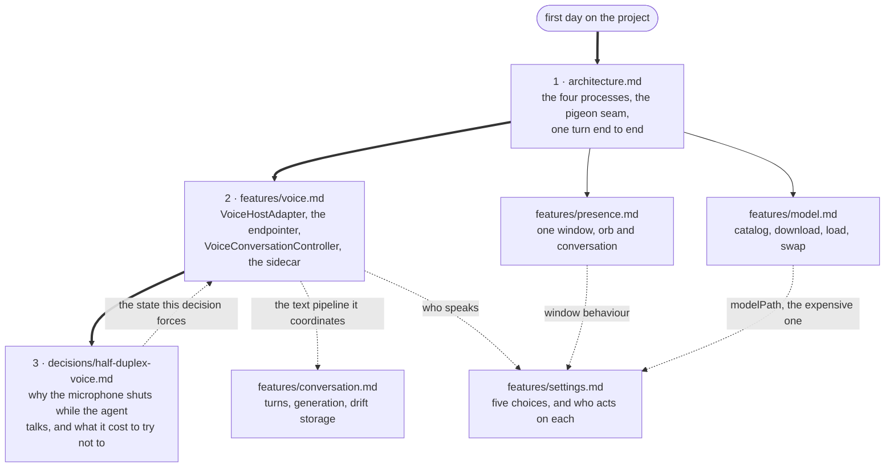

# Lulo — documentation

What is written down here is what could not be read off the code in an
afternoon: where the boundaries between the four processes fall, and the
handful of decisions that were measured rather than guessed. Everything else
lives in the source, where the comments are unusually long on purpose.

## The map

The three numbered documents are a reading path; the rest are looked up when
you touch the part they describe. The dotted edges are the couplings that make
one document send you to another.

## Read in this order

1. **[architecture.md](architecture.md)** — the four parties (Flutter/Dart,
   the Swift Runner, the Python TTS sidecar, the local model), what each one
   owns, how pigeon joins them, and one full turn of conversation end to end.
2. **[features/voice.md](features/voice.md)** — the voice pipeline. The most
   intricate part of the project and the one with the most ways to break it
   quietly. Read it before touching anything under `features/voice/` or
   `VoiceHostAdapter.swift`.
3. **[decisions/half-duplex-voice.md](decisions/half-duplex-voice.md)** — why
   the agent stops listening while it talks, what full duplex cost to try,
   and the condition under which it comes back.

For the repository's own rules — the workspace layout, the quality gate, the
window architecture — see [`CLAUDE.md`](../CLAUDE.md) and
[`AGENTS.md`](../AGENTS.md) at the root. Those are instructions; this is
explanation.

## Feature documents

| Document | Where the code is | State |
|---|---|---|
| [features/voice.md](features/voice.md) | `VoiceHostAdapter.swift`, `lib/features/voice/`, `~/dev/lulo-tts` | Written |
| [features/conversation.md](features/conversation.md) | `packages/agent_core`, `lib/features/conversation/` | Written |
| [features/presence.md](features/presence.md) | `DesktopPanelController.swift`, `lib/features/presence/` | Written |
| [features/model.md](features/model.md) | `lib/features/model/`, `native/inference_service` | Written |
| [features/settings.md](features/settings.md) | `lib/features/settings/`, `lib/app/app.dart` | Written |

## Decisions

| Document | State |
|---|---|
| [decisions/half-duplex-voice.md](decisions/half-duplex-voice.md) | Written |

## A note on branches

The voice pipeline as described here is the state of
`feat/phase-1a-basic-conversation` at `819babf`, in the worktree at
`.worktrees/phase-1a`; the half-duplex decision it rests on is the commit
before it, `f4309e9`. **It is not merged into `main`.** `main` (`0cb7cf6`)
carries the voice work up to the latency sprint but not the full-duplex
attempt or its revert, and therefore none of the `fullDuplex` gating this
documentation describes. Where the two differ, the documents say so.
