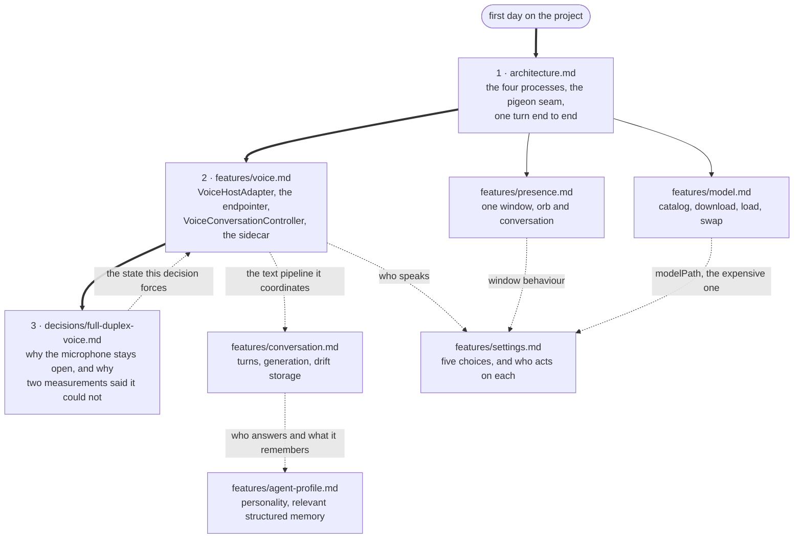

# Lulo — documentation

What is written down here is what could not be read off the code in an
afternoon: where the boundaries between the four processes fall, and the
handful of decisions that were measured rather than guessed. Everything else
lives in the source, where the comments are unusually long on purpose.

## The map

The three numbered documents are a reading path; the rest are looked up when
you touch the part they describe. The dotted edges are the couplings that make
one document send you to another.

## Read in this order

1. **[architecture.md](architecture.md)** — the four parties (Flutter/Dart,
   the Swift Runner, the Python TTS sidecar, the local model), what each one
   owns, how pigeon joins them, and one full turn of conversation end to end.
2. **[features/voice.md](features/voice.md)** — the voice pipeline. The most
   intricate part of the project and the one with the most ways to break it
   quietly. Read it before touching anything under `features/voice/` or
   `VoiceHostAdapter.swift`.
3. **[decisions/full-duplex-voice.md](decisions/full-duplex-voice.md)** — why
   the microphone stays open while the agent talks, what the echo canceller
   actually needed, and why two measurements in a row concluded it was
   impossible. Read it before trusting any measurement of an echo canceller.

For the repository's own rules — the workspace layout, the quality gate, the
window architecture — see [`CLAUDE.md`](../CLAUDE.md) and
[`AGENTS.md`](../AGENTS.md) at the root. Those are instructions; this is
explanation.

## Feature documents

| Document | Where the code is | State |
|---|---|---|
| [features/voice.md](features/voice.md) | `VoiceHostAdapter.swift`, `lib/features/voice/`, `~/dev/lulo-tts` | Written |
| [features/conversation.md](features/conversation.md) | `packages/agent_core`, `lib/features/conversation/` | Written |
| [features/presence.md](features/presence.md) | `DesktopPanelController.swift`, `lib/features/presence/` | Written |
| [features/model.md](features/model.md) | `lib/features/model/`, `native/inference_service` | Written |
| [features/settings.md](features/settings.md) | `lib/features/settings/`, `lib/app/app.dart` | Written |
| [features/agent-profile.md](features/agent-profile.md) | `packages/agent_core/lib/src/agent_profile/`, `lib/features/agent_profile/` | Written |
| [Taiwan Mandarin voice evaluation](../benchmarks/voice_eval/README.md) | `benchmarks/voice_eval/` | Implemented |
| Reversible transcript refinement | `packages/agent_core/lib/src/transcript_refiner/`, `lib/features/transcript_refiner/` | Implemented |

## Decisions

| Document | State |
|---|---|
| [decisions/full-duplex-voice.md](decisions/full-duplex-voice.md) | Written |
| [decisions/no-dart-audio-engine.md](decisions/no-dart-audio-engine.md) | Written — read before adding any audio package |
| [decisions/half-duplex-voice.md](decisions/half-duplex-voice.md) | Superseded, kept for the method error |

## A note on branches

This describes `main`, where the voice work, conversation memory,
model-download repair, full-duplex pipeline and developer agent profile are
integrated.
