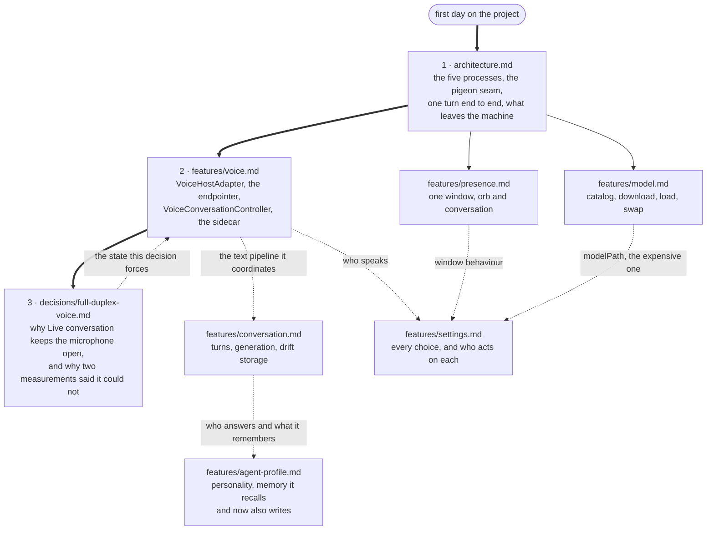

# Lulo — documentation

What is written down here is what could not be read off the code in an
afternoon: where the boundaries between the five processes fall, and the
handful of decisions that were measured rather than guessed. Everything else
lives in the source, where the comments are unusually long on purpose.

## The map

The three numbered documents are a reading path; the rest are looked up when
you touch the part they describe. The dotted edges are the couplings that make
one document send you to another.

## Read in this order

1. **[architecture.md](architecture.md)** — the five parties (Flutter/Dart,
   the Swift Runner, the local model, and two Python sidecars: the voice and
   the batch recogniser), what each one owns, how pigeon joins them, one full
   turn of conversation end to end, and exactly what leaves the machine.
2. **[features/voice.md](features/voice.md)** — the voice pipeline. The most
   intricate part of the project and the one with the most ways to break it
   quietly. Read it before touching anything under `features/voice/` or
   `VoiceHostAdapter.swift`.
3. **[decisions/full-duplex-voice.md](decisions/full-duplex-voice.md)** — why,
   once Live conversation is switched on, the microphone stays open while the
   agent talks, what the echo canceller actually needed, and why two
   measurements in a row concluded it was impossible. Holding to talk is the
   default door and does not depend on it; read it anyway before trusting any
   measurement of an echo canceller.

For the repository's own rules — the workspace layout, the quality gate, the
window architecture — see [`CLAUDE.md`](../CLAUDE.md) and
[`AGENTS.md`](../AGENTS.md) at the root. Those are instructions; this is
explanation.

## Feature documents

| Document | Where the code is | State |
|---|---|---|
| [features/voice.md](features/voice.md) | `VoiceHostAdapter.swift`, `lib/features/voice/`, `~/dev/lulo-tts` | Written |
| [features/conversation.md](features/conversation.md) | `packages/agent_core`, `lib/features/conversation/` | Written |
| [features/presence.md](features/presence.md) | `DesktopPanelController.swift`, `OrbActionStrip.swift`, `lib/features/presence/` | Written |
| [features/model.md](features/model.md) | `lib/features/model/`, `native/inference_service` | Written |
| [features/settings.md](features/settings.md) | `lib/features/settings/`, `lib/app/app.dart` | Written |
| [features/agent-profile.md](features/agent-profile.md) | `packages/agent_core/lib/src/agent_profile/`, `lib/features/agent_profile/` | Written |
| [The Obsidian journal](decisions/a-journal-in-someone-elses-vault.md) | `packages/agent_core/lib/src/obsidian/`, `lib/features/obsidian/`, `ObsidianVault.swift` | Built, off by default — the decision record is the description |
| [Sidecar health](architecture.md) | `lib/features/sidecar/` | Written, in architecture.md › Python sidecars |
| [Taiwan Mandarin voice evaluation](../benchmarks/voice_eval/README.md) | `benchmarks/voice_eval/` | Implemented |
| Reversible transcript refinement | `packages/agent_core/lib/src/transcript_refiner/`, `lib/features/transcript_refiner/` | Implemented |

## Decisions

| Document | State |
|---|---|
| [decisions/voice-turn-latency.md](decisions/voice-turn-latency.md) | Written — read before tuning the endpointer or the prompt |
| [decisions/turn-taking-by-words.md](decisions/turn-taking-by-words.md) | Adopted — read before changing either interruption or endpointing thresholds |
| [decisions/one-lexicon-many-matchers.md](decisions/one-lexicon-many-matchers.md) | Adopted — the turn-taking words live once in `agent_core` and are generated into Swift; read before editing either lexicon |
| [decisions/batch-asr-candidates.md](decisions/batch-asr-candidates.md) | Measured — which recogniser answers the hold key, and why the streaming one is a different question |
| [decisions/the-agent-opens-in-english.md](decisions/the-agent-opens-in-english.md) | Shipped — English by default, Chinese a switch; read before touching the recogniser's locale or `AgentLanguage` |
| [decisions/full-duplex-voice.md](decisions/full-duplex-voice.md) | Accepted — governs the always-open microphone, which is off by default |
| [decisions/dictation-cannot-share-the-tap.md](decisions/dictation-cannot-share-the-tap.md) | Measured — why dictation has an audio engine of its own (`DictationController`); read before adding any mode to the conversation's microphone tap |
| [decisions/taiwan-mandarin-voice-candidates.md](decisions/taiwan-mandarin-voice-candidates.md) | Voice swap measured and not taken; words are respelled instead — 214 entries in `sidecars/pronunciation`, plus the user's own in `AgentProfile.respellings` |
| [decisions/no-dart-audio-engine.md](decisions/no-dart-audio-engine.md) | Written — read before adding any audio package |
| [decisions/silence-in-front-of-the-voice-is-latency.md](decisions/silence-in-front-of-the-voice-is-latency.md) | Measured and shipped — read before raising `STREAM_INTERVAL` or loosening the onset trim |
| [decisions/half-duplex-voice.md](decisions/half-duplex-voice.md) | Superseded, kept for the method error |
| [decisions/answer-length-should-follow-the-question.md](decisions/answer-length-should-follow-the-question.md) | Adopted — read before changing any length line in the prompt |
| [decisions/the-first-answer-is-already-as-warm-as-it-gets.md](decisions/the-first-answer-is-already-as-warm-as-it-gets.md) | Measured — why there is no warm-up generation; read before adding one |
| [decisions/the-window-guard-only-ran-once.md](decisions/the-window-guard-only-ran-once.md) | Shipped — read before changing how a turn is charged against the context window |
| [decisions/tool-calling-readiness.md](decisions/tool-calling-readiness.md) | Measured — the model does call tools under the app's own instruction; read before building another one |
| [decisions/tools-declared-in-dart-loop-in-dart.md](decisions/tools-declared-in-dart-loop-in-dart.md) | Adopted — where each piece of the tool loop lives; read before moving any of it |
| [decisions/memory-is-an-attack-surface.md](decisions/memory-is-an-attack-surface.md) | Threat-modelled — read before widening what the extraction pass may read |
| [decisions/the-model-will-not-interrupt-itself-to-remember.md](decisions/the-model-will-not-interrupt-itself-to-remember.md) | Measured and shipped off by default — read before registering a tool, changing the extraction prompt, or turning memory on by default |
| [decisions/the-companion-that-watches.md](decisions/the-companion-that-watches.md) | Staged — stages 0 to 2 are built: the frontmost app's name, one screenshot on request, and a quiet light on the orb whose only trigger so far is a kept memory; continuous watching stays a non-goal |
| [decisions/an-ignored-light-stays-ignored.md](decisions/an-ignored-light-stays-ignored.md) | The budgets and tripwires `PresenceNoticeCenter` enforces — read before adding a notice kind |
| [decisions/the-orb-that-answers-without-opening.md](decisions/the-orb-that-answers-without-opening.md) | Built, off by default — read before adding a button beside the orb |
| [decisions/a-journal-in-someone-elses-vault.md](decisions/a-journal-in-someone-elses-vault.md) | Built, off by default — read before changing what is written into the vault, or how |

## Plans and specs

`superpowers/` holds the design specs and implementation plans four early
features were built from: the developer agent profile, reversible transcript
refinement, the Qwen transcript shadow, and the Taiwan Mandarin voice
evaluation. They are plans as written before the code, not descriptions of
it; where one disagrees with a feature document, the feature document is the
one describing what shipped.

## A note on branches

This describes `main`, where the voice work, conversation memory,
model-download repair, full-duplex pipeline and developer agent profile are
integrated.
