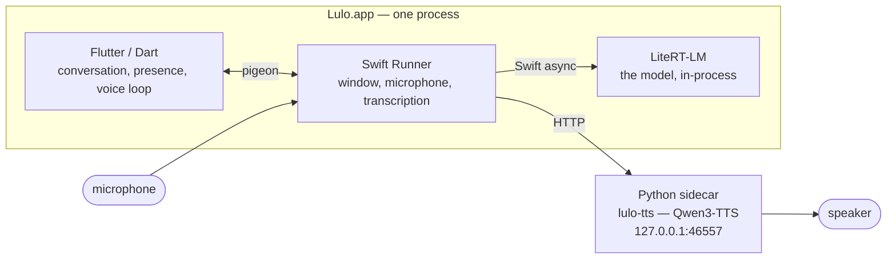
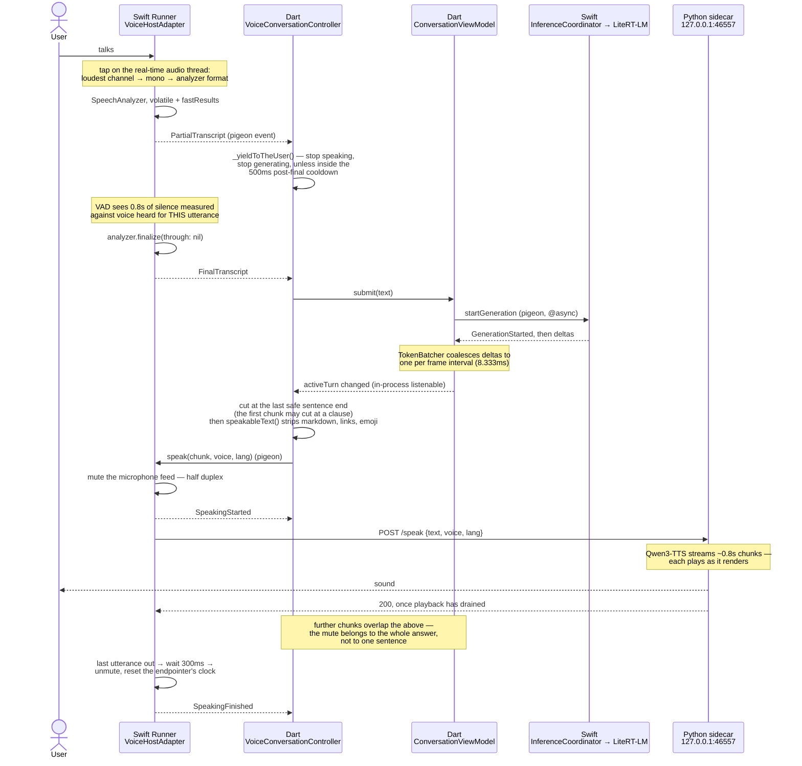

# Architecture

Lulo is four programs that agree to be one agent. Three of them run in the
app's process; the fourth is a resident Python server that owns a model too
large to reload and, for now, the speaker.

Nothing here talks to a network. Every boundary below is either a function
call, a pigeon channel, or a socket on `127.0.0.1`.

## The four parties



### Flutter / Dart — `apps/local_agent_macos/lib`, `packages/agent_core`

Everything that is a decision rather than a capability. The conversation's
turn model and its storage, the presence orb, the settings, and the voice
loop that decides *when* to listen, *what* to say aloud, and *when* to give
way. It holds no audio and no model weights.

`packages/agent_core` is pure Dart and must never import Flutter — it is the
turn, generation, and conversation vocabulary the app is written in.

The composition root is `lib/app/bootstrap.dart` →
`lib/app/app_composition.dart`. Dependencies are constructed there and passed
down; there are no globals, no singletons, and no service locator. Which
runtime the app is wired to (`fake` or `litert`), whether it has ears at all,
and where conversations are stored are all decided in that one place. See
`AGENTS.md`.

### Swift Runner — `apps/local_agent_macos/macos/Runner`

Everything macOS will only lend to a native process:

- **The window.** `DesktopPanelController`, `MainFlutterWindow`,
  `GlobalHotKeyController`, `MenuBarController`. One stage hosts both the orb
  and the conversation and never changes size — see `AGENTS.md` for why.
- **The ears.** `VoiceHostAdapter` runs `AVAudioEngine` and SpeechAnalyzer's
  on-device transcriber, and decides when an utterance has ended.
- **The mouth's remote control.** The same adapter drives the TTS sidecar
  over HTTP and owns the mute that keeps the agent from hearing itself.
- **The model's host.** `LocalRuntimeHostAdapter` bridges pigeon to the
  `InferenceCoordinator` actor in `native/inference_service`.

### The local model — `native/inference_service`, `native/vendor/litert_lm`

A Swift package wrapping LiteRT-LM, loaded in-process. Not a separate
program: `InferenceCoordinator` is an actor, so loading gigabytes and
generating tokens stay off the main thread while remaining a plain `await`
away from the Runner.

The model file is chosen by the user through the system's own open panel
(`ChosenModelAccess` reclaims the sandbox permission on later runs). Loading
starts at launch rather than on the first prompt — this is a resident agent
summoned repeatedly, so the seconds are paid where nobody is waiting.

Without a model path the app runs `DeterministicFakeInferenceService`: one
fixed reply, no weights. That is what the tests and the preview run against,
so a canned answer means the runtime is working, not that the model failed.

### Python TTS sidecar — `~/dev/lulo-tts` (separate repository)

`server.py`, a `ThreadingHTTPServer` on `127.0.0.1:46557` holding
`mlx-community/Qwen3-TTS-12Hz-0.6B-CustomVoice-8bit` resident in MLX. Kept
alive by a launchd agent, `com.lulo.tts`, with `RunAtLoad` and `KeepAlive`.

It is out of tree, and deliberately so: the model takes long enough to load
that it must outlive any app launch, and MLX compute stalls off the main
thread, which is a constraint the app should not have to share. The app's
only knowledge of it is a port number and four routes.

If the sidecar is not running, the agent still hears, thinks, and writes; it
simply does not speak. `speakThroughSidecar` returns false and the sentence
is skipped — there is deliberately no system-synthesizer fallback.

That is a defensible failure and it used to be an invisible one. Settings now
opens a socket against both sidecar ports and says which is down:
`SidecarHealthProbe` in `lib/features/sidecar/`. It reports and does not
offer to fix, because the sandbox forbids spawning a subprocess and a button
that cannot work is worse than a sentence that tells the truth. A connection
rather than a `GET /health`, because neither sidecar is in this repository or
under its control — assuming a route would report a running process as
stopped the day that route is renamed.

## The seam: pigeon

`pigeons/desktop_host_api.dart` and `pigeons/voice_host_api.dart` are the
single source of truth for the Dart↔Swift boundary. Each declares two
directions:

| Direction | Annotation | Desktop | Voice |
|---|---|---|---|
| Dart → Swift | `@HostApi()` | `DesktopHostApi` | `VoiceHostApi` |
| Swift → Dart | `@FlutterApi()` | `DesktopHostEventApi` | `VoiceHostEvents` |

Generation is configured inside the definition files with `@ConfigurePigeon`,
so regenerating needs only the input:

```sh
dart run pigeon --input pigeons/voice_host_api.dart
dart run pigeon --input pigeons/desktop_host_api.dart
```

Output lands in `lib/generated/*.g.dart` and
`macos/Runner/Generated*HostApi.swift`. Both are checked in. **Edit the
`pigeons/` file, never the generated pair.**

Neither generated API is used directly by features. Each is wrapped once, and
the wrapper is where errors stop being exceptions:

- `PigeonDesktopHostService` implements `DesktopHostService`
- `PigeonVoiceService` implements `VoiceService`

`PigeonVoiceService._guard` turns any host failure into a `VoiceFailed`
event on the same stream as everything else, because the conversation loop
has to survive a microphone that went away. Tests inject
`FakeVoiceService`/`ControlledInferenceService` at these interfaces and never
touch a channel.

Async host methods are `@async` and complete off the main thread; events come
back one at a time, in order, over the `@FlutterApi()`.

## One turn, end to end

The user speaks; the room goes quiet; the answer is generated, spoken as it
is written, and the microphone reopens. Every arrow below crosses a process
or a language boundary except where noted.



Three things about that diagram are load-bearing and easy to lose:

- **Speech starts before the answer is finished.** Generation, synthesis, and
  playback overlap. The first chunk goes out on a finished clause; later ones
  accumulate to ~40 characters so the voice does not reset its prosody every
  short sentence.
- **The mute belongs to the answer, not the sentence.** `outstandingUtterances`
  counts; the first `speak` mutes and only the last one back unmutes. Unmuting
  per sentence would reopen the microphone while sentence two is still
  playing, and the agent would transcribe itself.
- **The microphone is deaf while the agent talks.** That is a decision with a
  measurement behind it — see
  [decisions/half-duplex-voice.md](decisions/half-duplex-voice.md).

## Typed by hand, not spoken

The same path minus the ears: `ConversationComposer` calls
`ConversationViewModel.submit` directly and nothing else changes.
`VoiceConversationController` is pure coordination over the text pipeline —
an utterance submits exactly like a typed message. That is why it can be
tested without audio at all.

## Where state lives

| What | Where | Lifetime |
|---|---|---|
| Conversations | SQLite via drift, `~/Library/Application Support/Lulo/conversations.db` | Forever, on the calling isolate |
| Settings (model path, voice, window behaviour) | `FileSettingsStore`, same directory | Forever |
| Downloaded models | `~/Library/Application Support/Lulo/models` | Forever |
| Model weights in memory | `InferenceCoordinator` actor | App lifetime, swappable |
| TTS weights in memory | The sidecar | Across app launches |
| A listening session | `VoiceHostAdapter.ListeningSession` | One microphone run, torn down as one |

A home directory that cannot be resolved falls back to memory everywhere
rather than refusing to start: conversations are forgotten instead of lost.

## Verification

`dart run tool/verify.dart` from the root runs the whole gate — format,
analyze, the Dart and Flutter tests, a real-window integration test, a
profile build, the macOS `RunnerTests`, and `swift test`. It runs everything
and reports every failure rather than stopping at the first. Details, and
the two ways it hangs, are in `CLAUDE.md`.
