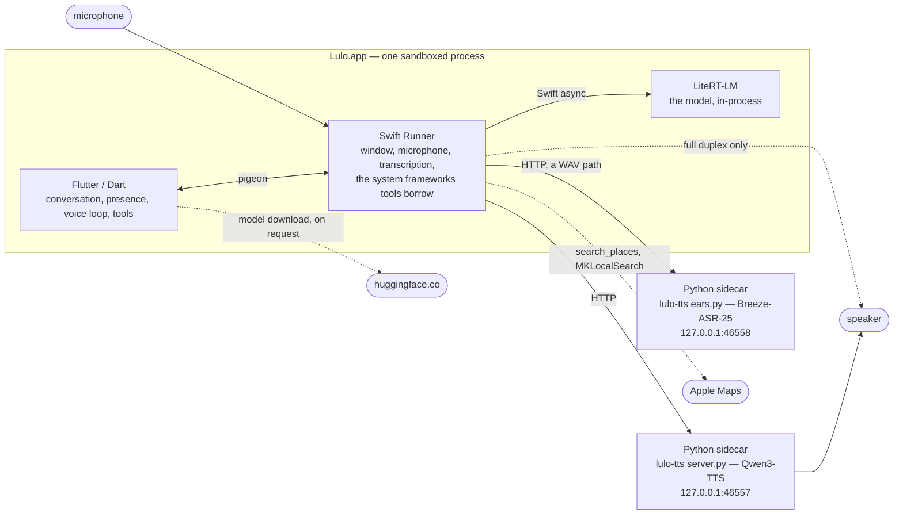
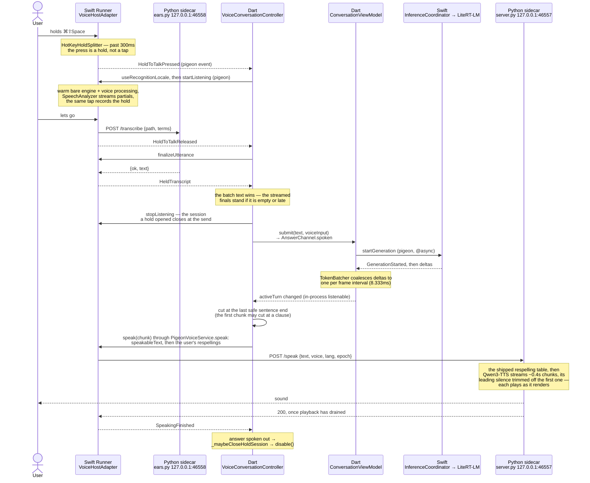
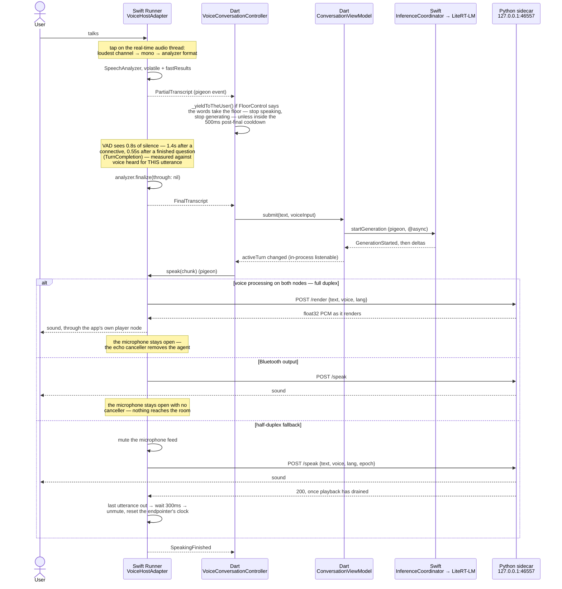
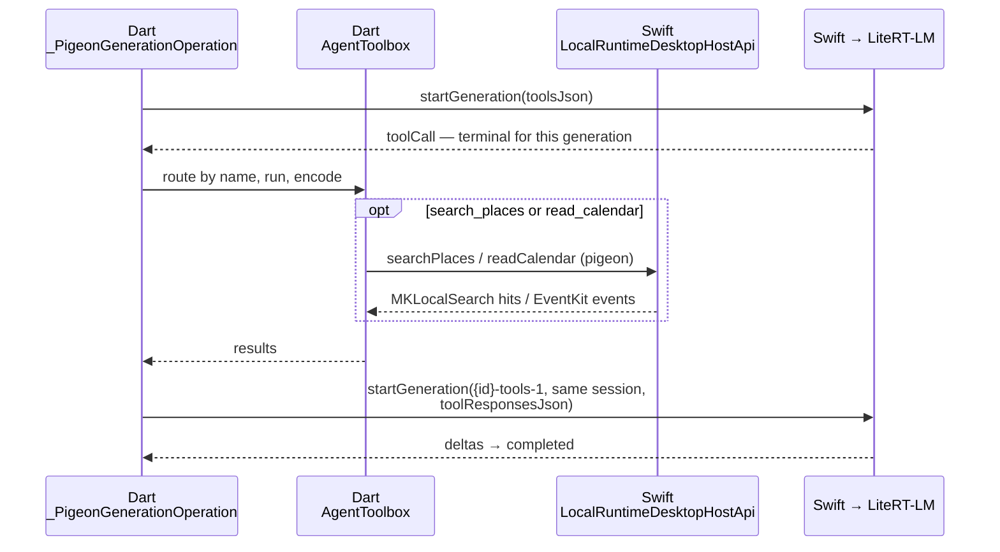

# Architecture

Lulo is five programs that agree to be one agent. Three of them run in the
app's process; the other two are resident Python servers outside this
repository, each holding a model too large to reload — the voice, which on
every path but full duplex also owns the speaker, and the batch recogniser
that a held key is transcribed by.

The conversation itself never leaves the machine: the model runs in-process,
the microphone is transcribed on-device, and both sidecars are reached on
`127.0.0.1`. That is not the same as nothing here talking to a network — a
place search goes to Apple Maps and a model download comes from Hugging Face
— and [What leaves the machine](#what-leaves-the-machine) lists every case.

## The five parties



### Flutter / Dart — `apps/local_agent_macos/lib`, `packages/agent_core`

Everything that is a decision rather than a capability. The conversation's
turn model and its storage, the presence orb, the settings, and the voice
loop that decides *when* to listen, *what* to say aloud, and *when* to give
way. It holds no audio and no model weights.

It also owns every tool the model can call. `buildToolbox` in
`lib/app/bootstrap.dart` builds one `AgentToolbox` — `search_conversations`,
`search_places`, `read_calendar` — and the loop that runs them lives in
`PigeonInferenceService`; the Swift side only lends the system framework
behind the last two. And it owns the one place the conversation is written
outside the app's container without being asked each time — an export is a
single file through the save panel; this is a standing mirror:
`ObsidianJournalWriter`, which `AppComposition` wraps around the
conversation store, off by default.

Two fragment shaders ship with it: the orb (`shaders/agent_presence.frag`)
and the aurora that rises behind the conversation from the moment the user
holds to talk, or sends a question, until the answer's first word
(`shaders/conversation_aurora.frag`, drawn by `ConversationAurora`).

`packages/agent_core` is pure Dart and must never import Flutter — it is the
turn, generation, and conversation vocabulary the app is written in.

The composition root is `lib/app/bootstrap.dart` →
`lib/app/app_composition.dart`. Dependencies are constructed there and passed
down; there are no globals, no singletons, and no service locator. Which
runtime the app is wired to (`fake` or `litert`), whether it has ears at all,
and where conversations are stored are all decided between `lib/main.dart`
and that one place. See `AGENTS.md`.

### Swift Runner — `apps/local_agent_macos/macos/Runner`

Everything macOS will only lend to a native process:

- **The window.** `DesktopPanelController`, `MainFlutterWindow`,
  `GlobalHotKeyController`, `MenuBarController`. One stage hosts both the orb
  and the conversation and never changes size — see `AGENTS.md` for why.
  Two pieces of chrome are AppKit's because Flutter has nowhere to draw them:
  the File menu (⌘N, ⇧⌘O, ⌘W — `AppDelegate.installFileMenu`), because the
  menu bar is AppKit's, and the buttons beside the resting orb
  (`OrbActionStrip`, off by default), because the orb's square sits at the
  bottom of the stage's frame and the stage may not grow. The strip's and the
  menu bar's words come from Dart over pigeon; the File menu's are still
  written in Swift.
- **The ears.** `VoiceHostAdapter` runs `AVAudioEngine` and SpeechAnalyzer's
  on-device transcriber, and decides when an utterance has ended. A held
  ⌘⇧Space (`HotKeyHoldSplitter`: past 300ms a press is a hold, before it a
  tap that toggles the window) is also recorded and handed to the batch
  recogniser. ⌃⇧Space is dictation to the clipboard on an engine of its own
  (`DictationController`), and never reaches Dart — see
  [decisions/dictation-cannot-share-the-tap.md](decisions/dictation-cannot-share-the-tap.md).
- **The mouth's remote control.** The same adapter drives the TTS sidecar
  over HTTP and, on the half-duplex fallback, owns the mute that keeps the
  agent from hearing itself.
- **The model's host.** `LocalRuntimeDesktopHostApi` (in
  `LocalRuntimeHostAdapter.swift`) bridges pigeon to the
  `InferenceCoordinator` actor in `native/inference_service`. The same class
  answers the rest of `DesktopHostApi`, including the two system frameworks
  tools borrow: `MKLocalSearch` for `searchPlaces`, and EventKit for
  `readCalendar`, which asks for calendar access the first time it is called
  and reports a denial as a denial rather than as an empty day.

### The local model — `native/inference_service`, `native/vendor/litert_lm`

A Swift package wrapping LiteRT-LM, loaded in-process. Not a separate
program: `InferenceCoordinator` is an actor, so loading gigabytes and
generating tokens stay off the main thread while remaining a plain `await`
away from the Runner.

The model file is either downloaded from a curated catalog — three Gemma 4
builds on huggingface.co, each with its size and SHA-256 pinned in
`modelCatalog` (`lib/features/model/model_catalog.dart`) and fetched by
`ModelFileService` — or chosen by the user through the system's own open
panel (`ChosenModelAccess` reclaims the sandbox permission on later runs).
Loading starts at launch rather than on the first prompt — this is a resident
agent summoned repeatedly, so the seconds are paid where nobody is waiting.

Without a model path the app runs `DeterministicFakeInferenceService`: one
fixed reply, no weights. That is what the tests and the preview run against,
so a canned answer means the runtime is working, not that the model failed.
A first launch does not meet it: with no model chosen, `FirstRun` covers the
conversation and offers the recommended download (`lib/app/app.dart`). The
XCTest host runs the fake even with a model installed (`lib/main.dart`), so
the native suite never loads gigabytes into its connection window.

### Python sidecars — `~/dev/lulo-tts` (separate repository)

Two servers in one directory, both out of tree and both kept alive by a
launchd agent with `RunAtLoad` and `KeepAlive`. The agents' plists live in
`~/Library/LaunchAgents` and are tracked in neither repository, so a new
machine has to be given them by hand.

**The voice.** `server.py`, a `ThreadingHTTPServer` on `127.0.0.1:46557`
holding `mlx-community/Qwen3-TTS-12Hz-0.6B-Base-8bit` resident in MLX,
cloning its voice from one fixed reference recording (`voices/ryan.wav`).
Kept alive by `com.lulo.tts`.

It is out of tree, and deliberately so: the model takes long enough to load
that it must outlive any app launch, and MLX compute stalls off the main
thread, which is a constraint the app should not have to share. The app's
only knowledge of it is a port number, the three routes `VoiceHostAdapter`
calls — `/speak`, `/render`, `/stop` — and the voice names
`lib/features/voice/tts_voices.dart` mirrors.

The coupling runs the other way exactly once. At startup the sidecar imports
this repository's respelling table, `sidecars/pronunciation`, from
`~/dev/flutter_local_agent/sidecars/pronunciation` unless
`LULO_PRONUNCIATION_DIR` says otherwise. A table that will not import is
skipped and the text is spoken unchanged, so moving this checkout turns the
table off without a sound; an entry added to it reaches the voice only when
that process is next started. The user's own respellings
(`AgentProfile.respellings`) are applied earlier, in
`PigeonVoiceService.speak`, and so run first.

**The batch recogniser.** `ears.py`, a single-threaded `HTTPServer` on
`127.0.0.1:46558` holding `Kenji8000/Breeze-ASR-25-mlx` through
`mlx_whisper`, kept alive by `com.lulo.ears`. The app calls one route,
`POST /transcribe {path, terms}`, from four places, all through
`HeldSpeech.transcribeHeld`: the held ⌘⇧Space, the second listen for a
sentence the streaming recogniser doubted (`reHearUtterance`), dictation, and
Settings' recording transcription (`transcribeRecording`, with a 600-second
budget). What crosses the socket is a file path, not audio: the clip is a WAV
in the app's temporary directory, and the sidecar, which is not sandboxed,
reads it from there. Why this model is in
[decisions/batch-asr-candidates.md](decisions/batch-asr-candidates.md).

If the voice is not running, the agent still hears, thinks, and writes; it
simply does not speak. `speakThroughSidecar` returns false and the sentence
is skipped — there is deliberately no system-synthesizer fallback. If the
recogniser is not running, the streamed transcript stands, which is
measurably worse but not nothing.

That is a defensible failure and it used to be an invisible one. Settings now
opens a socket against both sidecar ports and says which is down:
`SidecarHealthProbe` in `lib/features/sidecar/`. It reports and does not
offer to fix, because the sandbox forbids spawning a subprocess and a button
that cannot work is worse than a sentence that tells the truth. A connection
rather than a `GET /health`, because neither sidecar is in this repository or
under its control — assuming a route would report a running process as
stopped the day that route is renamed.

## The seam: pigeon

`pigeons/desktop_host_api.dart` and `pigeons/voice_host_api.dart` are the
single source of truth for the Dart↔Swift boundary. Each declares two
directions:

| Direction | Annotation | Desktop | Voice |
|---|---|---|---|
| Dart → Swift | `@HostApi()` | `DesktopHostApi` | `VoiceHostApi` |
| Swift → Dart | `@FlutterApi()` | `DesktopHostEventApi` | `VoiceHostEvents` |

`DesktopHostApi` is broader than its name. Besides the window it carries
model loading and generation, the file panels, the tool backends
(`searchPlaces`, `readCalendar`), the Obsidian vault (`appendToVault`),
`setLaunchAtLogin` and `captureScreenLook`. `VoiceHostApi` is the microphone,
the voice, and what the recogniser should expect before it hears anything —
`useRecognitionLocale`, `useSpokenVocabulary`, `useUnfinishedEndings`.

Generation is configured inside the definition files with `@ConfigurePigeon`,
so regenerating needs only the input:

```sh
dart run pigeon --input pigeons/voice_host_api.dart
dart run pigeon --input pigeons/desktop_host_api.dart
```

Output lands in `lib/generated/*.g.dart` and
`macos/Runner/Generated*HostApi.swift`. Both are checked in. **Edit the
`pigeons/` file, never the generated pair.**

Neither generated API is used directly by features. Each is wrapped once, and
the wrapper is where errors stop being exceptions:

- `PigeonDesktopHostService` implements `DesktopHostService`
- `PigeonVoiceService` implements `VoiceService`

`PigeonVoiceService._guard` turns any host failure into a `VoiceFailed`
event on the same stream as everything else, because the conversation loop
has to survive a microphone that went away. Tests inject
`FakeVoiceService`/`ControlledInferenceService` at these interfaces and never
touch a channel.

Async host methods are `@async` and complete off the main thread; events come
back one at a time, in order, over the `@FlutterApi()`.

## One turn, end to end

Holding to talk is the default door — the composer's mic button, or
⌘⇧Space from anywhere. The always-open microphone is a switch, Settings ›
Taking turns › Live conversation (`AppSettings.liveConversation`), off by
default. The held key is drawn below: the user holds, speaks, lets go, and
the answer is spoken as it is written. Every arrow crosses a process or a
language boundary except where noted.



What the diagram compresses:

- **Letting go is the endpoint.** No silence is waited out. The release
  finalizes the streaming transcript and asks the batch recogniser, whose
  answer replaces it; if that is empty, or has not arrived within
  `_pttBatchWait` (8s), the streamed finals stand. The composer's mic button
  takes the same path without the recording and the second recogniser —
  only the hotkey captures audio natively — so its question is the streamed
  transcript (`_HoldToTalkButton` in `conversation_composer.dart`).
- **The session closes at the send.** A session a hold opened stops
  listening the moment the question goes (`_submitHeldSpeech`), because the
  voice-processed microphone ducks every other app's audio for as long as it
  is open. The controller stays enabled until the answer has been handed to
  the voice; `_maybeCloseHoldSession` then disables it.
- **The language is chosen before anyone speaks.**
  `AppSettings.conversationLanguage` — English unless switched
  (`AgentLanguage.byDefault`) — is pushed with `useRecognitionLocale` before
  `startListening`, because the transcriber's locale is fixed when the
  session opens. `RecognitionLocale.resolve` falls back to the Mac's
  preferred languages when the choice has no model. See
  [decisions/the-agent-opens-in-english.md](decisions/the-agent-opens-in-english.md).
- **Speech starts before the answer is finished.** Generation, synthesis, and
  playback overlap. The first chunk goes out on a finished clause; later ones
  accumulate to about 64 characters, 32 in a Chinese answer (`_chunkTarget`,
  `_cjkChunkTarget`), so the voice does not reset its prosody every short
  sentence.
- **Everything said passes one door.** `PigeonVoiceService.speak` strips what
  cannot be spoken (`speakableText`) and applies the user's respellings
  before the text crosses pigeon, so the read-aloud action on a finished
  turn, which calls the voice service directly rather than enabling the
  controller, gets the same treatment as the voice loop.
- **The screen redraws only what changed.** `StreamingMarkdown` holds
  everything before the answer's last paragraph break as the same widget
  instance, and `ConversationList` hands back the widget already built for
  each finished `Turn`. Measured in widget tests when that landed: one
  streaming rebuild of a 1118-character answer went from 7.88ms to 2.71ms,
  and appending a turn to
  an 80-exchange conversation from 78.0ms to 24.2ms — neither grows with
  what is already on screen.

### With the microphone left open

With Live conversation on, the session stays open across turns, the
endpointer rather than a key decides that a question is over, and the user
can talk over an answer.



Two things about that diagram are load-bearing and easy to lose:

- **Whether the agent can hear itself depends on the output.** With voice
  processing granted on both the input and the output node — the ordinary
  case on this hardware — the echo canceller removes the agent and the
  microphone never mutes; see
  [decisions/full-duplex-voice.md](decisions/full-duplex-voice.md). With
  Bluetooth output the microphone stays open with no canceller, because
  nothing reaches the room (`InputDevicePolicy.skipsEchoCancellation`). Only
  where neither holds does the mute take over.
  [decisions/half-duplex-voice.md](decisions/half-duplex-voice.md) is the
  superseded record of the mute as the whole answer, kept for its method
  error.
- **The mute belongs to the answer, not the sentence.** On that fallback
  `SpeechTurn.outstanding` counts; the first `speak` mutes and only the last
  one back unmutes. Unmuting per sentence would reopen the microphone while
  sentence two is still playing, and the agent would transcribe itself.

The endpointer, barge-in and both duplex paths in full:
[features/voice.md](features/voice.md).

## The two turns those diagrams do not show

A tool call breaks the straight line above, and so does the work the app
does with the model when nobody is talking to it. Both matter to anyone
reading the flow for the first time.

**A tool round is a second host generation.** The model emitting a tool call
*ends* the generation on the Swift side — the event is terminal there — so
Dart runs the tool and starts a fresh host generation on the same session,
carrying the results. The turn the user sees never notices; `GenerationStarted`
fires once however many rounds happen underneath it. Three rounds maximum
(`_PigeonGenerationOperation.maxToolRounds`).



The toolbox is built once, in `buildToolbox` (`lib/app/bootstrap.dart`), and
offered on every turn: `search_conversations`, `search_places`,
`read_calendar`. The last two are Dart tools whose work happens natively, so
a round that calls one makes one more round trip over pigeon. `RememberTool` is built and
deliberately not registered — see
[decisions/the-model-will-not-interrupt-itself-to-remember.md](decisions/the-model-will-not-interrupt-itself-to-remember.md).
Where each piece of the loop lives, and why, is
[decisions/tools-declared-in-dart-loop-in-dart.md](decisions/tools-declared-in-dart-loop-in-dart.md).

**An aside is a generation with no conversation around it.** A
`GenerationRequest` carrying `instruction` sends that string as the whole
system instruction — no persona, no memories, no clock — and turns the
toolbox off. The memory extraction pass is the first one.

The constraint that governs both: **the runtime has one generation slot.**
`LiteRTLMRuntimeBackend` refuses a second `startGeneration` with
`generationBusy`. A tool round is safe because it is the same turn taking
its own slot back; an aside is not, so `BetweenTurns.yieldSlot()` is awaited
before every question and the aside is cancelled to make room. The user
always wins the slot.

Details, and the measurements behind the no-persona and no-tools rules, in
[features/conversation.md](features/conversation.md).

## Typed by hand, not spoken

The same path minus the ears: `ConversationComposer` hands the text to
`ConversationViewModel.submit` and the voice loop never sees it.
`VoiceConversationController` is pure coordination over the text pipeline —
an utterance is submitted through the same `submit`, carrying its
`voiceInput`. That is why it can be tested without audio at all.

One thing downstream does differ. A question with no `voiceInput` goes out as
`AnswerChannel.written` (`ConversationViewModel.submit`), and
`composeAgentPrompt` builds reading rules for it instead of listening ones.
The channel sits in the stable half of the prompt, so switching between
typing and talking rebuilds the conversation once.

## Where state lives

`Application Support/Lulo` below is `$HOME/Library/Application Support/Lulo`
as `lib/app/bootstrap.dart` builds it. Inside the sandbox `HOME` is the app's
container, so on disk — as found on the development machine — it is
`~/Library/Containers/com.flutterlocalagent.localAgentMacos/Data/Library/Application Support/Lulo`.

| What | Where | Lifetime |
|---|---|---|
| Conversations | SQLite via drift, `Application Support/Lulo/conversations.db` | Forever, on the calling isolate |
| Settings (model path, voice, conversation language, window and orb behaviour, and the opt-ins: live conversation, what may be remembered, shared or mirrored) | `FileSettingsStore`, `settings.json`, same directory | Forever |
| Who the agent is, and what it remembers about the user | `agent_profile.json`, same directory — hand-editable, watched in debug | Forever, and written by the app as well as read |
| The presence notice ledger | `presence_notices.json`, same directory | The newest 200 notices (`PresenceNoticeLedger.capacity`) |
| Downloaded models | `Application Support/Lulo/models` | Forever |
| Permission to reach a file outside the container — a chosen model, the vault folder | Security-scoped bookmarks in the app's `UserDefaults` (`ChosenModelAccess`, `ObsidianVault.bookmarkKey`) | Until the file moves or the grant is revoked |
| The journal | One Markdown page a day in the vault folder the user chose, appended to and never rewritten (`ObsidianVault.append`) | The user's — written to outlive the app |
| Held speech | `lulo-held-*.wav` in the app's temporary directory (`HeldSpeech.writeHeldClip`) | Swept after an hour (`HeldSpeech.sweepHeldClips`) |
| A screen look | One image under `screen-looks` in the temporary directory (`ScreenLookController`) | Deleted by the next look |
| Launch at login | macOS's own login-item registration (`LaunchAtLogin`) | Read back, never stored — the user can revoke it while the app is not running |
| Model weights in memory | `InferenceCoordinator` actor | App lifetime, swappable |
| TTS and recogniser weights in memory | The sidecars | Across app launches |
| A listening session | `VoiceHostAdapter.ListeningSession` | One microphone run, torn down as one |

A home directory that cannot be resolved falls back rather than refusing to
start: settings, conversations and the notice ledger to memory, so they are
forgotten instead of lost, and the profile and model downloads to the
system's temporary directory.

## What leaves the machine

Four things cross the machine's edge. Everything else stays, and the list
after the table says what keeps it there.

| What | Where it goes | What is sent | When | Code |
|---|---|---|---|---|
| A place search | Apple Maps, through `MKLocalSearch` | The `query` string the model wrote for `search_places`, with no region and no location | Whenever the model calls the tool. It is in every toolbox and no setting gates it | `LocalRuntimeDesktopHostApi.searchPlaces`, `PlaceSearchTool`, `buildToolbox` |
| A model download | `huggingface.co`, over HTTPS, following redirects | A GET for a catalog URL, with a `Range` header when resuming | Only when the user presses download, on `FirstRun` or in Settings | `modelCatalog`, `ModelFileService._fetchHttps` |
| The transcriber's model | Apple, fetched by macOS | Whatever `AssetInventory` requests for the locale | The first listening session in a locale whose asset is not installed | `VoiceHostAdapter.begin(id:)` |
| The sidecars' weights | Hugging Face, from the sidecar processes | The repository id in each script's `MODEL` | A first start downloads them; whether a later start contacts the Hub is not verified | `~/dev/lulo-tts/server.py`, `~/dev/lulo-tts/ears.py` |

What stays, and why:

- **The question, the answer and the history.** Generated in-process by
  LiteRT-LM and stored in the container's SQLite. The one way a question's
  words leave is inside a place search.
- **The microphone.** Transcribed on-device by SpeechAnalyzer. A held clip
  is a WAV in the app's temporary directory, and only its path is posted to
  `127.0.0.1:46558` (`HeldSpeech.transcribeHeld`).
- **What is spoken.** Posted to `127.0.0.1:46557` and nowhere else.
- **A screen look.** One file in the temporary directory, read by the
  in-process model through `GenerationRequest.imagePath`
  (`ScreenLookController`).
- **The calendar.** Read through EventKit into the model's context; nothing
  is written back (`readCalendar`).
- **The developer transcript shadow.** `TRANSCRIPT_SHADOW_ENDPOINT` is
  refused at construction unless it is a literal loopback HTTP URI
  (`LoopbackTranscriptProposalProvider`).
- **The journal.** A file appended in the folder the user chose. If that
  folder syncs somewhere, the syncing is the user's tooling, not this app's.

The sandbox is not what keeps this list short. `Release.entitlements` grants
`com.apple.security.network.client`, which the sandbox requires even for
loopback — and which permits any outbound connection at all. What keeps
traffic local is the code, so a new outbound call needs no entitlement and
nothing in the gate will notice it (`verify_release_entitlements.dart` checks
that keys are present, not what the code does with them). Whoever adds one
adds a row to the table above.

## Verification

`dart run tool/verify.dart` from the root runs the whole gate — format,
analyze, the Dart, Flutter and Python tests, the generated-lexicon diff, two
real-window integration tests, a profile build with its bundle and
entitlement checks, the macOS `RunnerTests`, and `swift test`. It runs
everything and reports every failure rather than stopping at the first.
Details, and the ways it hangs, are in `CLAUDE.md`.
