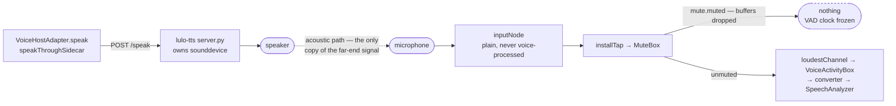
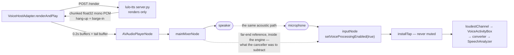

# The agent stops listening while it talks

**Status:** accepted, reversible
**Decided:** `f4309e9` on `feat/phase-1a-basic-conversation` (not yet merged
into `main`)
**Attempt preserved on:** `wip/full-duplex-aec` (`13f2cbb`)

## The decision

While Lulo is speaking, the microphone feed into the transcriber is muted.
`fullDuplex` is a field on `VoiceHostAdapter` and it is assigned `false`
unconditionally in `begin`. Barge-in by voice does not work. The composer's
stop button (`conversation-stop-button`) still ends the generation, but it is
wired to `ConversationViewModel.stop` alone — chunks already handed to the
sidecar play out.

Every piece of machinery full duplex would need is written and gated on that
flag: the `AVAudioPlayerNode`, the render format, `renderAndPlay`, and the
sidecar's `/render` route streaming raw PCM instead of owning the speaker.
It is kept, not deleted.

## The two audio paths

The difference between them is not the mute. It is **who holds the agent's own
voice as a signal.** An echo canceller subtracts a reference — the far-end
signal — from what the microphone hears, so it can only exist where both live
in the same audio graph.

**Today.** The sidecar owns the speaker. The agent's voice reaches the
microphone only as sound in the room, and the app never holds a copy of it:

**`wip/full-duplex-aec`.** Playback moves inside the app, so the same
`AVAudioEngine` that captures also renders — which is the arrangement
`setVoiceProcessingEnabled(true)` needs to have any reference to work from:

Read together: the second diagram is what makes an echo canceller *possible*
on this hardware, and the first is what the app is left with once the
canceller turns out not to work. Muting is a consequence, not a design — with
no reference signal and no subtraction, the only way to keep the agent from
transcribing itself is to stop listening.

## What was wanted

A conversation where the user can talk over the agent mid-sentence and be
heard — the thing that separates talking to something from taking turns with
it. That requires the microphone to stay open while the speaker is playing,
which requires the agent's own voice to be subtracted from what the
microphone hears. An acoustic echo canceller.

macOS ships one. `AVAudioInputNode.setVoiceProcessingEnabled(true)` is the
documented way to ask for it.

## What was tried

`wip/full-duplex-aec` (`13f2cbb`) moved playback out of the sidecar and into
the app so the agent's output would pass through the voice-processed path the
canceller knows about:

1. The sidecar grew `POST /render`, which streams raw float32 mono PCM over a
   chunked HTTP response instead of playing the audio itself. The client
   hanging up became the barge-in signal.
2. The adapter grew `renderAndPlay`, scheduling 0.2s buffers into an
   `AVAudioPlayerNode` attached to `mainMixerNode` — appending to whatever was
   already scheduled, so consecutive sentences of one answer play back to back
   with no seam — and a one-frame tail buffer whose playback callback is the
   drain signal.
3. Voice processing was enabled on the input node, and the mute was lifted.

## What was measured

Quoted verbatim from `git show f4309e9`, because the numbers are the decision:

> Full duplex was built on the assumption that macOS voice processing
> would subtract the agent's own voice from its microphone. Measured
> against a control, it does not: with voice processing enabled the input
> node delivers nine channels reading 1.4x the noise floor for a sound a
> plain input node hears at 14.6x, and no tap format — nil, mono, the
> node's own input or output — recovers it. The transcriber hears silence,
> which is what the comment this change deleted had said all along.
>
> The -10875 that came first was a different bug and its fix was wrong.
> It is not input and output both enabling voice processing; it is any
> player node joining the graph afterwards, because a mainMixerNode
> instantiated after voice processing lands on 44.1kHz against 48kHz
> hardware. Touching the mixer first starts the engine — and only then
> does the deaf microphone show itself.
>
> So: half-duplex again, with the reasoning in the code rather than in a
> session someone has to find. The playback machinery stays, gated on
> `fullDuplex`, for whenever there is a canceller that works here. The
> attempt is on wip/full-duplex-aec.
>
> Two fixes from that work survive, and they are the ones that were
> actually asked for: the system-synthesizer fallback is gone, so a failed
> sentence is skipped instead of read by a second voice mid-answer, and
> horizontal rules and list bullets are no longer read aloud.
>
> Verified end to end: a question played into the room transcribes, is
> answered, and is spoken back in one voice, with the VAD reading 0.0000
> while the agent talks. 330 tests green.

Two things worth separating out of that, because they were separate bugs and
the order in which they appeared is what made this expensive:

**`kAUInitialize -10875` is not the echo-canceller problem.** It is a sample
rate mismatch: a `mainMixerNode` instantiated *after* voice processing is
enabled lands on 44.1kHz while the hardware is at 48kHz. Any player node
joining the graph afterwards triggers it. The first diagnosis — that input and
output must not both enable voice processing — was wrong, and its fix
appeared to work only because it never got as far as starting the engine.
Touching the mixer before enabling voice processing starts the engine
successfully, and only then does the real failure become visible.

**The real failure is that the input node goes deaf.** Nine channels, the
loudest at 1.4× the noise floor for a sound a plain input node hears at 14.6×.
No tap format recovers it — not `nil`, not mono, not the node's own input or
output format. Whatever those nine channels carry, it is not this room.

## Why not work around it

The options that were considered and are not being taken:

- **Software AEC of our own.** The correct answer eventually, and the
  condition for reopening this. Not a weekend: it needs the reference signal
  aligned to the captured signal, delay estimation, an adaptive filter, and
  double-talk detection — and it has to run under the real-time thread's
  budget alongside everything already there.
- **Duck the output and listen through it.** The transcriber needs a clean
  signal, not a quiet dirty one. It would trade "cannot hear the user" for
  "transcribes a blend of both speakers", which is worse because it fails
  plausibly.
- **Keyword spotting on the muted-but-still-sampled feed.** Would mean running
  a second detector on audio the transcriber is not allowed to see, to catch
  one word. Large mechanism, narrow win.
- **Headphones.** Solves it acoustically and is what the developer's own
  testing used, but a resident desktop agent cannot require them.

## What was kept

Half duplex is not free, and the cost is paid in the state machine described
in [../features/voice.md](../features/voice.md): because the microphone is
shut while the agent talks, the VAD's clock freezes, and `muteLiftedAt`,
`utteranceHeardAt`, `outstandingUtterances`, `unmuteGeneration` and
`speakingReported` all exist to make the endpointer survive that gap. That
complexity is the price of this decision, and it disappears when full duplex
arrives — which is another reason to keep the gated path rather than delete
it.

Two changes from the attempt survived on their own merits, because they were
what had actually been asked for:

- **No system-synthesizer fallback.** A sentence the sidecar declines is
  skipped and logged, not read aloud by `AVSpeechSynthesizer`. A second voice
  cutting in mid-answer reads as the agent changing person.
- **Horizontal rules and list bullets are stripped** in `speakableText`.
  `---` read aloud is a groan, and `- 第一點` otherwise starts with a minus.

## Reopening

Flip `fullDuplex` to true when — and only when — there is an echo canceller
that measurably works on this hardware. Concretely, the bar is the inverse of
the measurement above: with the agent speaking at normal volume, a sound the
plain input node hears at ~14.6× the noise floor must still reach the
transcriber, and the transcriber must produce a usable transcript of the
user's speech while the agent's own words are playing.

The rest is already in place. `renderAndPlay`, the player node, the render
format, and `/render` need no new work — they need the flag and a canceller
under them. Start from `wip/full-duplex-aec` for the shape, not the
conclusion.

When that happens, `utteranceEnded`'s `if !self.fullDuplex` branch is the
piece to read first: full duplex never mutes, never freezes the VAD's clock,
and must not reset an utterance the user is in the middle of.
