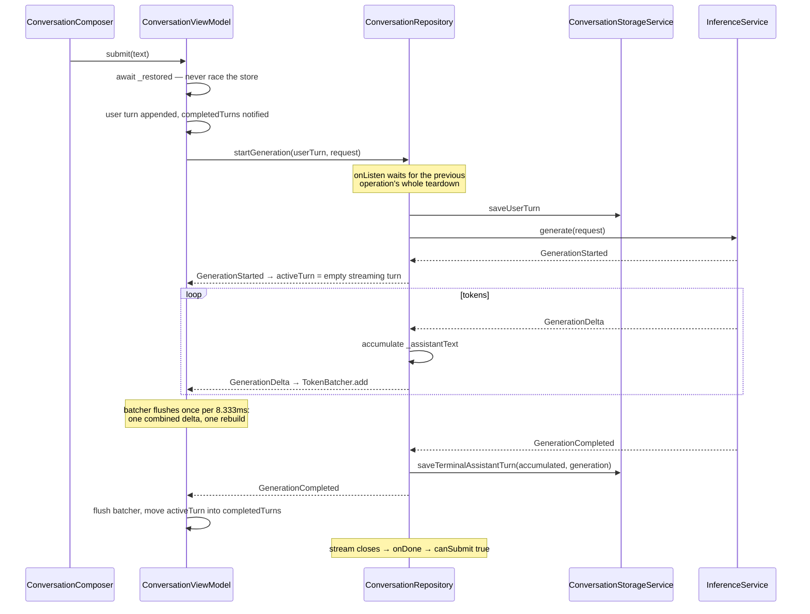

# Conversation

Everything the agent is for, minus the ways it hears and speaks. A message is
submitted, one generation runs, tokens arrive faster than a display can show
them, the answer lands in SQLite, and at every one of those steps something
can be cancelled underneath.

The shape to hold on to: **the turn model is pure Dart and knows nothing about
Flutter, the model, or the disk.** Everything platform-shaped is an
implementation of an interface the app layer declares. That is why the whole
pipeline can be tested without a window, a microphone, or a model.

## The files

| File | Owns |
|---|---|
| `packages/agent_core/lib/src/conversation/` | The vocabulary: `Turn`, `TurnStatus`, `ConversationProjection`, `Generation`, `GenerationEvent`. Pure Dart |
| `lib/features/conversation/conversation_view_model.dart` | Presentation state, the three listenables, submit and stop |
| `lib/features/conversation/token_batcher.dart` | Coalescing deltas to one rebuild per frame |
| `lib/features/conversation/conversation_repository.dart` | One generation at a time, persistence around it, cancellation teardown |
| `lib/features/conversation/conversation_storage_service.dart` | The storage interface and `ConversationSummary` |
| `lib/features/conversation/drift_conversation_storage_service.dart` | The durable store: one table, SQLite through drift |
| `lib/features/conversation/inference_service.dart` | The inference interface — two methods, no platform in sight |
| `lib/features/conversation/pigeon_inference_service.dart` | The production implementation, over the desktop host boundary |
| `lib/features/conversation/swappable_inference_service.dart` | The model changeable underneath a live conversation |
| `lib/app/fake_runtime.dart` | `DeterministicFakeInferenceService` and the in-memory store |
| `lib/features/conversation/widgets/` | The list, the composer, the streaming turn, the history sheet |

Tests: `test/features/conversation/conversation_view_model_test.dart`,
`conversation_view_model_batching_test.dart`, `token_batcher_test.dart`,
`conversation_repository_test.dart`, `conversation_restore_test.dart`,
`conversation_storage_contract_test.dart` (run against both stores through
`test/support/conversation_storage_contract.dart`),
`conversation_render_isolation_test.dart`, `conversation_scroll_test.dart`,
`swappable_inference_service_test.dart`, `pigeon_inference_service_test.dart`,
and `packages/agent_core/test/conversation_contract_test.dart`.

## The pure-Dart contract

`packages/agent_core` is the whole vocabulary and about two hundred lines. It
must never import Flutter — see `AGENTS.md`.

A `Turn` is a role, some text, and a status, and it is immutable: `append`
and `copyWith` return new ones. It carries no identity and no timestamp,
because neither is the turn's business — the store supplies both, and
`ConversationStorageService.saveUserTurn` takes the conversation id as a
separate argument precisely because the turn cannot say which conversation it
belongs to (ADR-003 found the earlier shape unable to).

`ConversationProjection` is the invariant, enforced in its factory:

- everything in `completedTurns` is terminal — `completed`, `cancelled`, or
  `failed`
- `activeTurn`, if there is one, is `streaming`

So "an answer is being written" and "an answer has been written" cannot be
confused by construction, and the widget layer never has to ask.

`GenerationEvent` is a sealed union — `GenerationStarted`, `GenerationDelta`,
`GenerationCompleted`, `GenerationCancelled`, `GenerationFailed` — which is
what lets every `switch` over it be exhaustive without a default arm.

## One turn, in the app layer



Three things in that picture are load-bearing:

- **The user turn is on screen before it is on disk.** `submit` appends it to
  the projection and notifies immediately; the repository writes it inside the
  operation. A slow disk delays the answer, never the echo of what was typed.
- **The repository accumulates the answer separately from the ViewModel.**
  `_GenerationOperation._assistantText` is what gets stored; the ViewModel's
  projection is what gets drawn. They receive the same deltas and are never
  compared. The store therefore never sees a partial answer: one row is
  written, once, at the terminal event. An answer interrupted by a crash is
  simply not there.
- **`await _restored` inside `submit`.** History lands before the first
  message, so the message joins the restored conversation instead of racing it
  into a freshly minted one.

## The three listenables

`ConversationViewModel` is a `ChangeNotifier`, but almost nothing listens to
it as one. It publishes three narrow `ValueListenable`s instead:

| Listenable | Notified when | Read by |
|---|---|---|
| `completedTurnsListenable` | A turn reaches a terminal state | The history list, the presence header, the voice loop |
| `activeTurnListenable` | The streaming answer grows or ends | `ActiveStreamingTurn` alone, and the voice loop |
| `canSubmitListenable` | A generation starts or finishes | The composer's send/stop button |

The split is the whole rendering strategy: a token delta must repaint the
streaming bubble and nothing else. `conversation_render_isolation_test.dart`
pins that — it counts builds of the chrome, the list, the completed turns, the
composer, and the orb, and fails if a delta touches any of them.

**The order in which two of them are notified is a contract.** In
`_finishActiveTurn`, `_completedTurns` is assigned *before* `_activeTurn` is
nulled. The voice loop reads the completed turns first and only then sees the
active turn disappear; reversing it makes the last sentence of every spoken
answer come out twice. See [voice.md](voice.md).

Note also that `canSubmit` (the getter, `_operationSubscription == null`) and
`_canSubmit.value` are deliberately not updated at the same instant on the
manual-cancel path in `_stop`. The subscription is dropped, the turn is
finished, and only then does the composer come back — so the voice dispatch
guard stays up across the batcher flush that finishing performs.

## The token batcher, twice

Tokens are coalesced at two separate boundaries, for two different reasons,
and it is worth not confusing them.

| | `GenerationEventBridge` | `TokenBatcher` |
|---|---|---|
| Where | Swift, `native/inference_service` | Dart, the ViewModel |
| Window | 10ms (`coalescingMilliseconds`, asserted into 8–16) | 8.333ms (`interval`) |
| Reason | Fewer platform-channel messages | One rebuild per displayed frame |
| Flush | On any terminal event | On any terminal event, via `_finishActiveTurn` |

`TokenBatcher` preserves order, drops nothing, and `flush()` hands over
whatever is pending ahead of the scheduled frame — which is why a terminal
event can never race its own last tokens. The `BatchScheduler` seam is what
tests stand behind: `test/support/microtask_batch_scheduler.dart` makes the
interval deterministic instead of waiting on a real timer.

`dispose` is the one asymmetry: it drops what is pending rather than emitting
it, because a disposed ViewModel has nothing left to draw into.

## Cancelling, which is where it gets interesting

A generation can be stopped from three places — the stop button, Escape while
streaming, and the voice loop yielding to a user who started talking — and it
can be stopped at two very different moments.

**Before the runtime has answered.** There is no `GenerationId` yet, so there
is nothing to cancel by name. `ConversationViewModel._stop` cancels the stream
subscription by hand. That skips the `onDone` that normally re-enables
submission, so it finishes the turn as `cancelled` and flips `_canSubmit`
itself — without that, the send key is dead for good.

**After it has started.** `_repository.stop(generationId)` runs the real
teardown: cancel the runtime, cancel the subscription, persist the turn as
`cancelled`, publish `GenerationCancelled`, close the stream. Every step is in
a `finally` above the next, so a failure anywhere still reaches the store and
still closes the stream.

Around both sits the queue. `ConversationRepository` permits one active
generation, but "at a time" is measured against the previous operation's
*whole* teardown, not just its terminal event:

```dart
final Future<void> previousDone = _previousOperationDone;
// onListen: previousDone.then((_) => operation.start())
```

A cancelled answer still has a native cancel round trip to finish, and the
next message queues behind it rather than being refused for arriving during
it. That matters most in voice, where the interruption and the replacement
question are milliseconds apart.

`_receiveDone` covers the last case: an inference stream that ends without
ever producing a terminal event is turned into `GenerationFailed('Inference
ended before a terminal event.')`, because a turn that never terminates is a
composer that never comes back.

### Deleting a conversation out from under a live answer

`ConversationRepository.deleteConversation` tells any operation still speaking
in that conversation to `forget()` before it deletes the rows. Otherwise the
operation's cancellation would write its terminal turn back afterwards, and in
this schema rows *are* the conversation — the one just deleted would stand
back up as a ghost with a blank title.

## Storage: one table, no second copy of the truth

`TurnRows` is the only table. A conversation is whatever rows share a
`conversationId`; its title is its first user row; its recency is its newest
row. `listConversations` derives all of that in one query
(`ORDER BY MAX(id) DESC` — insertion order, monotonic even when two turns land
inside the same millisecond). There is no conversations table to fall out of
step with the turns.

`role` and `status` are stored **by name**, so reordering either enum cannot
silently rewrite history. An unrecognised status reads back as `failed`.

Three pragmas are set in `beforeOpen`, each for a stated reason:

- `journal_mode = WAL`
- `synchronous = NORMAL` — in WAL mode this still cannot corrupt the file, and
  `FULL`'s per-commit `F_FULLFSYNC` is a 10–50ms device-cache flush landing on
  the calling isolate exactly when the user presses send
- an index on `(conversation_id, id)` — without it the list derivation is a
  full scan with a correlated subquery

**The database runs on the calling isolate, not a background one.** ADR-003
adopted `createInBackground`; `ConversationDatabase.atFile` documents why it
was taken back out: the background isolate's native-asset resolution maps
`sqlite3.framework` a second time into the process, and a statement created
through one mapping crashes when it reaches the other (upstream
`simolus3/sqlite3.dart#381`; the local report is
`Lulo-2026-07-30-231954.ips`). One isolate, one mapping. Writes are
microseconds per the ADR's own benchmark, and the background isolate returns
when the upstream fix lands.

Both stores — durable and in-memory — are held to the same suite
(`test/support/conversation_storage_contract.dart`), so the preview cannot
drift away from the real thing.

## The runtime behind the interface

`InferenceService` is two methods. Three things implement it:

- `DeterministicFakeInferenceService` — three fixed chunks, ~1s end to end,
  no weights. What the tests and the preview run against.
- `PigeonInferenceService` — the real one, over `DesktopHostService`.
- `SwappableInferenceService` — not really an implementation but a holder,
  with the model exchangeable underneath. See [model.md](model.md).

`PigeonInferenceService` is where readiness lives. `warmUp()` and `generate`
share one `_readinessAttempt`, so a prompt arriving mid-warmup waits for the
same load instead of starting a second one; a failed attempt is cleared, so
the next prompt retries and reports the failure where the user can see it.

**One thing that is easy to miss: the conversation's history is not sent to
the model.** `PigeonInferenceService` passes `context: const <String>[]` and
sets `sessionId` to the conversation's id. Continuity comes from the native
side keeping one LiteRT-LM `Conversation` per session id, alive for as long as
the model is loaded. The consequence is stated plainly in [model.md](model.md)
under *What the model remembers*.

## Traps

Ranked by how quietly they break.

1. **Reordering the `completedTurns` and `activeTurn` notifications** in
   `_finishActiveTurn`. Nothing in this feature notices; the voice loop speaks
   the last sentence of every answer twice.
2. **Flipping `_canSubmit` before finishing the turn** on the manual-cancel
   path. Reads like tidying up; opens a window in which the voice loop
   dispatches the flushed tail of an answer the user just interrupted.
3. **Making the batcher emit on `dispose`.** It would deliver into a
   projection that is being torn down.
4. **Awaiting the terminal event instead of `done` before the next
   generation.** The native cancel round trip is still in flight, and the next
   message gets refused as busy.
5. **Adding a conversations table.** The list is derived; a second copy of the
   truth is a second thing to keep in step, and deletion already has one ghost
   scenario without it.
6. **Persisting deltas as they arrive.** The single terminal write is what
   keeps sending cheap; per-delta writes put SQLite in the token path.
7. **Widening the storage isolate back to `createInBackground`** without
   checking that upstream issue. It crashes inside `sqlite3_bind_int64`, which
   points at nothing.
