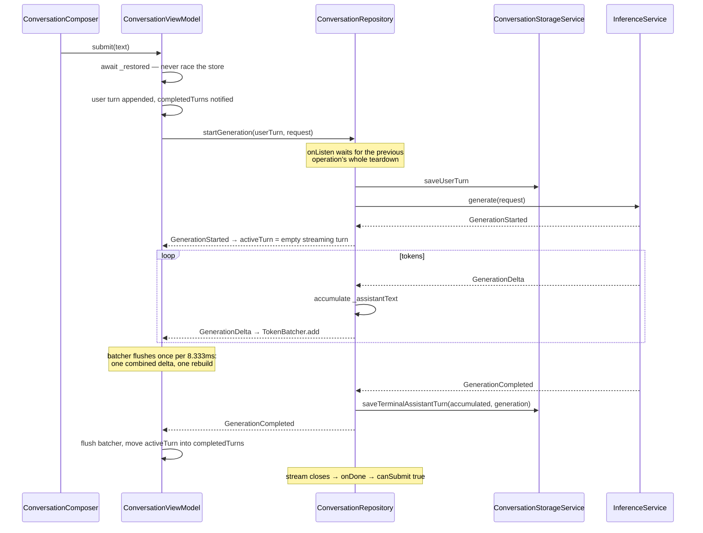

# Conversation

Everything the agent is for, minus the ways it hears and speaks. A message is
submitted, one generation runs, tokens arrive faster than a display can show
them, the answer lands in SQLite, and at every one of those steps something
can be cancelled underneath.

The shape to hold on to: **the turn model is pure Dart and knows nothing about
Flutter, the model, or the disk.** Everything platform-shaped is an
implementation of an interface the app layer declares. That is why the whole
pipeline can be tested without a window, a microphone, or a model.

## The files

| File | Owns |
|---|---|
| `packages/agent_core/lib/src/conversation/` | The vocabulary: `Turn`, `TurnStatus`, `ConversationProjection`, `Generation`, `GenerationEvent`. Pure Dart |
| `lib/features/conversation/conversation_view_model.dart` | Presentation state, the three listenables, submit and stop |
| `lib/features/conversation/token_batcher.dart` | Coalescing deltas to one rebuild per frame |
| `lib/features/conversation/conversation_repository.dart` | One generation at a time, persistence around it, cancellation teardown |
| `lib/features/conversation/conversation_storage_service.dart` | The storage interface and `ConversationSummary` |
| `lib/features/conversation/drift_conversation_storage_service.dart` | The durable store: one table, SQLite through drift |
| `lib/features/conversation/inference_service.dart` | The inference interface — two methods, no platform in sight |
| `lib/features/conversation/pigeon_inference_service.dart` | The production implementation, over the desktop host boundary |
| `lib/features/conversation/swappable_inference_service.dart` | The model changeable underneath a live conversation |
| `lib/app/fake_runtime.dart` | `DeterministicFakeInferenceService` and the in-memory store |
| `lib/features/conversation/widgets/` | The list, the composer, the streaming turn, the history sheet, how a turn arrives |

Tests: `test/features/conversation/conversation_view_model_test.dart`,
`conversation_view_model_batching_test.dart`, `token_batcher_test.dart`,
`conversation_repository_test.dart`, `conversation_restore_test.dart`,
`conversation_storage_contract_test.dart` (run against both stores through
`test/support/conversation_storage_contract.dart`),
`conversation_render_isolation_test.dart`, `conversation_scroll_test.dart`,
`turn_motion_test.dart`,
`swappable_inference_service_test.dart`, `pigeon_inference_service_test.dart`,
and `packages/agent_core/test/conversation_contract_test.dart`.

## The pure-Dart contract

`packages/agent_core` is the whole vocabulary and about two hundred lines. It
must never import Flutter — see `AGENTS.md`.

A `Turn` is a role, some text, and a status, and it is immutable: `append`
and `copyWith` return new ones. It carries no identity and no timestamp,
because neither is the turn's business — the store supplies both, and
`ConversationStorageService.saveUserTurn` takes the conversation id as a
separate argument precisely because the turn cannot say which conversation it
belongs to (ADR-003 found the earlier shape unable to).

`ConversationProjection` is the invariant, enforced in its factory:

- everything in `completedTurns` is terminal — `completed`, `cancelled`, or
  `failed`
- `activeTurn`, if there is one, is `streaming`

So "an answer is being written" and "an answer has been written" cannot be
confused by construction, and the widget layer never has to ask.

`GenerationEvent` is a sealed union — `GenerationStarted`, `GenerationDelta`,
`GenerationCompleted`, `GenerationCancelled`, `GenerationFailed` — which is
what lets every `switch` over it be exhaustive without a default arm.

## One turn, in the app layer



Three things in that picture are load-bearing:

- **The user turn is on screen before it is on disk.** `submit` appends it to
  the projection and notifies immediately; the repository writes it inside the
  operation. A slow disk delays the answer, never the echo of what was typed.
- **The repository accumulates the answer separately from the ViewModel.**
  `_GenerationOperation._assistantText` is what gets stored; the ViewModel's
  projection is what gets drawn. They receive the same deltas and are never
  compared. The store therefore never sees a partial answer: one row is
  written, once, at the terminal event. An answer interrupted by a crash is
  simply not there.
- **`await _restored` inside `submit`.** History lands before the first
  message, so the message joins the restored conversation instead of racing it
  into a freshly minted one.

## The three listenables

`ConversationViewModel` is a `ChangeNotifier`, but almost nothing listens to
it as one. It publishes three narrow `ValueListenable`s instead:

| Listenable | Notified when | Read by |
|---|---|---|
| `completedTurnsListenable` | A turn reaches a terminal state | The history list, the presence header, the voice loop |
| `activeTurnListenable` | The streaming answer grows or ends | `ActiveStreamingTurn` alone, and the voice loop |
| `canSubmitListenable` | A generation starts or finishes | The composer's send/stop button |

The split is the whole rendering strategy: a token delta must repaint the
streaming bubble and nothing else. `conversation_render_isolation_test.dart`
pins that — it counts builds of the chrome, the list, the completed turns, the
composer, and the orb, and fails if a delta touches any of them.

**The order in which two of them are notified is a contract.** In
`_finishActiveTurn`, `_completedTurns` is assigned *before* `_activeTurn` is
nulled. The voice loop reads the completed turns first and only then sees the
active turn disappear; reversing it makes the last sentence of every spoken
answer come out twice. See [voice.md](voice.md).

Note also that `canSubmit` (the getter, `_operationSubscription == null`) and
`_canSubmit.value` are deliberately not updated at the same instant on the
manual-cancel path in `_stop`. The subscription is dropped, the turn is
finished, and only then does the composer come back — so the voice dispatch
guard stays up across the batcher flush that finishing performs.

## The token batcher, twice

Tokens are coalesced at two separate boundaries, for two different reasons,
and it is worth not confusing them.

| | `GenerationEventBridge` | `TokenBatcher` |
|---|---|---|
| Where | Swift, `native/inference_service` | Dart, the ViewModel |
| Window | 10ms (`coalescingMilliseconds`, asserted into 8–16) | 8.333ms (`interval`) |
| Reason | Fewer platform-channel messages | One rebuild per displayed frame |
| Flush | On any terminal event | On any terminal event, via `_finishActiveTurn` |

`TokenBatcher` preserves order, drops nothing, and `flush()` hands over
whatever is pending ahead of the scheduled frame — which is why a terminal
event can never race its own last tokens. The `BatchScheduler` seam is what
tests stand behind: `test/support/microtask_batch_scheduler.dart` makes the
interval deterministic instead of waiting on a real timer.

`dispose` is the one asymmetry: it drops what is pending rather than emitting
it, because a disposed ViewModel has nothing left to draw into.

## Cancelling, which is where it gets interesting

A generation can be stopped from three places — the stop button, Escape while
streaming, and the voice loop yielding to a user who started talking — and it
can be stopped at two very different moments.

**Before the runtime has answered.** There is no `GenerationId` yet, so there
is nothing to cancel by name. `ConversationViewModel._stop` cancels the stream
subscription by hand. That skips the `onDone` that normally re-enables
submission, so it finishes the turn as `cancelled` and flips `_canSubmit`
itself — without that, the send key is dead for good.

**After it has started.** `_repository.stop(generationId)` runs the real
teardown: cancel the runtime, cancel the subscription, persist the turn as
`cancelled`, publish `GenerationCancelled`, close the stream. Every step is in
a `finally` above the next, so a failure anywhere still reaches the store and
still closes the stream.

Around both sits the queue. `ConversationRepository` permits one active
generation, but "at a time" is measured against the previous operation's
*whole* teardown, not just its terminal event:

```dart
final Future<void> previousDone = _previousOperationDone;
// onListen: previousDone.then((_) => operation.start())
```

A cancelled answer still has a native cancel round trip to finish, and the
next message queues behind it rather than being refused for arriving during
it. That matters most in voice, where the interruption and the replacement
question are milliseconds apart.

`_receiveDone` covers the last case: an inference stream that ends without
ever producing a terminal event is turned into `GenerationFailed('Inference
ended before a terminal event.')`, because a turn that never terminates is a
composer that never comes back.

### Deleting a conversation out from under a live answer

`ConversationRepository.deleteConversation` tells any operation still speaking
in that conversation to `forget()` before it deletes the rows. Otherwise the
operation's cancellation would write its terminal turn back afterwards, and in
this schema rows *are* the conversation — the one just deleted would stand
back up as a ghost with a blank title.

## Asking again

`regenerateLastAnswer` asks the last question again in place of the answer it
already has; `reviseLastQuestion` replaces the question first. The model runs
on this machine and is small enough to be wrong in ways a second attempt
fixes, so this is not a convenience — without it the only way past a bad
answer is to type the question out again, which leaves the bad one in the
conversation and in the model's own history.

Three things remember the answer being replaced, and all three have to let go:

1. **The screen.** The projection is cut back to before the last question,
   which `submit` then re-appends.
2. **The store.** `dropFromLastQuestion` deletes the question row and
   everything after it. Named by what it means rather than taking a count of
   turns: the view hides an answer that was cancelled before it said anything
   while the store keeps it, so a position counted from the screen is not a
   position in the store. The last question is the same turn in both.
3. **The runtime.** `ConversationRepository.dropFromLastQuestion` also calls
   `releaseSession`, for the same reason `deleteConversation` does — LiteRT-LM
   holds a live conversation per session id, and its KV cache still contains
   the rejected answer. Left alone the retry would be conditioned on the very
   thing it is replacing, and the model would see the question asked twice.

Only the newest exchange is retryable. Replacing an answer in the middle would
leave every answer after it standing on a question that never got that reply,
and nothing in this schema could represent that.

## Storage: one table, no second copy of the truth

`TurnRows` is the only table. A conversation is whatever rows share a
`conversationId`; its title is its first user row; its recency is its newest
row. `listConversations` derives all of that in one query
(`ORDER BY MAX(id) DESC` — insertion order, monotonic even when two turns land
inside the same millisecond). There is no conversations table to fall out of
step with the turns.

`role` and `status` are stored **by name**, so reordering either enum cannot
silently rewrite history. An unrecognised status reads back as `failed`.

Three pragmas are set in `beforeOpen`, each for a stated reason:

- `journal_mode = WAL`
- `synchronous = NORMAL` — in WAL mode this still cannot corrupt the file, and
  `FULL`'s per-commit `F_FULLFSYNC` is a 10–50ms device-cache flush landing on
  the calling isolate exactly when the user presses send
- an index on `(conversation_id, id)` — without it the list derivation is a
  full scan with a correlated subquery

**The database runs on the calling isolate, not a background one.** ADR-003
adopted `createInBackground`; `ConversationDatabase.atFile` documents why it
was taken back out: the background isolate's native-asset resolution maps
`sqlite3.framework` a second time into the process, and a statement created
through one mapping crashes when it reaches the other (upstream
`simolus3/sqlite3.dart#381`; the local report is
`Lulo-2026-07-30-231954.ips`). One isolate, one mapping. Writes are
microseconds per the ADR's own benchmark, and the background isolate returns
when the upstream fix lands.

Both stores — durable and in-memory — are held to the same suite
(`test/support/conversation_storage_contract.dart`), so the preview cannot
drift away from the real thing.

## The runtime behind the interface

`InferenceService` is two methods. Three things implement it:

- `DeterministicFakeInferenceService` — three fixed chunks, ~1s end to end,
  no weights. What the tests and the preview run against.
- `PigeonInferenceService` — the real one, over `DesktopHostService`.
- `SwappableInferenceService` — not really an implementation but a holder,
  with the model exchangeable underneath. See [model.md](model.md).

`PigeonInferenceService` is where readiness lives. `warmUp()` and `generate`
share one `_readinessAttempt`, so a prompt arriving mid-warmup waits for the
same load instead of starting a second one; a failed attempt is cleared, so
the next prompt retries and reports the failure where the user can see it.

**One thing that is easy to miss: the conversation's history is not sent to
the model.** `PigeonInferenceService` passes `context: const <String>[]` and
sets `sessionId` to the conversation's id. Continuity comes from the native
side keeping one LiteRT-LM `Conversation` per session id, alive for as long as
the model is loaded. The consequence is stated plainly in [model.md](model.md)
under *What the model remembers*.

## Tools: declared in Dart, routed in Dart

The model can decide, mid-answer, that it needs something it does not have.
What exists, what it may do, and what the model is told about it are all
product decisions, so all of them live in Dart and the runtime only renders
and reports. The reasoning is
[decisions/tools-declared-in-dart-loop-in-dart.md](../decisions/tools-declared-in-dart-loop-in-dart.md);
this is the path.

Three pieces, all in `agent_core/src/conversation/agent_tool.dart`:

- **`AgentTool`** — a name, a description, an OpenAPI property map, and
  `call`. The description is the whole interface the model reasons about,
  so it is written for the model rather than for a reader of code.
- **`AgentToolbox`** — the set offered on a conversation. It refuses two
  tools under one name at construction, renders `declarationsJson`, and
  **routes**: `call(AgentToolCall)` finds the tool by the name the model
  wrote and runs it.
- **`AgentToolCall` / `AgentToolResult`** — the wire shapes, decoded
  defensively. Malformed JSON is an empty list, not a throw.

```mermaid
sequenceDiagram
    participant VM as ConversationViewModel
    participant Op as _PigeonGenerationOperation
    participant Box as AgentToolbox
    participant Tool as ConversationSearchTool
    participant Host as Swift → LiteRT-LM

    VM->>Op: generate(request)
    Op->>Host: startGeneration(… toolsJson: declarationsJson)
    Host-->>Op: deltas
    Note over Host: the model emits a tool call —<br/>terminal for this host generation
    Host-->>Op: toolCall event (JSON)
    Op->>Box: call(name, arguments)
    Box->>Tool: call(arguments)
    Tool-->>Box: {"matches": …}
    Box-->>Op: AgentToolResult
    Op->>Host: startGeneration(continuation id,<br/>same session, toolResponsesJson)
    Host-->>Op: deltas, then completed
    Op-->>VM: one turn, which never saw any of this
```

Four things in that diagram are load-bearing:

- **A tool call ends the host generation.** The continuation is a *new*
  host generation on the same session, with id `<generation>-tools-<n>`, and
  the operation re-aims its event filter at it. `GenerationStarted` is
  emitted once for the whole turn however many rounds it spends.
- **Three rounds, then the turn fails.** `maxToolRounds` — a model looping
  on tools would otherwise hold the machine forever.
- **Nothing throws.** A name no tool owns, a tool that throws, a malformed
  argument: each becomes `{"error": …}` handed back to the model. The name
  and the failure came from the model's side of the conversation, and the
  turn has to survive them the way it survives any other wrong answer.
- **An empty toolbox costs what no toolbox cost.** `toolsJson` stays nil and
  the conversation is configured exactly as it was before the feature.

### What is registered, and what deliberately is not

Three tools, each held to the same measured bar — gemma-4-E4B calls it on
the question its description names and never on questions it does not:

- **`search_conversations`** — local, read-only, over data the app already
  owns, so a permission layer over it would be a layer over nothing. 5/5
  on 「我們之前聊過什麼」, 0/5 elsewhere.
- **`search_places`** — Apple Maps local search (`MKLocalSearch`), because
  its absence was watched failing: asked for quiet cafés, the model
  invented three shops and promised to search Google Maps. A system
  framework rather than a third-party API — the query goes where the
  user's own Maps searches go, with no key and no third party. No location
  is attached; the description tells the model to put the city or district
  in the query, and it does. Probed 5/5 recall, 0 spurious
  (`PlaceCalendarToolProbeTests`).
- **`read_calendar`** — read-only EventKit, behind the system's own
  permission dialog. A denial reaches the model as a denial, never as an
  empty window pretending to be a free day. Probed 5/5 recall (with the
  clock told in the turn, which production always does — without a date
  the model calls with empty arguments), 0 spurious. Writing events is
  deliberately absent: it is a side effect that deserves its own consent
  story before it exists.

The clock is **not** a tool, and neither is the app the user is in. Told in
the turn instruction they measure 5/5 at no latency; offered as a tool the
clock measured 0/5. The dividing line, written down in
[decisions/tool-calling-readiness.md](../decisions/tool-calling-readiness.md):
cheap, small, always-available facts are context; tools are for side effects
and for lookups that are expensive or variable.

`remember` is built, bounded, tested — and **not registered**, because the
same model that calls `search_conversations` 5/5 never calls it, in eleven
conditions, including one where the user says 「記住我住在台南」 outright. See
[decisions/the-model-will-not-interrupt-itself-to-remember.md](../decisions/the-model-will-not-interrupt-itself-to-remember.md).
That measurement is why the next section exists.

## Asides: work with the model that is not the conversation

Some things the app wants from the model are not turns. Reading a finished
turn for a fact worth remembering is the first of them.

A `GenerationRequest` carrying `instruction` is an **aside**: the string
travels as the whole system instruction instead of one composed from the
profile, `prompt` travels as written with no clock or memories around it,
and the toolbox is off. All three are measurements rather than tidiness —
the persona overrides output formats, and the extraction pass was measured
with no tools.

**The runtime has one generation slot.** `LiteRTLMRuntimeBackend` refuses a
second `startGeneration` with `generationBusy`. So an aside in flight is the
user's next question refused, and that shapes the whole design:

- `BetweenTurns` (`agent_core`) is the interface: `consider(said)` after a
  finished turn, `yieldSlot()` before a question.
- `ConversationViewModel` awaits `yieldSlot()` before every `startGeneration`
  and calls `consider` only on `GenerationCompleted` — never on a cancelled
  or failed turn.
- `AgentMemoryExtractor` implements it: one pass at a time, a turn arriving
  mid-pass **replaces** whatever was waiting rather than queueing behind it,
  and `yieldSlot` cancels in flight and drops the backlog.

The user always wins the slot. A fact can be read out of the next thing they
say; a question that came back "busy" cannot be un-refused.

One trap worth its own line, because it was a real hang: cancelling a
subscription is silent — no terminal event, no `onDone` — so a pass whose
listener is torn down waits forever, never releasing its session and never
letting the next one start. The extractor holds the reply completer and
settles it by hand in `yieldSlot`.

## The way back to the newest answer

`ConversationList` offers a single button, centred over the tail of the list,
and only while the newest answer is off screen. Everything about it is a
question of when it is *not* there.

Being near the bottom and following the bottom are kept apart on purpose:
`_atBottom` decides whether to offer the way back, `_following` decides
whether a new answer takes the view with it. A scroll that has only just
begun is still within a hair of the end, and treating that as consent to
follow is what made reading back impossible.

Whether the fold has moved is watched from **two** places, because it moves
in two ways. The scroll controller's listener catches the offset changing
under a list of fixed height. `ScrollMetricsNotification` catches the
opposite — the list changing height under a fixed offset — and that is the
one that was missing. The bottom overlay grows while the agent is listening
and shrinks when it stops, which moves the fold without moving the offset by
a pixel, so a button raised by the taller overlay stayed on screen over a
conversation that afterwards fitted on it. The user saw it as a button that
was simply always there.

The empty-conversation placeholder is sized to `maxHeight - 40 - bottomInset`
rather than to the viewport. The glass over the tail is not room it has, and
taking the whole viewport made an empty conversation taller than its own
scroll view — scrollable over nothing, and offering a way back to an answer
nobody had asked for yet. It is a `ConstrainedBox` on `minHeight`, not a
`SizedBox`, so a window too short for the empty state grows instead of
overflowing.

## Traps

Ranked by how quietly they break.

1. **Reordering the `completedTurns` and `activeTurn` notifications** in
   `_finishActiveTurn`. Nothing in this feature notices; the voice loop speaks
   the last sentence of every answer twice.
2. **Flipping `_canSubmit` before finishing the turn** on the manual-cancel
   path. Reads like tidying up; opens a window in which the voice loop
   dispatches the flushed tail of an answer the user just interrupted.
3. **Making the batcher emit on `dispose`.** It would deliver into a
   projection that is being torn down.
4. **Awaiting the terminal event instead of `done` before the next
   generation.** The native cancel round trip is still in flight, and the next
   message gets refused as busy.
5. **Adding a conversations table.** The list is derived; a second copy of the
   truth is a second thing to keep in step, and deletion already has one ghost
   scenario without it.
6. **Persisting deltas as they arrive.** The single terminal write is what
   keeps sending cheap; per-delta writes put SQLite in the token path.
7. **Widening the storage isolate back to `createInBackground`** without
   checking that upstream issue. It crashes inside `sqlite3_bind_int64`, which
   points at nothing.

## What it costs to draw

Two rebuild costs were measured in widget tests before anything was changed,
and the first hypothesis — that the Markdown parse was the expense — was wrong:
the parse is 50µs of a 7.9ms rebuild.

| | before | after |
|---|---|---|
| one streaming rebuild, 158 chars | 3.26 ms | 2.35 ms |
| one streaming rebuild, 1118 chars | 7.88 ms | 2.71 ms |
| one streaming rebuild, 3250 chars | — | 4.20 ms |
| appending a turn, 5 exchanges | 40.4 ms | 22.1 ms |
| appending a turn, 30 exchanges | 54.0 ms | 22.3 ms |
| appending a turn, 80 exchanges | 78.0 ms | 24.2 ms |

(Debug-mode numbers, so pessimistic in absolute terms. The shape is the point:
both costs used to grow with the length of what was already on screen.)

A token only ever changes the **last** paragraph, so `StreamingMarkdown`
splits the answer at the last paragraph break and holds the settled half as the
*same widget instance* across rebuilds — Flutter skips an identical child
outright, so those paragraphs are not rebuilt, not laid out again, and, behind
their own repaint boundary, not repainted. A break inside an unclosed code
fence is not a break: the fence pattern reaches across blank lines, and
settling inside one would cut the block in two and put it back together at
completion, which is exactly the visible hand-off this is meant to avoid.

A `Turn` is immutable, so `ConversationList` keeps the widget built for one and
hands the same instance back on the next rebuild. That is the trade
`_CompletedTurnState` already makes for its Markdown, one level up. The newest
question and the newest answer are never kept, because what they offer changes
as the conversation moves under them; the cache is pruned to the turns the
transcript still holds, so a deleted or rewound conversation leaves nothing
behind.

## How a turn arrives

Three pieces of motion, taken from ChunUI (MIT, github.com/liseami/ChunUI), a
SwiftUI design system. Only its numbers crossed over: nothing SwiftUI draws can
be drawn here.

**A question rises into place.** `TurnReveal` fades it in while it travels up
14pt, over 320ms on `Cubic(0.22, 0.8, 0.36, 1)` — ChunUI's `CCMotion.reveal`,
which arrives without overshooting. The rise is a paint transform, so the list
lays the turn out where it will settle from the first frame and the follow that
scrolls to the newest answer never chases a moving target. Only a question that
has *just been asked* moves: `_noteArrival` wants a lone new user turn at the
end with every other turn already shown, which is what sending and asking again
both look like, and what opening a conversation — every turn new at once —
does not. The reveal is keyed by its turn, because asking again puts the new
wording at the old one's index, and an unkeyed element there inherits an
entrance that has already played.

**The answer follows 70ms behind**, ChunUI's stagger step, as its bubble
appears in `ActiveStreamingTurn`. When it completes and moves into the history
nothing animates: that hand-off is meant to be invisible and still is.

**The placeholder shimmers.** Until the first word, 「思考中…」 is drawn
through a `ShaderMask` whose band of the accent colour passes over the words
every 1.6s. The words rest at half strength because in the dark scheme the
accent and the muted text are nearly the same brightness, and in the rendered
frames a light that only changed hue was a light nobody saw pass. It travels
100pt rather than the bubble's width: the placeholder is laid out full width so
the first word cannot move it, and a sweep across all of that spent most of
each pass lighting nothing. The ticker lives only while the placeholder is on
screen, so a streaming answer carries no animation at all.

Reduce Motion turns all three off: the turn is simply there and the placeholder
holds still.

**Not built: a cursor at the end of the streaming text.** The answer is
`SelectableText`, so anything placed inline — a `TextSpan` or a `WidgetSpan` —
becomes part of the text: it is copied with a selection, and every finder that
asks what the answer says reads it too. Drawing it over the text instead means
measuring the caret after layout on every batch. Neither was worth it beside a
shimmer that already covers the silent wait and text whose growth is its own
signal.

The entrance does not change what appending costs. The reveal is part of the
widget cached for each turn, so an old question is not rebuilt for it.
Re-measured on 2026-09-26 against the commit before it, appending a question
or an answer at 5, 30 and 80 exchanges stayed flat with length in both, and the
two differed by less than two runs of the same code differ from each other —
medians of 59–90ms for a question and 32–56ms for an answer. (Debug mode, and a
different harness from the table above, so the absolute numbers do not compare
with it.)
