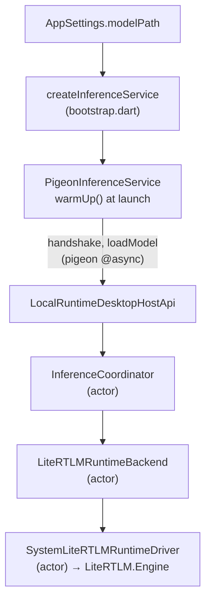

# The model

Between "the user picks a model" and "tokens arrive" there are five hops, two
of them across a language boundary and one across a vendored C++ runtime. Most
of this document is about the places where those hops can leave something
behind: a half-downloaded file that looks installed, a sandbox permission that
expired overnight, or a decode that cannot be stopped.

## The files

| File | Owns |
|---|---|
| `lib/features/model/model_catalog.dart` | The curated list: sizes and hashes, pinned |
| `lib/features/model/model_file_service.dart` | Downloading, resuming, verifying, and putting the file in place |
| `lib/features/model/model_download_manager.dart` | App-scoped download state that outlives the settings sheet |
| `lib/app/bootstrap.dart` (`createInferenceService`) | Which runtime is built for a given model path |
| `lib/features/conversation/swappable_inference_service.dart` | Changing the model under a live conversation |
| `macos/Runner/ChosenModelAccess.swift` | The sandbox permission for a file chosen outside the app |
| `macos/Runner/LocalRuntimeHostAdapter.swift` | Pigeon → `InferenceCoordinator`; the open panel |
| `native/inference_service/Sources/InferenceService/InferenceService.swift` | `InferenceCoordinator`: lifecycle, fencing, bounded shutdown |
| `native/inference_service/Sources/InferenceService/LiteRTLMRuntimeBackend.swift` | The LiteRT-LM actor: load, generate, cancel, drain |
| `native/vendor/litert_lm/` | The vendored Swift wrapper over LiteRT-LM |

Tests: `test/features/model/model_file_service_test.dart`,
`model_download_manager_test.dart`, `test/app/model_default_test.dart`,
`test/features/settings/settings_model_rows_test.dart`,
`test/features/conversation/swappable_inference_service_test.dart`,
`macos/RunnerTests/ChosenModelAccessTests.swift`,
`native/inference_service/Tests/InferenceServiceTests/LocalModelRuntimeTests.swift`,
and the two integration probes `integration_test/litert_bridge_probe_test.dart`
and `litert_gemma_vertical_slice_test.dart`.

## The first launch

With no model installed the app opens on `FirstRun` rather than on the
conversation. Behind it the conversation answers from the built-in preview,
which says the same thing every time; letting the user talk to that first is
the app pretending to work.

It offers one model — `recommendedModel` — not the catalogue. A first launch
has exactly one decision to make and a list turns it into a comparison nobody
arriving is equipped to make. The rest is in settings, for later.

`Look around first` puts it away for the session. It is not persisted: an app
with nothing to think with still has one thing to do, so the next launch
offers it again. Installing a model is what retires it, because the offer is
only made while `settings.modelPath` is empty.

## The catalog

Two entries, both official LiteRT community conversions of Gemma 4 (E4B
recommended, E2B lighter), each pinning an **exact** byte count and a SHA-256
from the model card. Curated rather than fetched, because a list the app
cannot be surprised by is a list it can verify downloads against — and because
the exact size is what tells a finished download apart from a truncated one.

`sha256` is nullable only so test fixtures can skip verification; the catalog
test refuses a real entry without one.

## Getting the bytes down

`ModelFileService.download` is a stream of progress and a small pile of
refusals. The order matters:

1. Bytes go into `{destination}.part`, never the destination. A crash or a
   dropped connection can then never leave behind something that looks like an
   installed model.
2. A `.part` from a previous attempt is picked back up with a `Range` header —
   gigabytes on a flaky network are worth keeping. A `.part` **longer** than
   the catalog's size is a corrupt past, not progress, and is discarded.
3. SHA-256 is computed as the bytes stream, and a resumed attempt hashes the
   kept prefix from disk first, so the pin still covers the whole file without
   a second pass over gigabytes.
4. Three separate refusals at the end: the stream ended short of what the
   sender promised; the total disagrees with the **catalog** (the upstream
   file changed, or it is not the model at all — and `isInstalled` would call
   it not-installed forever); the hash disagrees with the pin.
5. Only then `renameSync` into place. `isInstalled` is `exists && length ==
   sizeBytes`, so the file is either whole or absent.

Failure handling distinguishes the two kinds. A network error leaves the
`.part` for next time; a `StateError` — the catalog disagreements above —
deletes it, or every retry would refuse the same corrupt bytes forever.

The default HTTPS fetcher pipes the response through a controller rather than
returning it directly, because a consumer that cancels mid-download fires
neither `done` nor `error` and the client and its socket would outlive the
download they carried.

`ModelDownloadManager` sits above that and is owned by `AppComposition`, not
by any sheet: a multi-gigabyte download has to survive the settings being
closed. It notifies on **whole percents** only — a download arrives in tens of
thousands of chunks and every notification rebuilds whoever is watching on the
UI isolate. A failure is remembered per entry and cleared the moment the model
is asked for again, because the failure belongs to the attempt.

## Choosing one

Three ways a model path gets into settings:

- **Adoption at launch.** `_loadSettings` in `lib/app/app.dart`: if nothing
  has been chosen but the recommended model is already installed, use it and
  write that down. A deliberate choice, once made, is never overridden.
- **The catalog rows** in the settings sheet: Download, or Use if it is
  already there.
- **`Choose…`**, which opens `NSOpenPanel` through
  `LocalRuntimeDesktopHostApi.chooseModelFile`. Cancelling returns an empty
  string — an answer, not a failure: it means the user kept what they had.

That last path is the one with the sandbox in it. **The open panel grants
access for one run only.** Left at that, the model chosen today is a path in
settings pointing at a file the app is no longer allowed to open — which looks
exactly like having chosen no model at all. `ChosenModelAccess` writes the
grant down as a security-scoped bookmark at the moment the panel hands it over
(`remember`), and takes it up again before every load (`beginReading`, called
from `loadModel`). `unloadModel` gives every held permission back, because a
sandboxed app that keeps taking them without returning them runs out.

A model inside the app's own container needs none of this and is simply
readable — which is why the downloaded catalog models never touch bookmarks.

## Loading

**Loading starts at launch, not at the first prompt.** `createInferenceService`
fires `warmUp()` and deliberately drops its failure: the readiness attempt is
cleared when it fails, so the first real prompt retries and reports the error
through the conversation where the user can actually see it. A model path that
is empty builds `DeterministicFakeInferenceService` instead — one canned
answer, no weights. A canned answer therefore means the runtime is *working*,
not that the model failed.

The handshake is checked before the load: a runtime that does not report both
streaming and cancellation is refused as `runtimeUnavailable` rather than
being loaded and found wanting later.

Native context is `localModelContextSize = 4096` and one answer may run to
`localAnswerTokenBudget = 2048` — half, so the other half holds the
conversation. The previous budget of 512 cut real answers off mid-sentence,
which reads as broken rather than concise.

### The Swift package

`native/inference_service` is a plain SwiftPM package with no Flutter in it,
which is what lets `swift test` exercise the whole lifecycle without a window.
It has three parts:

- **`InferenceCoordinator`** — an actor, and the single arbiter. It owns the
  model state machine (`idle` / `loading` / `loaded`), the one-generation-at-
  a-time slot, cancellation and unload operations, and a shutdown with a real
  deadline (`SystemRuntimeShutdownDeadlineFactory`, 5s) so termination cannot
  hang on a running decode. Because it is an actor, loading gigabytes stays off
  the main thread while remaining a plain `await` away from the Runner.
- **`GenerationEventBridge`** — the outbound side: it enforces one active
  generation, strictly increasing sequences, and coalesces deltas over 10ms.
  It also keeps a small list of stale generation ids so a cancelled
  generation's late events cannot re-open the bridge. `cancelGeneration` is
  called from the host adapter after a successful cancel, and skipping it
  leaves the bridge pinned to the cancelled generation, which then rejects the
  *next* turn's `started` event and leaves that turn producing nothing at all.
- **`LiteRTLMRuntimeBackend`** — the actor that actually talks to LiteRT-LM,
  through a `LiteRTLMRuntimeDriving` seam so the tests can drive it without a
  model file.

`LiteRTLMCompileSmoke` is a tiny executable target that builds an
`EngineConfig` against a nonexistent path and prints the backend name — a
link-time check that the vendored runtime is still wired up.

### GPU first, CPU if not

`LiteRTLMRuntimeConfiguration.defaultBackend` is `.gpu` on arm64. A load that
throws falls back to CPU with `activeProcessorCount - 1` threads, once, and
only when the primary really was GPU; both failing is `modelLoadFailed`.
Compilation artefacts are cached under
`~/Library/Caches/FlutterLocalAgent/LiteRTLM`.

`validateModel` is deliberately picky before any of that: the extension must
be `.litertlm`, and the path must `lstat` as a regular file that `access(R_OK)`
can read — so a file whose sandbox permission was never restored fails as
`modelNotInstalled` rather than somewhere inside the runtime.

## What the model remembers

`sessionId` is the conversation's id, and `SystemLiteRTLMRuntimeDriver` keeps
one LiteRT-LM `Conversation` object per session for as long as the engine is
loaded. One session is not a conversation at all: `memory-extraction` is
taken and released around every run of the memory pass, which is the only
caller that releases after each use rather than when something is deleted —
a pass that kept its session would accumulate the whole day into a prompt
that is supposed to be one sentence long. See
[agent-profile.md](agent-profile.md). The prompt sent for each turn is the **user's message alone** —
`PigeonInferenceService` passes `context: const <String>[]`.

Two consequences follow and both are worth knowing before changing anything
here:

- Continuity within a run is the native `Conversation`'s, not the app's.
- Reopening a stored conversation after a relaunch, or after a model swap,
  shows the user their history but gives the model none of it. The text is on
  screen; the session behind it is new.

`sessionSamplers` records what a session has most recently been asked for.
It used to *refuse* a mismatch, and this paragraph used to end "so this only
bites if those become user-visible" — which is exactly what happened when
`AnswerStyle` became a setting. Refusing failed the turn the user had just
asked and every turn after it in that conversation.

It no longer refuses. The sampler is fixed in `ConversationConfig` at
`createConversation` and `sendMessageStream` has no argument for it, so a
changed sampler cannot be applied to a live conversation at all — it is
handled where the system instruction already is, by rebuilding the
conversation and re-seeding from history. `conversationSamplers` holds what
each live conversation was actually built with, and the two maps differ
exactly when the user has changed the style and the rebuild has not happened
yet. One prefill, never a model load.

## Cancelling, and the drain

The single most surprising piece of behaviour in the native layer:

> LiteRT-LM v0.14.0's `CancelProcess` **does not end the running task**. It
> leaves one active task in the callback thread pool permanently, which wedges
> the engine so completely that a later generation only ever reports `started`,
> and even `unloadModel` blocks. Measured against the real Gemma artifact, the
> engine never recovered across four minutes.

Cancelling the Swift task cannot help either — the loop is suspended awaiting
a stream that has stopped yielding. So `LiteRTLMRuntimeBackend.cancelGeneration`
**abandons** the decode instead of stopping it:

1. `activeGeneration = nil` first, which fences any chunk still in flight.
2. The task is moved to `drainingGeneration` with its token, and left to
   finish on its own token budget with its output discarded.
3. A terminal `cancelled` event is emitted anyway — the coordinator only
   releases its one generation slot when it observes a terminal event, so
   skipping this would leave every later generation rejected as busy for the
   lifetime of the process.
4. The next `startGeneration` waits for the drain, polling at 50ms up to
   `drainTimeoutSeconds = 120`, then reports `runtimeUnavailable`. The wait is
   bounded on purpose: an unbounded one turns any runtime stall into a
   permanently unresponsive app.

`unloadModel` clears the pending drain outright, because it refers to an
engine that is about to be torn down and must not block the generation that
follows a reload.

## Swapping the model without restarting

The conversation and its repository are built once at launch and hold one
`InferenceService` for as long as they live. `SwappableInferenceService` sits
in that one place and exchanges what is behind it, which is the only part that
actually has to change. `AppComposition.useModel` → `replaceWith` →
`createInferenceService` with the new path.

Three decisions inside it:

- **Fenced when the change is asked for, not when it runs.**
  `_changesUnderway` is incremented synchronously, so a prompt that arrives in
  between belongs to neither model and is refused with a sentence that says so
  ("Lulo is changing the model it thinks with. Try again in a moment.")
  rather than failing as though something broke.
- **Released first, built second.** These models are gigabytes; holding two at
  once to save a few seconds of overlap is the wrong trade. For those seconds
  there is genuinely nothing to ask.
- **Two changes in quick succession queue rather than race**, or the second
  would release a model the first is still building. A `build` that throws
  leaves nothing installed, deliberately: the old model has already gone and
  pretending otherwise would leave the user talking to the model they thought
  they had just replaced.

The app only calls `useModel` when the path actually changed
(`_changeSettings` compares first) — every other switch on the settings sheet
would otherwise pay for a multi-gigabyte reload.

## Traps

Ranked by how quietly they break.

1. **Removing the terminal event from `cancelGeneration`.** It looks redundant
   next to the acknowledgement. The coordinator's generation slot is never
   released and every later turn is refused as busy — for the rest of the
   process, with no error anywhere.
2. **Skipping `eventBridge.cancelGeneration` after a successful cancel.** The
   bridge stays pinned to the dead generation and silently drops the next
   turn's `started`.
3. **Calling LiteRT-LM's `CancelProcess` and treating the decode as over.**
   Read the drain section first.
4. **Making the drain wait unbounded** "so cancellation is reliable". It
   converts a runtime stall into a hung app.
5. **Dropping the `.part` file and streaming straight to the destination.** An
   interrupted download then looks installed until the size check happens to
   run, and `isInstalled` disagrees with the disk forever.
6. **Forgetting `ChosenModelAccess.remember` on a new path-entry point.** It
   works perfectly until the next launch, when the model silently becomes "no
   model chosen".
7. **Holding both models across a swap** to avoid the gap. Gigabytes, twice.
8. **Assuming the model can see the conversation on screen.** It cannot; see
   *What the model remembers*.
