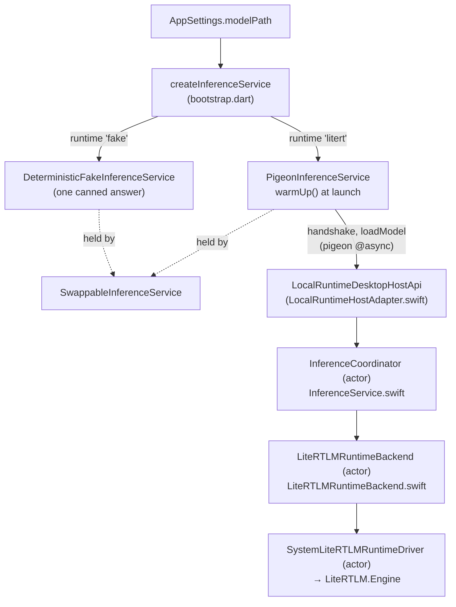
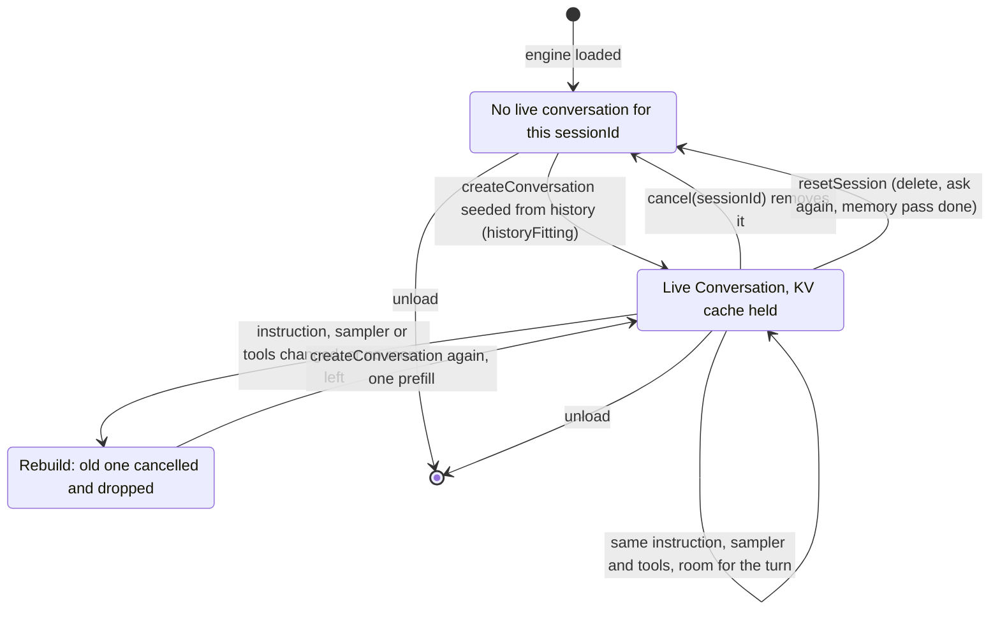
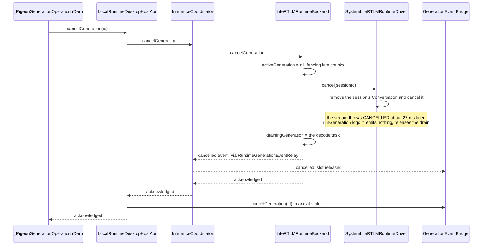

# The model

Between "the user picks a model" and "tokens arrive" there are five hops, two
of them across a language boundary and one across a vendored C++ runtime. This
document follows a model from the catalogue to the engine and a turn from Dart
to LiteRT-LM and back. Most of it is about the places where those hops can
leave something behind: a half-downloaded file that looks installed, a sandbox
permission that expired overnight, a decode still holding the engine after the
user pressed stop, or a conversation a cancel left dead that refuses every
turn after it.

## The files

| File | Language | Owns |
|---|---|---|
| `lib/features/model/model_catalog.dart` | Dart | The curated list: sizes and hashes, pinned |
| `lib/features/model/model_file_service.dart` | Dart | Downloading, resuming, verifying, and putting the file in place |
| `lib/features/model/model_download_manager.dart` | Dart | App-scoped download state that outlives the settings sheet |
| `lib/features/model/first_run.dart` | Dart | The one-model offer on a first launch |
| `lib/app/bootstrap.dart` (`createInferenceService`, `buildToolbox`) | Dart | Which runtime is built for a given model path, and the toolbox every model is handed |
| `lib/features/conversation/swappable_inference_service.dart` | Dart | Changing the model under a live conversation |
| `lib/features/conversation/pigeon_inference_service.dart` | Dart | Readiness, the request each turn sends, the tool loop's Dart half |
| `macos/Runner/AppDelegate.swift` | Swift | Wiring backend → relay → coordinator → event bridge |
| `macos/Runner/ChosenModelAccess.swift` | Swift | The sandbox permission for a file chosen outside the app |
| `macos/Runner/LocalRuntimeHostAdapter.swift` | Swift | Pigeon → `InferenceCoordinator`; the open panel; the host half of `search_places` and `read_calendar` |
| `native/inference_service/Sources/InferenceService/InferenceService.swift` | Swift | `InferenceCoordinator` (lifecycle, fencing, bounded shutdown) and `GenerationEventBridge` |
| `native/inference_service/Sources/InferenceService/LiteRTLMRuntimeBackend.swift` | Swift | `LiteRTLMRuntimeBackend` (load, generate, cancel, drain, the window budget) and `SystemLiteRTLMRuntimeDriver` (one live LiteRT-LM `Conversation` per session) |
| `native/vendor/litert_lm/` | Swift | The vendored LiteRT-LM **v0.16.0** wrapper and its four local patches, listed in `PATCHES.md` |

`pigeons/desktop_host_api.dart` defines the boundary; `lib/generated/` and
`macos/Runner/GeneratedDesktopHostApi.swift` are generated from it and are not
read as hand-written code.

## The first launch

With no model installed the app opens on `FirstRun` rather than on the
conversation. Behind it the conversation answers from the built-in preview,
which says the same thing every time; letting the user talk to that first is
the app pretending to work.

It offers one model — `recommendedModel` — not the catalogue. A first launch
has exactly one decision to make and a list turns it into a comparison nobody
arriving is equipped to make. The rest is in settings, for later.

`Look around first` puts it away for the session. It is not persisted: an app
with nothing to think with still has one thing to do, so the next launch
offers it again. Installing a model is what retires it, because the offer is
only made while `settings.modelPath` is empty.

## The catalog

Three entries, all official LiteRT community conversions of Gemma 4, each
pinning an **exact** byte count and a SHA-256 from the model card: E4B
(recommended, and first), E2B (lighter), and 12B. Curated rather than fetched,
because a list the app cannot be surprised by is a list it can verify
downloads against — and because the exact size is what tells a finished
download apart from a truncated one.

12B is the one Google packaged for laptops and the strongest answers on offer,
and it is **deliberately last and not `recommended`**. The comment above its
entry records its time to first token on an M4 at 4.2s, against the 362ms a
settled voice turn is held to: worth choosing on purpose, wrong to hand to a
first launch. On an M1 Pro it is worse than slow —
[tool-calling-readiness.md](../decisions/tool-calling-readiness.md) measured a
59.5s engine load, a 17.4s first token, and roughly one generation in seven
killed by a GPU readback timeout. The entry is the plain bundle, not the
`-gpu` one beside it, whose size does not match the one the model card
benchmarks.

`sha256` is nullable only so test fixtures can skip verification; the catalog
test refuses a real entry without one.

## Getting the bytes down

`ModelFileService.download` is a stream of progress and a small pile of
refusals. The order matters:

1. Bytes go into `{destination}.part`, never the destination. A crash or a
   dropped connection can then never leave behind something that looks like an
   installed model.
2. A `.part` from a previous attempt is picked back up with a `Range` header —
   gigabytes on a flaky network are worth keeping. A `.part` **longer** than
   the catalog's size is a corrupt past, not progress, and is discarded. A
   `.part` **exactly** the catalog's size skips the fetch and goes straight to
   verification: every byte is home and only the rename is missing, and asking
   for the range after the end returns 416 rather than the 206 a resume needs —
   a failure that is not a `StateError`, so it used to keep the file and wedge
   every retry the same way.
3. SHA-256 is computed as the bytes stream, and a resumed attempt hashes the
   kept prefix from disk first, so the pin still covers the whole file without
   a second pass over gigabytes.
4. Three separate refusals at the end: the stream ended short of what the
   sender promised; the total disagrees with the **catalog** (the upstream
   file changed, or it is not the model at all — and `isInstalled` would call
   it not-installed forever); the hash disagrees with the pin.
5. Only then `renameSync` into place. `isInstalled` is `exists && length ==
   sizeBytes`, so the file is either whole or absent.

Failure handling distinguishes the two kinds. A network error leaves the
`.part` for next time; a `StateError` — the catalog disagreements above —
deletes it, or every retry would refuse the same corrupt bytes forever.

The default HTTPS fetcher pipes the response through a controller rather than
returning it directly, because a consumer that cancels mid-download fires
neither `done` nor `error` and the client and its socket would outlive the
download they carried.

`ModelDownloadManager` sits above that and is owned by `AppComposition`, not
by any sheet: a multi-gigabyte download has to survive the settings being
closed. It notifies on **whole percents** only — a download arrives in tens of
thousands of chunks and every notification rebuilds whoever is watching on the
UI isolate. A failure is remembered per entry and cleared the moment the model
is asked for again, because the failure belongs to the attempt.

## Choosing one

Three ways a model path gets into settings:

- **Adoption at launch.** `_loadSettings` in `lib/app/app.dart`: if nothing
  has been chosen but the recommended model is already installed, use it and
  write that down. A deliberate choice, once made, is never overridden.
- **The catalog rows** in the settings sheet: Download, or Use if it is
  already there.
- **`Choose…`**, which opens `NSOpenPanel` through
  `LocalRuntimeDesktopHostApi.chooseModelFile`. Cancelling returns an empty
  string — an answer, not a failure: it means the user kept what they had.

That last path is the one with the sandbox in it. **The open panel grants
access for one run only.** Left at that, the model chosen today is a path in
settings pointing at a file the app is no longer allowed to open — which looks
exactly like having chosen no model at all. `ChosenModelAccess` writes the
grant down as a security-scoped bookmark at the moment the panel hands it over
(`remember`), and takes it up again before every load (`beginReading`, called
from `loadModel`). `unloadModel` gives every held permission back, because a
sandboxed app that keeps taking them without returning them runs out.

A model inside the app's own container needs none of this and is simply
readable — which is why the downloaded catalog models never touch bookmarks.

## Loading

**Loading starts at launch, not at the first prompt.** `createInferenceService`
fires `warmUp()` and deliberately drops its failure: the readiness attempt is
cleared when it fails, so the first real prompt retries and reports the error
through the conversation where the user can actually see it. While it runs,
`modelLoading` is true and the conversation says so ("Loading the model…") —
the load was measured at 3.7–8.5s against 1.5s for the first answer once the
model is in memory, and a question asked inside that window would otherwise
wait with nothing to explain the wait. It is cleared on failure as well as
success.

Which runtime is built is decided by the caller, not by the path: `main.dart`
asks for `'litert'` only when a model path is set and the process is not an
XCTest host, and `AppComposition.changeModel` asks for `'fake'` when the new
path is empty. `createInferenceService` itself refuses `'litert'` with an empty
path. `'fake'` builds `DeterministicFakeInferenceService` — one canned answer,
no weights. A canned answer therefore means the runtime is *working*, not that
the model failed.

The handshake is checked before the load: a runtime that does not report both
streaming and cancellation is refused as `runtimeUnavailable` rather than
being loaded and found wanting later.

Native context is `localModelContextSize = 4096` and one answer may run to
`localAnswerTokenBudget = 2048` — half, so the other half holds the
conversation. The previous budget of 512 cut real answers off mid-sentence,
which reads as broken rather than concise. The window is the **same for every
model**, 12B included: it is one constant in `bootstrap.dart`, and
`LiteRTLMRuntimeBackend.validateModel` takes it from the request, not from the
file.

### The Swift package

`native/inference_service` is a plain SwiftPM package with no Flutter in it,
which is what lets `swift test` exercise the whole lifecycle without a window.
It has three parts:

- **`InferenceCoordinator`** — an actor, and the single arbiter. It owns the
  model state machine (`idle` / `loading` / `loaded`), the one-generation-at-
  a-time slot, cancellation and unload operations, and a shutdown with a real
  deadline (`SystemRuntimeShutdownDeadlineFactory`, 5s) so termination cannot
  hang on a running decode. Because it is an actor, loading gigabytes stays off
  the main thread while remaining a plain `await` away from the Runner. A
  `toolCall` event is terminal here exactly like `completed` (`isTerminal`),
  which is why every tool continuation is a new generation.
- **`GenerationEventBridge`** — the outbound side: it enforces one active
  generation, strictly increasing sequences, and coalesces deltas over 10ms
  (`AppDelegate` passes `coalescingMilliseconds: 10`; the initializer accepts
  8–16). It also keeps a small list of stale generation ids so a cancelled
  generation's late events cannot re-open the bridge. `cancelGeneration` is
  called from the host adapter after a successful cancel, and skipping it
  leaves the bridge pinned to the cancelled generation, which then rejects the
  *next* turn's `started` event and leaves that turn producing nothing at all.
- **`LiteRTLMRuntimeBackend`** — the actor that actually talks to LiteRT-LM,
  through a `LiteRTLMRuntimeDriving` seam so the tests can drive it without a
  model file. The production driver, `SystemLiteRTLMRuntimeDriver`, is where
  the live conversations are held and where every decision about reusing or
  rebuilding one is made — see *What the model remembers*.

`AppDelegate` wires them together: the backend emits into a
`RuntimeGenerationEventRelay`, which buffers until the coordinator attaches so
a generation that finishes during wiring is not lost; the coordinator's
`receiveGenerationEvent` sequences and fences each event and hands it to the
bridge, which delivers it to Dart on the main queue.

`LiteRTLMCompileSmoke` is a tiny executable target that builds an
`EngineConfig` against a nonexistent path and prints the backend name — a
link-time check that the vendored runtime is still wired up.

### GPU first, CPU if not

`LiteRTLMRuntimeConfiguration.defaultBackend` is `.gpu` on arm64. A load that
throws falls back to CPU with `activeProcessorCount - 1` threads, once, and
only when the primary really was GPU; both failing is `modelLoadFailed`.
Compilation artefacts are cached under
`~/Library/Caches/FlutterLocalAgent/LiteRTLM`.

The vision executor rides along on the same backend
(`EngineConfig(visionBackend:)` in `SystemLiteRTLMRuntimeDriver.load`). It was
measured before being enabled at about 0.5s added to an engine load and
nothing to a text turn, with a look at 5.7s end to end; it is what lets a
question carry the invited look's screenshot (`imagePath`).

`validateModel` is deliberately picky before any of that: the extension must
be `.litertlm`, and the path must `lstat` as a regular file that `access(R_OK)`
can read — so a file whose sandbox permission was never restored fails as
`modelNotInstalled` rather than somewhere inside the runtime.

## What the model remembers

Each turn crosses the boundary as one `DesktopGenerationRequest`, built in
`_PigeonGenerationOperation.start` (`pigeon_inference_service.dart`):

- **`systemInstruction`** — the stable half of `AgentPromptContext`: who the
  agent is and how it answers, identical for every turn of a conversation in
  one language and never containing the question. It becomes the LiteRT-LM
  conversation's system message, so it is prefilled once per conversation
  rather than with every question. Sending it inside every user message was
  measured at 1648ms to the first token against 362ms for a settled Chinese
  turn; see [voice-turn-latency.md](../decisions/voice-turn-latency.md).
- **`prompt`** — the turn half, `turnInstruction`: the question exactly once,
  with what it brought — the memories it made relevant, the clock, and up to
  `maxDocumentCharacters` of an open document. How it is composed is
  [agent-profile.md](agent-profile.md)'s subject.
- **`history`** — the turns already on screen, read in
  `ConversationViewModel.submit` *before* the new question joins them, so the
  question is not put to the model twice.
- **`toolsJson`** and **`imagePath`** — the toolbox's declarations, and the
  screenshot when the user asked for a look.
- **`context`** — always `const <String>[]`. It still reaches
  `sendMessageStream` as `extraContext`, empty.

An **aside** — a `GenerationRequest` carrying `instruction`, which today means
the memory pass — replaces the composed system instruction with its own and
sends no tools. The reasons are in
[conversation.md](conversation.md) under *Asides*.

`SystemLiteRTLMRuntimeDriver` keeps one LiteRT-LM `Conversation` per
`sessionId` — the conversation's id — for as long as the engine is loaded,
and `history` is consulted **only when no live conversation exists** for that
session (`RuntimeGenerationRequest.history`). So the model has two different
memories of the same conversation, depending on whether the runtime already
holds it:

- **Held:** the KV cache, which contains every earlier turn *as it was sent* —
  the whole turn instruction with its clock, memories and document passages —
  and every answer. Not the clean transcript on screen.
- **Not held** (the first turn after a launch, after a model swap, after a
  cancel, after a rebuild): a new conversation seeded from the history on
  screen, trimmed from the oldest end by `historyFitting`.

A live conversation is rebuilt — cancelled, dropped, and created again from
the trimmed history — whenever it no longer matches what the turn needs,
because none of these can be amended inside a prefilled KV cache. The checks
are all in `SystemLiteRTLMRuntimeDriver.generate`:

- the **system instruction** changed (an edited profile, a different
  language, a switch between typed and spoken answers);
- the **sampler** changed (an answer style the user picked) — the sampler is
  fixed in `ConversationConfig` and `sendMessageStream` has no argument for
  it;
- the **tool declarations** changed — they render into the same system turn
  the instruction does;
- the conversation has **no room left for this turn**
  (`liveConversationHasRoomForTurn`, see below).

Each costs one prefill of the history, never a model load.

### The window, on both paths

`historyFitting` bounds the window where a conversation is **built**:
`maxOutputTokens`, the prompt, the system instruction **plus the tool JSON**,
800 tokens for a picture (`imageTokenEstimate`), and six tokens of turn
markers per turn are reserved first, and the history keeps as much of its tail
as fits. LiteRT-LM cannot tokenize a string, so `estimatedTokenCount` charges
one token per three UTF-8 bytes — about right for Han, high for English, and
deliberately never low, because an overflow does not degrade: it arrives as an
empty, failed answer.

That alone ran only once per conversation. Every later turn goes to the
conversation the runtime already holds, and what accumulates in its cache is
the whole turn instruction plus the answer — measured against the app's own
defaults at 103 tokens a turn in Chinese with nothing open and 224 with a
document open, so 38 and 17 turns before a 4096-token window is gone.
`liveConversationHasRoomForTurn` now charges the next turn the same way
`historyFitting` does, against `Conversation.getTokenCount()` — an exact count
read back from the cache — and a conversation without room is rebuilt from the
trimmed history, which sheds the accumulated clocks and passages and keeps what
the conversation was about. A runtime that will not report its count leaves
the conversation alone. See
[the-window-guard-only-ran-once.md](../decisions/the-window-guard-only-ran-once.md).

### The sampler, and the record nobody reads

A changed sampler used to be *refused*, which was harmless while the app sent
the same three numbers forever and stopped being harmless when `AnswerStyle`
became a setting: refusing failed the turn the user had just asked and every
turn after it in that conversation. It is now one of the rebuild triggers
above, decided by the driver's `conversationSamplers` — what each live
conversation was actually built with — against the request's sampler.

`LiteRTLMRuntimeBackend.sessionSamplers`, which records what each session was
most recently asked for, is still written on every `startGeneration` and
cleared on reset and unload, but nothing reads it any more.

### Sessions that are not conversations, and the one slot

One session is not a conversation at all: `memory-extraction`
(`AgentMemoryExtractor.session`) is taken and released around every run of
the memory pass — a pass that kept its session would accumulate the whole day
into a prompt that is supposed to be one sentence long. See
[agent-profile.md](agent-profile.md).

The runtime has **one generation slot**, and the memory pass uses it.
`ConversationViewModel.submit` awaits `BetweenTurns.yieldSlot()` before every
question, which cancels an extraction in flight and drops anything queued —
an extraction still on the runtime would get the user's question refused as
`generationBusy`, and a refused question cannot be un-refused.

### Anything that rewrites the past releases the session

Because a held conversation remembers its cache rather than the store,
anything that changes what was said has to drop it:
`ConversationRepository.deleteConversation` and `dropFromLastQuestion` (behind
`重新回答` and the in-place rewrite) both call `releaseSession`, so the next
turn is seeded from what the store now says. `PigeonInferenceService.releaseSession`
cancels any generation still running in that session **before** it resets it —
see trap 1.

## Tool calls at the runtime boundary

The tool loop is Dart's — what exists, what it may do, and how many rounds it
gets are in [conversation.md](conversation.md) under *Tools* and in
[tools-declared-in-dart-loop-in-dart.md](../decisions/tools-declared-in-dart-loop-in-dart.md).
The runtime's part is narrow:

- Declarations arrive as opaque JSON and go into `ConversationConfig` through
  the vendored `toolDeclarationsJson`, with `automaticToolCalling: false`, so
  the stream hands calls back instead of looking for Swift tool types that do
  not exist. Both depend on local patches 3 and 4 in
  `native/vendor/litert_lm/PATCHES.md`.
- A streamed message carrying `toolCalls` becomes a `.toolCalls` chunk, and
  `LiteRTLMRuntimeBackend.receiveToolCalls` ends the generation with a
  terminal `toolCall` event. It is terminal in the coordinator and the bridge
  too, so the slot is released while Dart runs the tools.
- The continuation is a new generation (`<id>-tools-<n>`) on the same session,
  carrying `toolResponsesJson` instead of a prompt and repeating the first
  phase's `systemInstruction` and `toolsJson` verbatim — either one changing
  would trip a rebuild, and a rebuilt conversation has forgotten the call it
  is answering. `maxToolRounds` is three; a fourth round fails the turn.

The host halves of two tools live in `LocalRuntimeDesktopHostApi`.
`searchPlaces` is `MKLocalSearch` with no region and no location — the query
goes out as the model wrote it — and a search that fails is logged and
answered as no places. `readCalendar` is read-only EventKit behind the system's
own permission dialog, asked the first time the tool is used rather than at
launch, and it returns `authorized` beside the events, because an empty window
means "free" only when the app was allowed to look.

## Cancelling, and the drain

Stopping an answer stops it — since LiteRT-LM **v0.16.0**. On v0.14.0
`CancelProcess` did not end the running task: it left one active task in the
callback thread pool permanently, the engine never recovered across four
minutes, and even `unloadModel` blocked. So `cancelGeneration` used to
*abandon* the decode, which went on burning its whole 2048-token budget
invisibly while the next question waited for it. Re-measured on v0.16.0 by
`CancelProbeTests`, the stream ends **27 ms** after `cancel()` and the engine
answers again **2.7 s** later, so `LiteRTLMRuntimeBackend.cancelGeneration`
now calls the driver's cancel:

1. `activeGeneration = nil` first, which fences any chunk still in flight.
2. `driver.cancel(sessionId:)`, which **removes** the session's conversation
   rather than only cancelling it. A conversation `cancel()` has stopped is
   dead for good — every later `sendMessageStream` on it throws `CANCELLED:
   Task cancelled` immediately. `CancelProbeTests` had only ever asked a fresh
   conversation; `CancelSameSessionProbeTests` walks the production path and
   failed exactly that way before the fix, which was observed live as every
   answer after a barge-in failing for the rest of the session. Removing it
   sends the next turn down the rebuild path.
3. The task is moved to `drainingGeneration` with its token. The drain stays:
   it is what guarantees two decodes never overlap on one engine, which is a
   property of the engine rather than of a runtime version. It now resolves in
   milliseconds, when the cancelled stream's throw reaches `runGeneration`.
4. A terminal `cancelled` event is emitted, exactly one
   (`testLiteRTLMBackendCancellationEmitsOneTerminalAndFreesTheSlot`).
5. The next `startGeneration` waits for the drain, polling at 50ms up to
   `drainTimeoutSeconds = 120`, then reports `runtimeUnavailable`. The wait is
   bounded on purpose: an unbounded one turns any runtime stall into a
   permanently unresponsive app.

Two fences keep a cancel and a start that cross from becoming a decode nobody
wants. In the backend, a cancel for a generation that is not active yet is
recorded in `cancelledBeforeStart`, so a start asleep in the drain wait aborts
as `cancelled` when it wakes instead of claiming the engine; and a waiter that
wakes to find another one already claimed the engine refuses as busy rather
than putting a second decode on it. In the coordinator,
`cancelledGenerationIds` refuses to start an id it has let go, still forwards
the cancel to the backend (whose cancel is idempotent), and an unacknowledged
cancel of a generation that never reached the backend gives the slot back.

`unloadModel` clears the pending drain outright, because it refers to an
engine that is about to be torn down and must not block the generation that
follows a reload.

## Swapping the model without restarting

The conversation and its repository are built once at launch and hold one
`InferenceService` for as long as they live. `SwappableInferenceService` sits
in that one place and exchanges what is behind it, which is the only part that
actually has to change. `AppComposition.useModel` → `replaceWith` →
`createInferenceService` with the new path. The memory extractor is built over
the swappable service too, so a swap moves the memory pass with it.

Three decisions inside it:

- **Fenced when the change is asked for, not when it runs.**
  `_changesUnderway` is incremented synchronously, so a prompt that arrives in
  between belongs to neither model and is refused with a sentence that says so
  ("Lulo is changing the model it thinks with. Try again in a moment.")
  rather than failing as though something broke.
- **Released first, built second.** These models are gigabytes; holding two at
  once to save a few seconds of overlap is the wrong trade. For those seconds
  there is genuinely nothing to ask. It is also the only order the runtime
  accepts: `LiteRTLMRuntimeBackend.loadModel` refuses a different model while
  one is loaded, as `modelLoadFailed`.
- **Two changes in quick succession queue rather than race**, or the second
  would release a model the first is still building. A `build` that throws
  leaves nothing installed, deliberately: the old model has already gone and
  pretending otherwise would leave the user talking to the model they thought
  they had just replaced.

The app only calls `useModel` when the path actually changed
(`_changeSettings` compares first) — every other switch on the settings sheet
would otherwise pay for a multi-gigabyte reload.

## Traps

Ranked by how quietly they break.

1. **Resetting a session that still has a generation running.**
   `LiteRTLMRuntimeBackend.resetSession` takes the active generation away
   without a terminal event, and `InferenceCoordinator.resetSession` passes
   straight through without touching its slot — so the slot stays claimed and
   every later turn is refused as busy, for the rest of the process.
   `PigeonInferenceService.releaseSession` cancels first for exactly this
   reason.
2. **Keeping a conversation a cancel stopped.** It answers nothing ever again,
   and the error it throws on every later turn reaches the user as a bare
   `generationFailed` with no reason. `runGeneration` now logs what threw,
   which is the only place the difference shows. Only opt-in probes can see
   this; the gate's driver is a spy.
3. **Skipping `eventBridge.cancelGeneration` after a successful cancel.** The
   bridge stays pinned to the dead generation and silently drops the next
   turn's `started`.
4. **Removing the drain because cancel is fast now.** The drain was never
   about speed; it is what keeps two decodes off one engine.
5. **Making the drain wait unbounded** "so cancellation is reliable". It
   converts a runtime stall into a hung app.
6. **Changing the instruction, the sampler or the toolbox between a tool call
   and its continuation.** The driver rebuilds the conversation, and the
   rebuilt one never made the call it is being answered for.
7. **Removing the terminal event from the backend's `cancelGeneration`.** On
   the coordinator's own cancel path this would no longer wedge the slot —
   `InferenceCoordinator.finishCancellation` emits a `cancelled` itself when
   the backend acknowledged and no terminal has arrived — but the backend
   tests pin exactly one terminal, and the backend's comment still says the
   slot depends on it.
8. **Dropping the `.part` file and streaming straight to the destination.** An
   interrupted download then looks installed until the size check happens to
   run, and `isInstalled` disagrees with the disk forever.
9. **Forgetting `ChosenModelAccess.remember` on a new path-entry point.** It
   works perfectly until the next launch, when the model silently becomes "no
   model chosen".
10. **Holding both models across a swap** to avoid the gap. Gigabytes, twice —
    and the backend refuses the second load anyway.
11. **Assuming the model sees the conversation the way the screen does.** A
    held conversation sees its own cache, clocks and passages included; the
    history on screen is read only when there is no held conversation.

## Where the tests are

In the gate, model-free:

- `test/features/model/model_file_service_test.dart` — the catalog (the
  recommended model first, 12B offered and not the default, every entry
  pinned), and every download refusal including the complete `.part`.
- `test/features/model/model_download_manager_test.dart`,
  `test/features/model/first_run_test.dart`, `test/app/model_default_test.dart`,
  `test/features/settings/settings_model_rows_test.dart`.
- `test/features/conversation/swappable_inference_service_test.dart` — the
  fence and its sentence, release-before-build, and a failed build leaving
  nothing half-installed.
- `test/features/conversation/pigeon_inference_service_test.dart` — readiness
  shared across generations, the exact request payload, the tool loop and its
  three-round cut-off, a cancel during a tool round, a start that outran its
  cancel, and "releasing a session cancels the generation still running in
  it" (trap 1).
- `native/inference_service/Tests/InferenceServiceTests/LocalModelRuntimeTests.swift`
  — the backend through `LiteRTLMRuntimeDriverSpy` and the coordinator through
  `RuntimeBackendSpy`: the drain, one terminal per cancel, a start cancelled
  while draining, one waiter per released drain, a tool-call chunk as a
  terminal, a changed sampler accepted rather than refused, the window budget
  on both paths (`testTheLiveCheckReservesTheSameRoomAsTheSeedingBudget`), the
  bounded shutdown, and the event bridge.
- `macos/RunnerTests/ChosenModelAccessTests.swift`.

Opt-in, against the real model — skipped unless `REAL_GEMMA_MODEL_PATH` is set
for `swift test`, or `--dart-define=LOCAL_MODEL_PATH` for the Flutter
integration probes:

- `CancelProbeTests` (27 ms to end the stream, 2.7 s to answer again) and
  `CancelSameSessionProbeTests` (the same session answers after a cancel),
  plus `testRealGemmaServesTheNextTurnAfterACancellation` in
  `LocalModelRuntimeTests`.
- `ToolLoopIntegrationTests`, `ToolCallProbeTests`,
  `PlaceCalendarToolProbeTests` — the native half of the tool loop and whether
  the model calls what it is offered.
- `WrittenPrefaceProbeTests`, `EnglishPrefaceProbeTests`,
  `BackgroundRecitalProbeTests`, `AnswerLengthProbeTests`,
  `RememberProbeTests` — what the composed instructions make the model do.
- `VisionProbeTests`, `FirstReplyLatencyTests`.
- `integration_test/litert_bridge_probe_test.dart` and
  `litert_gemma_vertical_slice_test.dart`.

## What is not done

- **The driver's own decisions are not in the gate.** Every reuse-or-rebuild
  rule and the removal on cancel live in `SystemLiteRTLMRuntimeDriver`, which
  needs a real engine; the gate tests the backend through a spy driver. A
  regression there is seen only by the opt-in probes above.
- **A tool continuation carries no history**, and the window check runs on it
  like any other turn. If that check ever rebuilt the conversation between a
  call and its continuation, the rebuilt conversation would start from the
  system instruction alone and would not hold the call. Whether a real turn
  can get that close to the edge is unverified.
- **There is no tokenizer.** Both window checks estimate; the estimate is
  deliberately high, so a conversation in Latin script is trimmed earlier than
  it needs to be.
- **Every model gets the same 4096 tokens**, the 12B included. Nothing reads
  the window a model file supports.
- **The drain still waits up to 120s**, a bound sized for v0.14.0's abandoned
  decodes. On v0.16.0 it resolves in milliseconds and the bound has not been
  revisited.
- **12B is offered but not measured as usable on every Mac.** The figures
  above come from an M4 and an M1 Pro; nothing in the app checks the machine
  before offering it.
