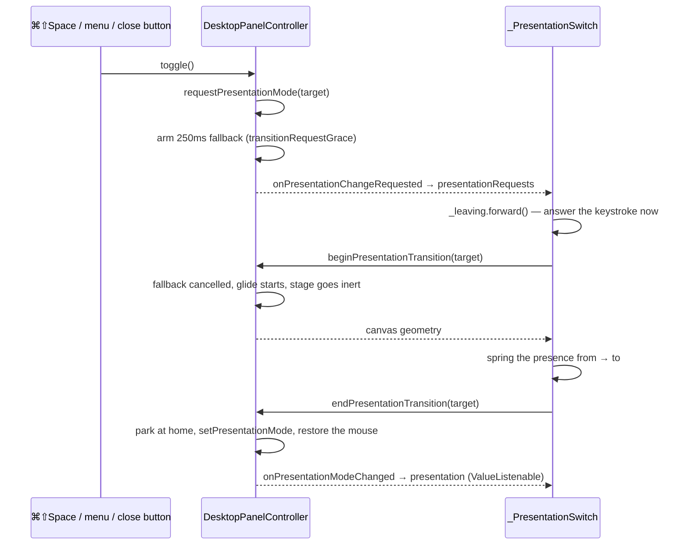

# Presence

The agent has two forms and one window. It rests on the desktop as an orb,
it is summoned into a conversation, and the same presence travels between the
two. Almost everything difficult here follows from the sentence "one window",
which is not an aesthetic choice — it is what the measurements left.

> **Read first.** The rules of this window are in the **"Window architecture"**
> section of [`AGENTS.md`](../../AGENTS.md) at the repository root. They are
> measured conclusions and this document does not restate them. What follows
> is how the thing works given those rules.

## The files

| File | Owns |
|---|---|
| `macos/Runner/DesktopPanelController.swift` | The stage: geometry, the two homes, click routing, the glide, per-form window behaviour |
| `macos/Runner/DesktopPanelController.swift` (`OrbInputPanel`, `OrbCatcherView`) | The orb's clicks, in a panel of their own |
| `macos/Runner/DesktopPanelController.swift` (`StagePassThroughView`) | Where the window answers the mouse at all |
| `macos/Runner/MainFlutterWindow.swift` | The one `NSPanel`, the one engine, the one view controller |
| `macos/Runner/AppDelegate.swift` | Wiring the panel's callbacks to the pigeon event API; the hotkey; the menus |
| `macos/Runner/GlobalHotKeyController.swift` | ⌘⇧Space, through Carbon |
| `lib/app/app.dart` (`_PresentationSwitch`) | The Dart half: which form is drawn, and the flight between them |
| `lib/features/presence/presence_flight.dart` | The spring, the arc, and how the conversation leaves |
| `lib/features/presence/desktop_orb_surface.dart` | The resting form, and the accessibility path into it |
| `lib/features/presence/agent_presence_orb.dart` | The orb itself: shader, fallback, motion budget |
| `lib/features/presence/agent_presence_state.dart`, `agent_presence_controller.dart` | Six states, their blend, and the audio envelope |
| `lib/platform/pigeon_desktop_host_service.dart` | The Dart side of the window boundary |

Tests: `macos/RunnerTests/DesktopPanelControllerTests.swift` (the stage, in a
real window — seventeen cases, including `testTheRestingAgentStandsInNobodysWay`
and `testAClickOnTheRestingOrbReachesTheCatcher`),
`test/app/presentation_switch_test.dart`, `test/app/reduced_motion_test.dart`,
`test/features/presence/presence_flight_test.dart`,
`desktop_orb_surface_test.dart`, `agent_presence_state_test.dart`,
`agent_presence_orb_controller_swap_test.dart`, and the golden set under
`test/features/presence/goldens/`.

## The stage

One `NSPanel` — `MainFlutterWindow`, which *is* the panel rather than owning
one — hosts one `FlutterEngine` for the app's whole life. Toggling forms never
creates a second of either
(`testToggleRetainsOnePanelAndOneFlutterEngine`).

The window's frame is the stage. Both forms are placed inside it:

```
┌─────────────────────────────────────┐  ← the window frame, unchanged by form
│                                     │
│          conversation               │
│          (the whole frame)          │
│                                     │
│                       ┌───────────┐ │
│                       │    orb    │ │  ← 168pt, in the lower trailing corner
└───────────────────────┴───────────┴─┘
```

`DesktopPanelController.transitionGeometry(conversation:orb:)` is a pure
function: it takes both screen rectangles, unions them into a canvas, and
restates each one from the canvas's **top-left with y growing downwards** —
Flutter's coordinate space, not AppKit's. That flip is the only place the two
coordinate systems meet, and it is tested without a window or a screen.

Because the orb lives *inside* the conversation's rectangle, that union is the
conversation's frame and nothing grows
(`testTransitionCanvasDoesNotGrowWhenOneFormAlreadyContainsTheOther`,
`testTheWindowIsNoBiggerThanTheConversationItIsShowing`). The window is
therefore the same size in both forms, which is the property the whole design
is built to keep.

`currentGeometry()` derives from `retainedPanel.frame` rather than
recomputing from the screen. A geometry that answered from the screen instead
is what kept snapping the window back to its birth corner on every change of
form.

### Two homes

| Form | Home | Why |
|---|---|---|
| Conversation | `rememberedExpandedFrame` — wherever the user last had it | An ordinary window stays where it was put |
| Orb | The current screen's lower trailing corner, `orbMargin = 32` from the edges | A resting place that wandered meant collapsing left the orb wherever work happened to be |

`homeFrame(for:)` changes only the origin; it takes the size from the current
frame in both cases. The window never resizes for a change of form — see
`AGENTS.md`.

`rememberExpandedFrame()` is called from `windowDidMove`, `windowDidResize`,
`setPresentationMode`, and `beginTransition`, and it records **only** while
the conversation is showing and not full screen. The orb going home to its
corner, or being dragged around the desktop, says nothing about where the user
wants their conversation. `setFrameAutosaveName("")` disables AppKit's own
frame restoration for the same reason: macOS would restore the orb's frame on
the next launch and the conversation would open at orb size.

`placeStageIfNeeded()` chooses a place exactly once, on first appearance
(720×560, by the lower trailing corner). After that the frame belongs to the
user.

## Click routing, in three layers

This is the part with the most ways to be subtly wrong, because the window
server — not the app — decides who owns a click on a see-through window.

1. **`StagePassThroughView.hitTest`** returns nil outside `interactiveRect`,
   which is the currently drawn form. That is what hands events to the window
   below, and it needs no permission to do it — watching the pointer with a
   global event monitor would, and without that permission the window could
   never notice the pointer coming back and would stay deaf forever.
2. **`ignoresMouseEvents`** is set while the orb is showing. Returning nil
   from a view's `hitTest` is *not enough* on a titled window: the window's
   own frame still takes the event, so the transparent stage stood as an
   invisible wall across the desktop. A resident assistant must not be in the
   way of anything.
3. **`OrbInputPanel`** gets the orb's own clicks back. Step 2 took them away
   along with everything else, so a separate borderless `NSPanel` the size of
   the orb is placed over it, drawing an **oval at 1% alpha**. Not nothing:
   the window server decides ownership from drawn alpha, so a catcher that
   painted nothing was not invisible but absent, and every click on the orb
   went through to the desktop. Anything below one part in 255 rounds away
   again.

   That tint has to be drawn to be there at all, so wherever it reaches past
   the orb it is the only thing on the pixel and its edge stands on the
   desktop as a faint circle. It therefore fills only `bodyFraction = 0.62`
   of the square — measured from the capture below, where the resting orb is
   still painting 90/255 at that radius. Filling the whole square put that
   edge a full half-side out, where the orb draws nothing at all, and took
   every click inside it away from whatever the user meant to hit.

### Where the presence stops

The orb is drawn into a square but is not one, and on the desktop the rest of
that square is the user's screen. `agentPresenceSilhouetteFraction = 0.75` is
where it ends, and `integration_test/agent_presence_silhouette_test.dart`
holds it there by running the real shader and reading the alpha back per ring
— a fragment program cannot be read for this, only measured.

The bound was found by breaking it. The shader's halo ran to `1.02` of the
square while the body's own density was gone by `0.65`, so from there out the
halo was the only thing painting: 23/255 at 0.70, still visible at 0.95. A
wide, even, barely-there field does not read as light coming off the orb. It
reads as a faint circle wrapped around it, darkest at the bottom because the
light sits top-left and that is the ring's shadow side. The halo now stops at
`fieldRadius + 0.12`, hugging the vapour instead of surrounding it, and the
measured profile ends at 0.725 in every state.

`OrbCatcherView` turns presses into a summon or a drag itself:
`acceptsFirstMouse` is true so the very first click works while the app is in
the background, and a press that travels more than `dragSlop = 3` points is a
drag rather than a click.

The Flutter gesture layer in `DesktopOrbSurface` therefore never sees a real
click. It is kept because assistive technology activates through Flutter
semantics rather than the mouse; removing it makes the resting agent
unreachable to VoiceOver. It also carries the drag-slop replay: a pan is only
recognised after the pointer has crossed the slop, and that travel is never
reported as a delta, so `onPanStart` gives it back explicitly or the orb
settles that far behind the cursor for the rest of the drag.

`updateInteractiveRect()` is the single place all three layers are set
together, and it is called after anything that moves the window.

## Who asks whom

The hotkey and the menu bar are native. If they simply moved the window, the
app would only ever learn about a change of form after it had happened, and
the presence could never be drawn travelling. So the panel **asks**:



The 250ms fallback exists because a hotkey that depends on the Dart side being
responsive is a hotkey that stops working under load
(`testAnUnansweredRequestStillMovesTheWindow`). When it fires,
`setPresentationMode` settles the window on its own and lands in the same
place a drawn transition would have.

That is also why `_PresentationSwitchState` listens to `presentation` as well
as to `presentationRequests`: `_followPresentation` snaps `_leaving` to match
a form change the app did not draw, or the conversation is left standing on a
desktop that has already collapsed.

The close button routes here too. `windowShouldClose` returns false and
requests the orb instead: Lulo is resident and has no closed state, only a
resting one. `File ▸ Close` (⌘W, installed in `AppDelegate`) does the same
thing.

## The collapse glide

Two clocks and a spring, on purpose.

**`_leaving`** (`AnimationController`, `leavingDuration = 190ms`) takes the
conversation away: opacity on a raised cosine, scale shrinking by
`_conversationShrink = 0.06`. It runs on the keystroke, *before* anything is
asked of the host, because `beginPresentationTransition` is a round trip that
costs about a quarter of a second with the screen otherwise completely still.
Leaving covers that wait.

The conversation is never removed from the tree while gone — the header anchor
the presence lands on is measured from its layout, and `Opacity` already skips
painting when there is nothing to see. It is also rounded *inside* the shrink
(`ClipRRect` within `Transform.scale`), because a rounding applied outside is
cut at a size the conversation no longer is and shows four square corners for
the duration.

**`_flight`** is an unbounded controller driven by a `SpringSimulation`:

```dart
SpringDescription(mass: 1, stiffness: 290, damping: 25)
```

Underdamped deliberately — it passes its destination slightly and comes back,
which is what reads as weight rather than repositioning. Tuning note worth
keeping: arrival time is set by the damped frequency
`sqrt(stiffness) · sqrt(1 - ζ²)`, so damping it harder makes it *slower* to
arrive, which is the opposite of what it looks like it should do. Speed comes
from stiffness.

`_flyTo` waits for the presence to be **home** (`_flight.value >= 1`), not for
the spring to stop wobbling. Those are far apart, and the window only settles
when that wait returns; waiting for the wobble left the agent motionless at
its destination with nothing happening around it. A `settling.orCancel`
guard completes the wait anyway if the spring somehow never arrives.

`presenceFlightRect` puts the position on a quadratic curve bowed
`_arcDepth = 0.16` of the distance perpendicular to the travel, and clamps the
result into the stage — the overshoot must not be drawn outside a window whose
edge is usually exactly where the presence comes to rest. Only the position is
pulled back; the size it reached is what it is.

On the native side, `beginTransition` starts the window gliding to the target
form's home **at the same time**, over 0.22s, ease-out, **origin only**.
Moving alongside the flight rather than after it is what makes the presence
appear to travel to the corner of the *screen* rather than to the corner of a
window that then jumps. `endTransition` parks the window exactly at that home
however far the glide got.

**Reduced motion takes none of this path.** If
`MediaQuery.maybeDisableAnimationsOf` is set, `_flyTo` sets `_leaving`
outright and calls begin/end back to back: the change of form itself, at once.
The travelling presence is ornament.

## What each form *is*, to macOS

`applyWindowBehaviour(for:)` reshapes the same window into two kinds of thing.

| | Orb | Conversation |
|---|---|---|
| Activation policy | `.accessory` — no Dock tile, no menu bar | `.regular` — its own menu bar |
| Level | `.floating`, or `.normal` if the user turned that off | `.normal` |
| `nonactivatingPanel` | inserted — never takes focus from what is being typed into | removed |
| `isFloatingPanel` | true | false — AppKit refuses to make a floating panel full screen |
| Full screen | `.fullScreenAuxiliary` — may sit over another app's full screen | `.fullScreenPrimary` — the green button works |
| Window buttons | hidden — chrome beside the vapour frames it as a window again | shown |

Spaces are decided by one setting for **both** forms
(`applySpaceBehaviour`). The conversation used to be tied to a single Space on
the reasoning that an ordinary window belongs to one — but this window is not
opened, it is summoned, and summoning activates the app, which is what makes
macOS carry the user off to wherever the window was tied
(`testSummoningTheConversationDoesNotCarryYouToAnotherSpace`).

The panel keeps `.titled` with `.fullSizeContentView`, transparent titlebar
and hidden title throughout: a borderless panel cannot take key for the
conversation, and the titled mask is what costs the whole-frame mouse
behaviour described above. `.closable`, `.miniaturizable` and `.resizable` are
inserted in code because a nib that omits them leaves those buttons nil
forever.

`currentScreen()` answers `retainedPanel.screen` first and only falls back to
the pointer's screen. Asking the pointer meant every change of form dragged
the agent onto whichever display the cursor was on at that instant; it now
decides the very first placement and nothing else.

## The orb itself

One `AgentPresenceOrb` exists at a time and is *moved* between the forms
rather than rebuilt in each. `_PresentationSwitchState` holds it under a
`GlobalKey` (`_orbKey`), so changing form reparents it and its clock and
shader survive. Exactly one host may claim it: `_conversation(hostsOrb:)`
passes it to the header only while the conversation is the visible form, and
`AgentPresenceHeader` renders a same-sized `SizedBox` under `anchorKey` when
the controller was handed down but the orb is elsewhere — the space is
reserved so the header does not reflow, and it is what `_anchorRect()`
measures to find where the presence should land.

The presence *state* is six values (`idle`, `listening`, `thinking`,
`speaking`, `working`, `error`) blended by a pure reducer:
`AgentPresenceSnapshot.weightsAt(now)` returns a deterministic blend vector for
any monotonic instant, so the visual has no animation state of its own and the
goldens are reproducible. The conversation is *projected* into it by
`AgentPresenceHeader._projectConversation` — active turn with no text yet is
thinking, with text is speaking, a failed last assistant turn is error — which
is a separate entry point from the explicit event reducer precisely so the
conversation cannot fabricate event states it never went through.

Motion budget is measured and differs by form:

- Inline, idle, the orb steps at **33ms** (`_idleFrameInterval`). Idling at
  the display's 120fps cost 26–34% of a core continuously; stepped, the same
  orb costs about 2%. For something that sits on the desktop all day that is
  most of what it costs to exist.
- On the desktop the orb is the only thing on screen and stepping reads as a
  stutter, so `continuousMotion: true` puts it back on the display's cadence.
  `didUpdateWidget` reacts to that flag changing, because the same mounted orb
  moves between the two budgets.

The shader (`shaders/agent_presence.frag`) is loaded after the first frame;
a load failure or a paint failure latches `AgentPresenceFallbackPainter` for
the life of that orb, and the rendering path is observable
(`AgentPresenceRenderingPath`) so integration evidence can say which one ran.

`_timebaseOffset` deserves a mention: snapshots are stamped by whoever drives
the controller, and an orb built later starts its own stopwatch at zero.
Without the one-time alignment in `_syncTimebase` a running controller reads as
not having started its transition, and the orb paints the state being left.
Re-aligning on every sample instead would peg reported time to the last sample
and freeze blend progress between them.

## Traps

Ranked by how quietly they break.

1. **Resizing the engine-hosting window.** See `AGENTS.md`; it blocks for up
   to ~1.004s waiting for a frame.
2. **Making the catcher panel draw nothing** because 1% alpha "is
   invisible anyway". The orb stops answering clicks entirely and only the
   hotkey works.
3. **Dropping `ignoresMouseEvents` and relying on `hitTest` alone.** A titled
   window still takes the event across its whole frame: an invisible wall over
   the desktop.
4. **Recomputing geometry from the screen instead of the panel's frame.** The
   window teleports back to its opening corner on every change of form.
5. **Recording `rememberedExpandedFrame` while the orb is showing, or during
   a transition.** The conversation is then summoned back to the orb's corner.
6. **Building an orb in both the header and the desktop surface.** Two widgets
   claim one `GlobalKey`, and the conversation stays mounted while collapsed,
   so it rebuilds on every collapse — exactly what moving one orb prevents.
7. **Waiting on the spring's `TickerFuture` instead of arrival at 1.** The
   window settles seconds late, with the agent sitting still at its
   destination.
8. **Setting the window's frame while it is full screen.** The frame belongs
   to the system; `beginTransition`, `endTransition` and `setPresentationMode`
   all guard on `isFullScreen` for this reason.
9. **Running windowed test suites from another app's full-screen Space.** They
   hang before the first frame — see `AGENTS.md` for the diagnosis.
