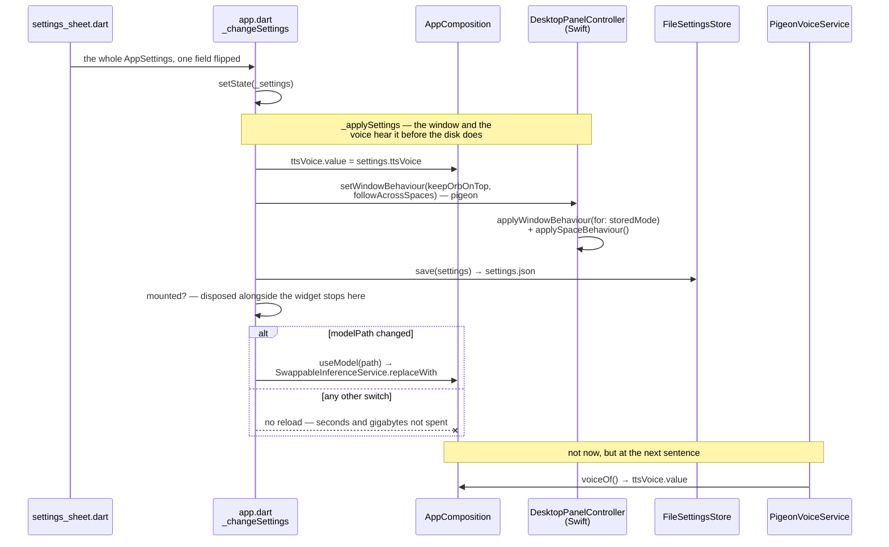

# Settings

Five choices in a JSON file. The interesting part is not the store, it is that
every one of them is honoured live by something outside the sheet — nothing is
kept that the app cannot act on, and nothing waits for a save button.

## The files

| File | Owns |
|---|---|
| `lib/features/settings/app_settings.dart` | `AppSettings`, `SettingsStore`, and the two implementations |
| `lib/features/settings/settings_sheet.dart` | The surface, shown over the conversation |
| `lib/app/app.dart` (`_loadSettings`, `_applySettings`, `_changeSettings`) | Reading, applying, and writing |
| `lib/main.dart` | The one read that happens before the composition exists |

Tests: `test/features/settings/app_settings_test.dart`,
`settings_sheet_test.dart`, `settings_model_rows_test.dart`,
`test/app/settings_race_test.dart`, `test/app/model_default_test.dart`.

## The store

`FileSettingsStore` writes `settings.json` into
`~/Library/Application Support/Lulo`, beside the conversations and the models.
A home that cannot be resolved falls back to `InMemorySettingsStore` — the
same trade the conversation store makes: settings are forgotten rather than
the app refusing to start.

`load()` never throws. A missing file, unreadable JSON, or a top-level value
that is not a map all return the defaults, because losing preferences costs
the user their preferences and failing to start costs them their agent.

`AppSettings.fromJson` reads field by field with a per-field fallback rather
than requiring a whole valid object, so a field written by a later version, or
one that has since been removed, does not stop the rest from being read.

## The five, and who acts on them

| Setting | Default | Read live by |
|---|---|---|
| `keepOrbOnTop` | true | `DesktopPanelController.applyWindowBehaviour` — the resting orb's window level |
| `followAcrossSpaces` | true | `applySpaceBehaviour` — `canJoinAllSpaces` vs `managed`, for **both** forms |
| `openConversationOnLaunch` | false | `_loadSettings`, once, after the stored choices arrive |
| `modelPath` | `''` | `AppComposition.useModel` → `SwappableInferenceService.replaceWith`; and `main.dart` before the graph is built |
| `ttsVoice` | `'ryan'` | `AppComposition.ttsVoice`, a `ValueNotifier` read by `PigeonVoiceService` at the moment of each `speak` |

The first two travel through `setWindowBehaviour` on the pigeon boundary;
see [presence.md](presence.md) for what they mean to AppKit. `modelPath` is
the expensive one — see [model.md](model.md).

`ttsVoice` is the one that is deliberately *not* passed as a value.
`PigeonVoiceService` is constructed with `voiceOf: () => ttsVoice.value`, so a
voice changed in the sheet applies to the very next sentence without anything
being rebuilt.

## Reading, applying, writing

There are two reads at different times and they exist for different reasons.

**`main.dart`** loads the store before `createAppComposition`, because which
inference runtime the graph is wired to depends on whether a model was chosen.
That read also seeds the `ttsVoice` notifier so the first answer of the run
speaks in the right voice.

**`_loadSettings`** in the app widget is the one the UI works from. It reads,
possibly adopts the recommended model (see [model.md](model.md)), applies, and
only then honours `openConversationOnLaunch`.

`_changeSettings` is the write path, and it does three things in a fixed
order: apply, save, and — only if `modelPath` actually changed — load the new
model. The comparison is not an optimisation: loading a model costs seconds
and several gigabytes, and every unrelated switch on the sheet would otherwise
pay for it. It also re-checks `mounted` after saving, because a composition
being disposed alongside the widget would only throw if asked to load
something.

One flip of one switch, from the sheet to whatever acts on it. Nothing
subscribes to a settings object; the write path hands each choice to its own
consumer, in a fixed order:

The last arrow is the one worth reading twice. Every other consumer is *told*;
`PigeonVoiceService` is not, because it was constructed with a closure and asks
at the moment it has something to say. That is the whole reason a voice changed
mid-answer is heard on the next sentence rather than the next launch.

`openConversationOnLaunch` is absent on purpose: it is the one setting with no
live consumer, read once by `_loadSettings` and never again in a run.

### The one race

The Settings menu item is native (`AppDelegate.installSettingsMenuItem`, which
takes over the template's existing `⌘,` item rather than adding a second one)
and arrives as `settingsRequests`. It could fire before the stored settings
have been read.

The sheet applies each flip **over the settings it can see** and hands back
the whole object, so a sheet opened over the defaults would save
defaults-plus-one-flip and silently erase every stored choice. `initState`
therefore gates showing it on the same `settingsLoaded` future it already
holds. `test/app/settings_race_test.dart` pins this.

## What is deliberately not stored

The window's frame. `setFrameAutosaveName("")` disables AppKit's own
restoration, and the conversation's place is kept in memory only
(`rememberedExpandedFrame`). The two forms have very different frames, and a
remembered one means macOS restores the orb's frame on the next launch and the
conversation opens at orb size. See [presence.md](presence.md).

## Deferred public profile experience

The developer profile is deliberately configured by JSON first; see
[agent-profile.md](agent-profile.md). A public release should expose the same
typed schema through human controls rather than showing a raw system prompt:

- a short conversational first-run setup;
- personality, language, voice and answer-length controls;
- memory proposals that require confirmation by default;
- source, global/project scope, edit, disable and delete actions per memory;
- sensitive categories that are never saved automatically;
- pause memory, export data and erase-all controls;
- an advanced **Additional instructions** field for experienced users.

Automatic extraction and semantic retrieval remain disabled until those
controls and their privacy review exist.

## Traps

1. **Showing the sheet before `load()` returns.** One flip then writes the
   defaults over everything the user had chosen.
2. **Calling `useModel` on every change.** A multi-gigabyte reload behind a
   toggle switch.
3. **Adding a setting nothing reads.** The class documents itself as holding
   only what the app can act on; a decorative field is a promise to the user
   that is not kept.
