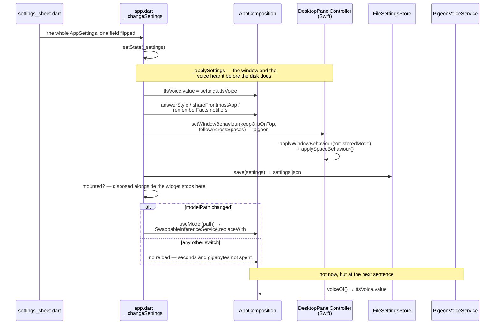

# Settings

Nine choices in a JSON file. The interesting part is not the store, it is that
every one of them is honoured live by something outside the sheet — nothing is
kept that the app cannot act on, and nothing waits for a save button.

## The files

| File | Owns |
|---|---|
| `lib/features/settings/app_settings.dart` | `AppSettings`, `SettingsStore`, and the two implementations |
| `lib/features/settings/settings_sheet.dart` | The surface, shown over the conversation |
| `lib/app/app.dart` (`_loadSettings`, `_applySettings`, `_changeSettings`) | Reading, applying, and writing |
| `lib/main.dart` | The one read that happens before the composition exists |

Tests: `test/features/settings/app_settings_test.dart`,
`settings_sheet_test.dart`, `settings_model_rows_test.dart`,
`test/app/settings_race_test.dart`, `test/app/model_default_test.dart`.

## The store

`FileSettingsStore` writes `settings.json` into
`~/Library/Application Support/Lulo`, beside the conversations and the models.
A home that cannot be resolved falls back to `InMemorySettingsStore` — the
same trade the conversation store makes: settings are forgotten rather than
the app refusing to start.

`load()` never throws. A missing file, unreadable JSON, or a top-level value
that is not a map all return the defaults, because losing preferences costs
the user their preferences and failing to start costs them their agent.

`AppSettings.fromJson` reads field by field with a per-field fallback rather
than requiring a whole valid object, so a field written by a later version, or
one that has since been removed, does not stop the rest from being read.

## The nine, and who acts on them

| Setting | Default | Read live by |
|---|---|---|
| `keepOrbOnTop` | true | `DesktopPanelController.applyWindowBehaviour` — the resting orb's window level |
| `followAcrossSpaces` | true | `applySpaceBehaviour` — `canJoinAllSpaces` vs `managed`, for **both** forms |
| `openConversationOnLaunch` | false | `_loadSettings`, once, after the stored choices arrive |
| `modelPath` | `''` | `AppComposition.useModel` → `SwappableInferenceService.replaceWith`; and `main.dart` before the graph is built |
| `ttsVoice` | `'ryan'` | `AppComposition.ttsVoice`, a `ValueNotifier` read by `PigeonVoiceService` at the moment of each `speak` |
| `showVoiceEvidence` | false | `ConversationView`, which draws `VoiceTurnHud` under the conversation. An instrument for tuning turn-taking, not a feature — see [voice.md](voice.md) |
| `answerStyle` | `balanced` | `AppComposition.answerStyle`, a `ValueNotifier` the inference service reads when it builds each request — the sampler travels in the request, so moving it reloads nothing |
| `shareFrontmostApp` | **false** | `ProfileAgentContextProvider.frontmostAppOf`, at the moment each question is composed |
| `rememberFacts` | **false** | `AgentMemoryExtractor`, read once per finished turn — see [agent-profile.md](agent-profile.md) |

The first two travel through `setWindowBehaviour` on the pigeon boundary;
see [presence.md](presence.md) for what they mean to AppKit. `modelPath` is
the expensive one — see [model.md](model.md).

The last two are the two that default to **off**, and they are the two that
are not about how the app behaves but about what it is allowed to know.
`shareFrontmostApp` lets a question carry the name of the app you are in;
`rememberFacts` lets a finished turn be read for one durable fact about you
and written into the profile. Both are read live rather than captured, so
switching either off stops the next turn without reloading anything, and
`AppSettings` reads an absent key as false — a settings file written before
either existed is not consent to either. See
[../decisions/memory-is-an-attack-surface.md](../decisions/memory-is-an-attack-surface.md)
for why the second one ships off rather than on.

`ttsVoice` is the one that is deliberately *not* passed as a value.
`PigeonVoiceService` is constructed with `voiceOf: () => ttsVoice.value`, so a
voice changed in the sheet applies to the very next sentence without anything
being rebuilt.

## Reading, applying, writing

There are two reads at different times and they exist for different reasons.

**`main.dart`** loads the store before `createAppComposition`, because which
inference runtime the graph is wired to depends on whether a model was chosen.
That read also seeds the `ttsVoice` notifier so the first answer of the run
speaks in the right voice.

**`_loadSettings`** in the app widget is the one the UI works from. It reads,
possibly adopts the recommended model (see [model.md](model.md)), applies, and
only then honours `openConversationOnLaunch`.

`_changeSettings` is the write path, and it does three things in a fixed
order: apply, save, and — only if `modelPath` actually changed — load the new
model. The comparison is not an optimisation: loading a model costs seconds
and several gigabytes, and every unrelated switch on the sheet would otherwise
pay for it. It also re-checks `mounted` after saving, because a composition
being disposed alongside the widget would only throw if asked to load
something.

One flip of one switch, from the sheet to whatever acts on it. Nothing
subscribes to a settings object; the write path hands each choice to its own
consumer, in a fixed order:

The last arrow is the one worth reading twice. Every other consumer is *told*;
`PigeonVoiceService` is not, because it was constructed with a closure and asks
at the moment it has something to say. That is the whole reason a voice changed
mid-answer is heard on the next sentence rather than the next launch.

`openConversationOnLaunch` is absent on purpose: it is the one setting with no
live consumer, read once by `_loadSettings` and never again in a run.

### The one race

The Settings menu item is native (`AppDelegate.installSettingsMenuItem`, which
takes over the template's existing `⌘,` item rather than adding a second one)
and arrives as `settingsRequests`. It could fire before the stored settings
have been read.

The sheet applies each flip **over the settings it can see** and hands back
the whole object, so a sheet opened over the defaults would save
defaults-plus-one-flip and silently erase every stored choice. `initState`
therefore gates showing it on the same `settingsLoaded` future it already
holds. `test/app/settings_race_test.dart` pins this.

## What is deliberately not stored

The window's frame. `setFrameAutosaveName("")` disables AppKit's own
restoration, and the conversation's place is kept in memory only
(`rememberedExpandedFrame`). The two forms have very different frames, and a
remembered one means macOS restores the orb's frame on the next launch and the
conversation opens at orb size. See [presence.md](presence.md).

Whether the app starts itself at login. This one is a switch on the sheet
and still not a stored setting, which is the point: the registration is
macOS's, not the app's. It survives a reinstall, and the user can revoke it
in System Settings › General › Login Items while the app is not running to
notice. A remembered copy would eventually claim something untrue about the
machine, so `_LaunchAtLoginSwitch` asks `SMAppService` every time the sheet
opens and shows what came back.

Five states, not two, because macOS answers with more than yes and no.

`needsApproval` is a registration macOS holds until the user allows it in
System Settings — and is also what it reports after they revoke consent
there. It reads as **on**, with the subtitle replaced by where to go: that is
what was asked for, and the subtitle is what stops it being a false promise.
Showing it off was the first version and it deadlocked, because the only way
out of the state was then a tap asking to register a second time, which macOS
answers with `kSMErrorAlreadyRegistered`. Shown on, the same tap withdraws it.

`refused` is macOS declining this copy of the app — an invalid signature,
which is what every ad-hoc-signed build from this repository gets, or a
bundle it cannot find. Reading the status alone reports `notRegistered` there
and would draw an ordinary off switch that silently does nothing when tapped.
`unavailable` is only macOS 12: `SMAppService` is 13 and the deployment
target is 12, so no copy of the app can help, where moving a refused one to
Applications can. Both leave the switch visible and disabled — the setting
exists, and why it is out of reach is the useful part.

`LaunchAtLogin.reading(_:)` maps the status and `after(_:asking:status:)`
maps a throwing register or unregister; both are pure and both are under
test. The register and unregister calls themselves talk to a system daemon
over XPC, which a unit test has no business waking up.

## How far it may roam

`AnswerStyle` is the one sampling dial a user has a reason to touch, named for
what it does to an answer rather than for the number behind it. Temperature
and nucleus probability move together because they are two halves of the same
choice, and offering them separately would be offering a decision nobody
outside the model has the information to make. `balanced` is exactly what the
app shipped with — changing the default would change every existing user's
answers, which is not what exposing a setting is for.

It is **per generation, not per model**, on the Dart side: the sampler travels
inside the request the host already receives, so `PigeonInferenceService`
reads `AnswerStyle Function()` on each question. `LocalModelConfig` no longer
carries temperature or topP for that reason — they were never properties of
the model.

Below the channel it is not that simple, and the first version of this feature
shipped a sentence saying it was. LiteRT-LM takes the sampler once, in
`ConversationConfig`; `sendMessageStream` has no argument for it. So a changed
style **rebuilds the native conversation** and re-seeds it from history, the
same treatment an edited profile already gets — one prefill, never a model
load. Before that fix the runtime *refused* a changed sampler and failed every
remaining turn in the conversation. See
[model.md](model.md) › *What the model remembers*.

## The language it is read in

Nothing on this screen picks a language. `MaterialApp` is given
`AppLocalizations.supportedLocales` and the system chooses; an unsupported one
falls back to English. The strings are in `lib/l10n/app_en.arb` and
`lib/l10n/app_zh.arb`, the latter Traditional because that is who this agent is
for.

This is separate from the language Lulo *answers* in, which is
`AgentIdentity.locale` in the profile and defaults to `zh-TW`. A Mac in English
with an agent answering in Chinese is a real configuration, not a mistake.

## Text selected in another app

`NSServices` in `Info.plist` puts "Ask Lulo about this" into every app that
handles text. It needs no Accessibility permission and works on the
deployment target — neither of which is true of reading the screen, which is
how the comparable products do it. `SelectionService.text(from:)` is the
testable half and refuses a whitespace-only selection, because the system
offers the item whenever any string is on the pasteboard.

It seeds the composer and does not submit. A selection is not a question: you
select a paragraph *because* you want something done to it, and only you know
what. What was already being typed is appended to rather than replaced.

**Replacing the selection with the answer is not available, and this is why**
rather than a thing nobody got to. A Services handler is synchronous — the
signature is `(NSPasteboard, userData, error)` returning `void`, with no
completion handler and no async variant, and anything it returns must be on
the pasteboard *before it returns*. Writing the answer back therefore means
blocking the calling app's main thread across a Pigeon round trip and a whole
generation: seconds to tens of seconds of beachball inside somebody else's
editor. The other route is what the comparable products take — Accessibility
permission and synthetic keystrokes into the focused element — which is a
permission this app should not ask for to save two steps.

The cheap improvement that *is* available, and is not built: copy the answer
to the clipboard automatically when the question came from a Services
invocation, so the result is one ⌘V away instead of a switch-and-copy. The
cost is clobbering whatever the user had copied, which is why it wants to be
scoped to Services-originated turns rather than applied to every answer.

## The profile, in the same sheet

`AgentProfileSettings` puts the typed profile behind human controls rather
than a raw system prompt: what Lulo is called and what it calls you, its tone
and how much it says, the facts it remembers, the words it hears, and the
user's own words for taking and yielding the floor.

The words it hears are two lists and the order they appear in is an argument.
`misheard` comes first — pairs of what was heard and what was said, applied
as a substitution, so it always takes effect. `vocabulary` comes second — a
hint to the recogniser, which `SpokenVocabularyBook` records changing the
transcript by not one character. Somebody who has just been misheard should
reach the one that works first, and the labels say which is which rather than
both describing the same job.

It writes the same file [agent-profile.md](agent-profile.md) documents, in the
same schema, through `AgentProfileStore.save`. There is no second copy of the
profile and no way for the two to disagree — and because the prompt, the
recogniser and the endpointer all read `profileStore.current`, a change is in
force on the next turn. The runtime rebuilds its conversation when the system
message changes, so an edit mid-conversation is not stranded behind a KV cache
holding the old one.

Three things about it are load-bearing:

- **`AgentProfile.copyWith` rebuilds `floorControl`** rather than carrying it
  over. It is derived from `turnTaking`, and carrying it would save the word
  and go on ignoring it.
- **`encodeAgentProfile` writes every field**, including the ones no screen
  shows. The decoder reads a missing list as empty rather than as its default, with `vocabulary` the one exception: absent keeps the built-in terms and an explicit `[]` is believed, because reading both as empty once stripped all ten of them from every hand-written profile.
- **Text fields commit on submit and on losing focus**, not per keystroke.
  Each save rewrites the file.

A memory added here is always `personal`. A memory with no triggers is only
ever eligible when it is personal or a preference, so any other kind offered
here would be saved and then never used.

Still deferred: memory proposals that require confirmation, per-memory scope
and source, sensitive categories that are never saved automatically, export
and erase-all. Automatic extraction and semantic retrieval remain disabled
until those controls and their privacy review exist.

## Traps

1. **Showing the sheet before `load()` returns.** One flip then writes the
   defaults over everything the user had chosen.
2. **Calling `useModel` on every change.** A multi-gigabyte reload behind a
   toggle switch.
3. **Adding a setting nothing reads.** The class documents itself as holding
   only what the app can act on; a decorative field is a promise to the user
   that is not kept.
