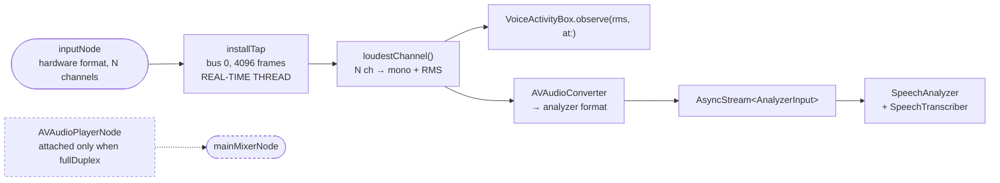
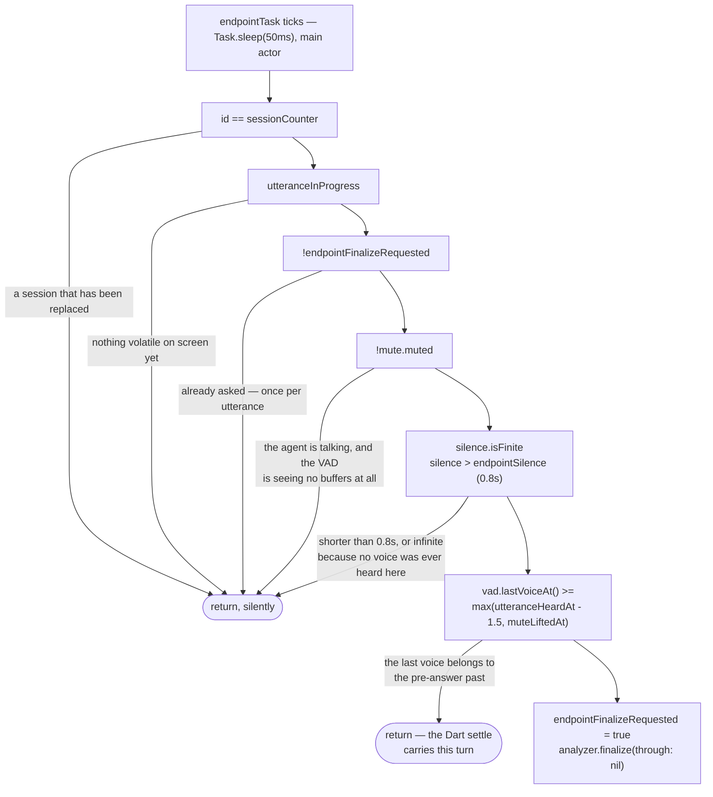
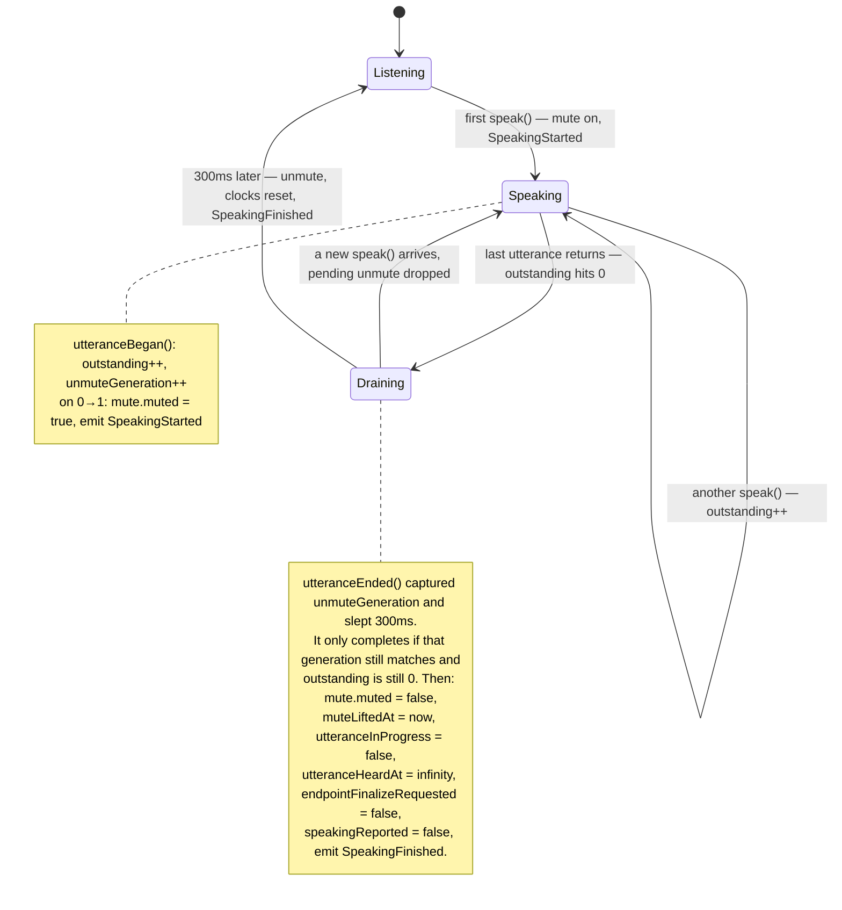

# Voice

The hardest part of the project. A conversation by voice has to decide, from
a stream of noisy floats, three things nobody ever states out loud: that the
user has started talking, that they have stopped, and that they have started
again over an answer they no longer want. Every one of those is a heuristic
with a way to fail silently.

> **State.** The always-listening session is **opt-in**: Settings › Taking
> turns › Live conversation, off by default. Holding to talk — the composer
> mic button or ⌘⇧Space — is the product's default door, and a session a
> hold opened closes **at the send**: the recogniser has its audio and the
> answer is spoken by the sidecar's own player, so the microphone — and
> the system-wide audio ducking its voice processing drags along — ends
> the moment the question is submitted, and the user's music comes back
> while the agent thinks. A new hold reopens the ears. Three reasons, all
> measured: the hold key's recogniser is 2-4x more accurate on the same
> audio; the open microphone runs voice-processed, which ducks every other
> app's audio system-wide for as long as it listens; and an always-open
> microphone transcribes a room that is mostly not talking to the agent.
> Ducking exists for input quality and nothing else, so it lasts exactly
> as long as the input does.
>
> When the switch is on, full duplex works as documented below: voice
> processing on both the input and the output node, the microphone open
> while the agent speaks, the user able to talk over an answer. The
> half-duplex path is the fallback for hardware where voice processing
> cannot be enabled. See
> [../decisions/full-duplex-voice.md](../decisions/full-duplex-voice.md)
> — including why two measurements in a row concluded the opposite.

## The files

| File | Owns |
|---|---|
| `macos/Runner/VoiceHostAdapter.swift` | The session, the node graph, transcription, endpointing, the mute, the sidecar calls |
| `macos/Runner/VoiceHostAdapter.swift` (`VoiceActivityBox`) | The RMS VAD and its adaptive noise floor |
| `pigeons/voice_host_api.dart` | The boundary. Edit here, regenerate, never edit the generated pair |
| `lib/features/voice/voice_service.dart` | The `VoiceService` interface and the `VoiceEvent` union |
| `lib/features/voice/pigeon_voice_service.dart` | The production implementation; turns host failures into events |
| `lib/features/voice/voice_conversation_controller.dart` | When to speak, what to speak, when to give way — and `speakableText` |
| `lib/features/voice/tts_voices.dart` | The voice list, mirroring the sidecar's |
| `~/dev/lulo-tts/server.py` | Qwen3-TTS, resident, on `127.0.0.1:46557` |

Tests: `macos/RunnerTests/VoiceActivityTests.swift` (the VAD, against
synthesised rooms), `test/features/voice/voice_conversation_controller_test.dart`
(the loop, against `FakeVoiceService`),
`test/features/voice/pigeon_voice_service_test.dart`,
`test/features/voice/voice_ui_test.dart`.

## Full duplex, and the half-duplex fallback

`fullDuplex` is a `var` on the adapter, assigned in `begin` from whether
Apple's voice processing was actually granted on **both** the input and the
output node. On this hardware it is, so the microphone stays open while the
agent speaks and the player node, `/render` and `renderAndPlay` are all live.
When the output node refuses, the input is turned back off and the mute-based
path below takes over — input-only voice processing is worse than none, since
the microphone stays open with nothing removing the agent from it.

The rest of this section is the history, kept because the reasoning in it was
wrong twice in the same way and that is worth not repeating. Quoted from
`git show f4309e9`:

> Full duplex was built on the assumption that macOS voice processing
> would subtract the agent's own voice from its microphone. Measured
> against a control, it does not: with voice processing enabled the input
> node delivers nine channels reading 1.4x the noise floor for a sound a
> plain input node hears at 14.6x, and no tap format — nil, mono, the
> node's own input or output — recovers it. The transcriber hears silence,
> which is what the comment this change deleted had said all along.
>
> The -10875 that came first was a different bug and its fix was wrong.
> It is not input and output both enabling voice processing; it is any
> player node joining the graph afterwards, because a mainMixerNode
> instantiated after voice processing lands on 44.1kHz against 48kHz
> hardware. Touching the mixer first starts the engine — and only then
> does the deaf microphone show itself.
>
> So: half-duplex again, with the reasoning in the code rather than in a
> session someone has to find. The playback machinery stays, gated on
> `fullDuplex`, for whenever there is a canceller that works here. The
> attempt is on `wip/full-duplex-aec`.

That conclusion was wrong, and so was its first correction; the whole story
is in [../decisions/full-duplex-voice.md](../decisions/full-duplex-voice.md).

The consequence to keep in mind while reading the rest of this document:
**in the half-duplex fallback the VAD's clock stops while the agent is
speaking**, and almost every piece of state below exists to survive that
gap. Under full duplex none of that happens — the clock runs continuously
and the mute never engages — which is why so much of the state machine below
is guarded by `if !self.fullDuplex`.

## The listening session

One run of the microphone is one `ListeningSession`, a struct holding the
engine, the analyzer, the input stream's continuation, two tasks, a
notification observer, and — when full duplex is ever on — the player node
and its render format. It is created whole in `begin` and torn down whole in
`endSession`. There is no half-open state.

### Starting

`startListening` is guarded by `session == nil, !starting` and then bumps
`sessionCounter`, capturing the new value as `id`. `begin(id:)` awaits
`guardCurrent(id)` at every step, throwing `CancellationError` when the
counter has moved on.

That paranoia is not decoration. `begin` can block for **minutes**: the
transcription model is a system asset and the first run downloads it
(`AssetInventory.assetInstallationRequest` → `downloadAndInstall()`). Every
`await` in that window is a chance for the user to toggle the microphone off
and on again. Without the counter, two engines would be running and the
second `startListening` would return success over a session that no longer
exists.

`stopListening` bumps the same counter, which invalidates any start still in
flight, and additionally resets the whole speech state (`speakEpoch`,
`unmuteGeneration`, `outstandingUtterances`, `speakingReported`,
`mute.muted = false`). A fallback utterance whose terminal callback never
arrived must not leave the microphone muted for the session that comes next.
`pipelineFailed` does exactly the same reset for the same reason.

### The node graph



Four things about this graph:

- **Both the input and the output node are voice-processed**, in that order,
  after the main mixer has been instantiated. Enabling only one of them
  leaves the canceller with no far-end reference: it was input-only for the
  whole of the first full-duplex attempt, and the agent transcribed itself.
- **The tap runs on the real-time audio thread.** It captures only values it
  owns — the continuation, the converter, `MuteBox`, `VoiceActivityBox` —
  and never `self`, whose state belongs to the main actor. `MuteBox` and
  `VoiceActivityBox` are `@unchecked Sendable` with an `NSLock` for exactly
  this crossing. Do not reach for adapter state from inside the tap.
- **The mute is checked first, and it drops buffers rather than silencing
  them.** A muted buffer never reaches the VAD either, which is what freezes
  the VAD's clock.
- **The microphone is an array.** Three channels built in, more on aggregate
  devices, and which one carries the voice is the device's business.
  `loudestChannel` picks by energy per buffer and returns that channel's RMS
  as a side product — the VAD and the transcriber see the same channel by
  construction.

### Transcription

```swift
SpeechTranscriber(
  locale: locale,
  transcriptionOptions: [],
  reportingOptions: [.volatileResults, .fastResults],
  attributeOptions: []
)
```

`.fastResults` trades a little accuracy for volatile results that arrive
*while the words are still being said*. Without it the first partial can trail
the speech by seconds, and the endpointer starves — it never learns that this
utterance was heard at all. The finals settle the spelling afterwards.

The locale comes from `Locale.preferredLanguages`, not `Locale.current`. The
bundle is unlocalized, so `Locale.current` reports English and a zh-TW
speaker would be transcribed into romanised noise.

Results are consumed in `resultsTask`. Bookkeeping inside it is guarded by
`id == self.sessionCounter` so a dead session's trailing results cannot steer
the live session's endpointer — but the guard runs **even for empty results**,
because a finalize that produced nothing must still clear
`endpointFinalizeRequested`, or the fast path stays latched off for the rest
of the session.

### Tearing down

`endSession` removes the observer, stops the player, cancels the endpoint
task, resets the utterance state, finishes the input stream, removes the tap,
stops the engine — and only then, in a detached task:

```swift
try? await analyzer.finalizeAndFinishThroughEndOfInput()
resultsTask.cancel()
```

The order matters. Finalization drains the words the transcriber still holds
through the results sequence, so its consumer must still be alive to receive
them. Cancelling first would drop the tail of a sentence stopped mid-word.
The cancel afterwards is ordering, not a hang guard.

### When the device changes

`AVAudioEngineConfigurationChange` — AirPods arriving, a USB microphone
leaving — is observed and reported through `pipelineFailed`. Without it the
tap simply goes quiet and the UI keeps a live microphone button over a dead
pipeline.

## What each path hears, and in what language

Three ways in, and they differ far more from each other than the two
languages do. The measurements are scattered across the decision docs; this
is the one place that puts them beside each other.

| | Typing | Holding the key | Full duplex |
|---|---|---|---|
| Recogniser | none | Breeze-ASR-25, batch | Apple `SpeechTranscriber`, streaming |
| How the language is chosen | from what is typed | **pinned `language="zh"`** | **pinned at `begin()` from `Locale.preferredLanguages`** |
| Chinese | — | 1.6% heard CER | 14.6% spoken CER / **6.0% heard CER** |
| English | — | **3.8% heard CER** | 16.4% spoken CER / **13.4% heard CER** |
| Per utterance | — | ~1.3 s | live partials |

**Typing** is the only path with no language disadvantage. The prompt is
translated whole according to whether the question contains a CJK character,
so a wholly-switched turn costs a rebuilt KV cache — 1580 ms against 362 ms —
and ordinary code-switching costs nothing. See
[voice-turn-latency.md](../decisions/voice-turn-latency.md).

**Holding the key** works in both, and is worse in English: 3.8% heard CER
against 1.6%, on the same model in the same configuration. The errors are not
spread out — they land on product names that are also ordinary English words,
`Swift tests` → `sweep test` and `Dart test` → `Dark text`, which is the one
thing a vocabulary list cannot fix by spelling — the words are correctly
spelled and correctly ordinary, so nothing downstream can tell they are
wrong. `AgentProfile.misheard` is the answer to exactly this: the user says
「你聽成 Dark text，其實是 Dart test」 once, and the substitution runs on every
transcript afterwards. A hint to the recogniser can do nothing; a
substitution cannot fail the same way. See
[agent-profile.md](agent-profile.md) and
[batch-asr-candidates.md](../decisions/batch-asr-candidates.md).

**Full duplex** pins one locale for the whole session, so on a zh-TW Mac an
English sentence is heard by a recogniser set to Chinese. This column used to
read "never measured", and the reason was not English: the full-duplex
recogniser could not be measured **at all**. `voice_eval` scores files and
`SpeechTranscriber` only existed wired to a live `AVAudioEngine`, so the only
way to get a transcript out of it was to speak into the machine — and a number
obtained that way cannot be re-run.

`SpeechAnalyzer` never needed the engine.
`macos/RunnerTests/FullDuplexCorpusProbeTests.swift` feeds it corpus `.wav`
files and writes the candidate `voice_eval` already knows how to score, so both
columns above now come from one instrument. It reproduces the 14.6% that was
obtained the old way, which is why the English figure beside it can be
believed. See
[full-duplex-through-the-file](../../benchmarks/voice_eval/evidence/full-duplex-through-the-file/README.md).

**Read the heard column, not the spoken one.** `spokenCer` folds punctuation
and case but not numerals, and the Chinese corpus spells out 一萬二 and 三點半
where the recogniser writes `12,000` and `3:30` — so Chinese is charged there
for a transcription convention rather than for mishearing. On `heardCer`,
which removes numbers and asks only whether the words were heard, **English is
2.2× worse: 13.4% against 6.0%.** The two spoken-CER figures looking
comparable is an artifact of the fold, and it points the opposite way to the
truth. Different corpora, different speakers, so this is enough to say English
is clearly worse and not enough to quote a ratio as a property of the model.

What was already known holds: this recogniser's worst *Chinese* errors were
code-switching (`Flutter → Flater`, `MLX → NLX`, `Dart test → Dortest`), which
is what sent us to Breeze for the other path — and the English run fails the
same way and harder (`LiteRT` → "light RT", `Gemma` → "Jemmon", `Flutter
3.44.1` → "Brother 3.44.1"). Withholding the vocabulary bias changes **not one
character of all sixteen English cases**, independently reproducing what
`SpokenVocabularyBook` already recorded. Every one of those errors is a
correctly spelled ordinary word, which is what `AgentProfile.misheard` is for
and what a hint list cannot reach.

Turn-taking is bilingual on both halves and does not depend on which of these
is in use: `FloorControl` carries English backchannels (`yeah`, `right`,
`sure`, `mm-hmm`) and corrections (`wait`, `stop`, `no`, `actually`) beside
the Chinese ones, `TurnCompletion` carries English connectives (`so`, `and`,
`but`, `because`, `like`, `um`), and the burst-duration signal underneath both
needs no language knowledge at all.

### What follows from this

Two of the three paths work in English and the third is now measured rather
than suspected: 13.4% heard CER against 6.0% for Chinese, on the same
recogniser through the same harness. So the English problem is **partly** an
interface question and partly not, and the halves want different answers.

The interface half is still the cheap one and still undone: **a user has no way
to know the hold key hears English well and the always-listening path does
not.** Holding the key is 3.8% heard CER; leaving voice on is 13.4%. Those are
the same app, and nothing on screen says so.

The other half is a recogniser this app does not control. `SpeechTranscriber`
is the only streaming option on the platform, the vocabulary bias has now twice
been measured changing nothing, and the errors it makes are ordinary English
words rather than nonsense — so nothing downstream can detect them either.
What softens this is that the streaming recogniser scores its own doubt, and
a doubted final now takes the batch path automatically:
[the second listen](#the-second-listen) re-runs the same audio through
Breeze before anything is submitted. What is left for the sentences it
scores confidently and hears wrongly is `AgentProfile.misheard`, one
substitution at a time. "Telling the user which door hears them better"
was resolved at the product level instead: the better door is the default
one, and the always-listening path sits behind its own switch, off.

## Endpointing

Three mechanisms decide that the user has stopped talking, in order of speed:

| Mechanism | Where | Latency | Role |
|---|---|---|---|
| RMS VAD + `finalize(through: nil)` | Swift, `checkEndpoint` | 0.55–1.4s of silence | The one that makes it feel like a reply |
| Dart settle | `_settleUtterance` | 1.5s of an unchanged partial | Fallback when the VAD declines |
| The transcriber's own endpointing | SpeechAnalyzer | several seconds | Last resort |

How much silence the first of those needs is not a constant. `TurnCompletion`
reads the volatile transcript and moves it: a sentence that stops on a
connective (然後, 因為, 的話, 我想問的是, …) waits 1.4s, a visibly finished
question of four syllables or more (ends on 嗎/呢/嘛 or on terminal
punctuation) waits 0.55s, and anything else waits the ordinary 0.8s. The
corpus's two mid-utterance pauses run to 1.02s and 1.10s and are past the
0.8s that submits a turn; nothing in the audio separates them from a real
ending, and Smart Turn v3.2 was measured and cannot either. See
[../decisions/turn-taking-by-words.md](../decisions/turn-taking-by-words.md).

### The VAD: RMS over an adaptive floor

`VoiceActivityBox.observe(rms:at:)` is called for every buffer that survives
the mute. A buffer counts as voice when

```
rms > max(minimumVoice, currentFloor * floorRatio)
    = max(0.004, floor * 3)
```

and `lastVoice` is set to that buffer's timestamp
(`ProcessInfo.processInfo.systemUptime` — a steady clock, not wall time).

The floor is **minimum statistics**: the quietest RMS of each one-second
window, kept for the last ten windows, and the floor is the smallest of
those. The reasoning is the asymmetry between a voice and a machine:

- Speech always dips. Breaths, inter-word gaps, inter-syllable troughs. Those
  dips hold its floor low no matter how long the monologue runs.
- A fan never dips. Within ten seconds its own level *becomes* the floor, and
  it stops reading as a voice.

`VoiceActivityTests.swift` pins all four corners of that claim: a quiet room,
a room that has never been spoken in (silence must be `infinite`, or
endpointing would fire before anyone said anything), a steady fan absorbed
within seconds, a voice still audible above the fan, and — the subtle one — a
minute of continuous talking at 85ms granularity with dips only ~12dB down,
which a floor that adapted on voiced frames would chase and swallow
mid-sentence.

`floorRatio = 3` is a cliff at 20·log₁₀(3) ≈ **9.5dB**. Speech whose quietest
85ms in every recent second sits within 9.5dB of its own syllables — in
practice, speech over a loud steady background — goes undetected, and the
endpointer declines in favour of the slower Dart settle. That is a deliberate
trade: declining is a beat of extra latency, firing wrongly cuts the user off
mid-sentence.

Every ~3 seconds (`ticks % 60`, at 50ms per tick) the adapter logs a
calibration heartbeat:

```
Lulo voice: vad floor 0.0021 peak 0.0480 (utterance pending)
```

`(utterance pending)` persisting across heartbeats is the diagnostic: the
endpointer is declining, the VAD never heard this utterance, and the Dart
settle is carrying the turn.

### `checkEndpoint` — the four guards and the two clocks

The endpoint task ticks every 50ms and calls `checkEndpoint`, which does
nothing unless **all** of:

```swift
id == sessionCounter          // this session
utteranceInProgress           // something volatile is on screen
!endpointFinalizeRequested    // asked once, not every tick
!mute.muted                   // the agent is not talking
```

then requires silence longer than `endpointSilence = 0.8`, and finally the
guard that is easiest to break:

```swift
guard vad.lastVoiceAt() >= max(utteranceHeardAt - 1.5, muteLiftedAt) else { return }
```

Read that as: *only trust a silence measured against voice heard for THIS
utterance, in a stretch of time the microphone was actually open.*

Every tick runs the whole cascade, and each rung refuses for its own reason:



The two clocks in the last guard are the ones with a history. `utteranceHeardAt`
answers *whose silence is this?* and `muteLiftedAt` answers *was anyone
listening during it?* — and the `decline` arm is not a failure. It is the
endpointer saying it has no honest measurement, which is what the heartbeat's
`(utterance pending)` reports and what the Dart settle exists to cover.

- **`utteranceHeardAt`** is set when the current utterance's first volatile
  arrives (`if !utteranceInProgress { utteranceHeardAt = now }`). The `- 1.5`
  margin exists because recognition trails the voice it heard: the first
  volatile can arrive after the room already went quiet, and without the
  margin its own utterance would look older than the last voice.
- **`muteLiftedAt`** is set to `systemUptime` when the mute is released after
  an answer. Anything the VAD heard before that instant is the pre-answer
  past. The mute was unmeasured dead time; a silence spanning it is not a
  silence anyone observed.

Without these two, the first volatile after an answer is finalized on the
spot — the VAD's `lastVoice` is minutes stale, so "silence" is enormous — and
the user's sentence is cut off at its first word. That failure mode looks
like a transcription bug and is not one.

### The mute / VAD-clock state machine

This is the cluster that breaks quietly. All of it lives on the main actor.



| State | Why it exists | Breaking it looks like |
|---|---|---|
| `outstandingUtterances` | The mute and `SpeakingFinished` belong to the whole answer, not one sentence | Sentence one's return reopens the microphone while sentence two plays; the agent transcribes itself |
| `unmuteGeneration` | Cancels a pending delayed unmute when a newer speech state supersedes it | A late unmute from the previous answer opens the microphone in the middle of the next one |
| `speakingReported` | The 300ms hangover can bridge two utterances | Doubled `SpeakingStarted`/`SpeakingFinished` pairs; the UI flickers |
| The 300ms delay itself | The speaker's tail is still in the air when the sidecar returns | The agent transcribes its own last word |
| `speakEpoch` | Bumped by `stopSpeaking`; an in-flight utterance captured it at entry | A barged-over sentence keeps rendering, or a stale one reports over the new turn |
| `muteLiftedAt`, `utteranceHeardAt`, `utteranceInProgress`, `endpointFinalizeRequested` reset together | The endpointer starts each turn clean | See above — first word of the next sentence gets finalized alone |

Note the `if !self.fullDuplex` around the endpointer reset in
`utteranceEnded`: full duplex never mutes, never freezes the clock, and the
user may be mid-interruption, so its utterance state must survive. The reset
runs only on the half-duplex fallback path.

## The Dart side

`VoiceConversationController` is pure coordination over the text pipeline. It
holds no audio. An utterance submits exactly like a typed message; a completed
answer is read aloud; the user starting to talk silences whatever the agent
was saying or generating. It is fully testable against `FakeVoiceService`.

### Enabling

`enable()` awaits `_conversation.restored` **before** setting `_enabled`. The
restore fires the completed-turns listener, and with the speak-from-here mark
(`_spokenThrough`) still at zero the agent would recite yesterday's
conversation aloud, turn by turn. `_spokenThrough` is seeded from the current
turn count both at construction and after the restore lands.

`enabled` (which the button reads) is `_enabled || _enabling`; `listening`
(which the indicator reads) is only what the host actually reported. They are
deliberately different: starting can sit in a minutes-long asset download,
and an indicator must not claim an open microphone during it.

### Speaking in chunks

Driven by `_onActiveTurnChanged`, which sees the streaming answer grow:

1. `_dispatchedOfActive` marks how much has already gone to the voice.
2. In the undispatched remainder, find the last **safe** sentence end
   (`[。！？!?.…；;\n]`).
3. If there is none and this is the answer's **first** chunk, accept a clause
   end instead (`,`, `，`, `、`) provided it has at least
   `_firstClauseTarget = 6` characters of substance — `好的,` alone reads as a
   stutter.
4. After the first chunk, require `_chunkTarget = 40` characters. Single short
   sentences drift in timbre and every separate synthesis pays its own prosody
   reset.
5. Dispatch through `_speakAloud`.

Two guards on "safe":

- **`_lastSentenceEnd`** rejects an ASCII `.` between digits — `3.14` must not
  be read as "three." A `.` after a digit at the very end of the buffer is
  also rejected; the next delta settles it. CJK `。` never appears inside a
  number and needs no guard.
- **`_clauseEnds` contains no colon.** Every URL starts with one, and a chunk
  cut at `https:` leaves a link half-stripped and read aloud.

The language is decided **once per answer**, at its first chunk
(`_activeLang ??= _cjk.hasMatch(...) ? 'zh' : 'en'`), and pinned for the
whole thing — one English word inside a Chinese reply must not flip the accent
mid-thought. It is decided from the whole active turn (`decidedBy`), not from
the chunk.

When the turn completes, `_onTurnsChanged` speaks only what streaming did not
already cover. That leans on `ConversationViewModel` notifying
`completedTurns` **before** nulling the active turn — the counter is read
here first, and only then reset by `_onActiveTurnChanged` seeing null. Change
that ordering and the last sentence of every answer is spoken twice.

### `speakableText`

The synthesizer reads exactly what it is given: emoji become their spelled-out
names, markdown becomes noise, and code is unreadable aloud. The full text
stays on screen; speech gets the sentences alone. In order:

1. Whole fenced code blocks, fences and all → dropped.
2. `[label](url)` → `label`. A link is read by its label; the address is for
   clicking.
3. Bare `https?://…` → dropped.
4. Horizontal rules (`^\s*[-*_]{3,}\s*$`, multiline) → dropped. `---` read
   aloud is a groan.
5. List markers (`^\s*[-•]\s+`) → dropped. `- 第一點` otherwise starts with a
   minus.
6. Inline marks `` ` * _ ~ # > `` → dropped, words kept.
7. Emoji, pictographs, arrows, variation selectors, ZWJ → dropped.
8. Whitespace collapsed, trimmed.

An empty result is not dispatched at all.

Rules 4 and 5 came out of the full-duplex work and were kept when the rest was
reverted; see the decision record.

### Barge-in

`_yieldToTheUser()` is the whole interruption:

```dart
if (_speaking || _speechRequested) { _voice.stopSpeaking(); }
if (!_conversation.canSubmit) { _stopRequestedForActive = true; _conversation.stop(); }
```

It fires from a `PartialTranscript` that `FloorControl` says takes the floor —
the user has started talking, so the agent stops, the way a friend does.

**What counts as taking it** is decided by the words, not their length.
`FloorControl.classify` sorts the utterance into `backchannel` (嗯嗯, 對對對,
OK, 原來如此 — never interrupts, at any length), `correction` (不對, 等等, 停,
wait, stop — always interrupts, at any length), or `substance`, which needs
three syllables, counting a whole run of Latin letters as one. A length
threshold got both ends wrong at once: 「對對對對對」 is five characters of
agreement and used to end the answer, and 「不對」 is two characters that used
to be ignored. See
[../decisions/turn-taking-by-words.md](../decisions/turn-taking-by-words.md).

One part of that decision needs no words at all. Every partial carries
`spokenFor` — how long the current burst of voice has run, measured by
`VoiceActivityBox` and pushed across as `speechMs` — and `substance` needs
half a second of it as well as three syllables. A backchannel is short in
every language that has been studied, so this is what stops 「うんうん」 from
ending an answer in a language whose acknowledgements nobody has listed. A
correction still lands however short it was, and an acknowledgement is still
ignored however long it ran; the clock only gates the case the lexicons have
nothing to say about.

While nothing is being said, anything at all takes the floor: there is
nothing to take away. Two further subtleties:

- **`_speechRequested`**, not just `_speaking`. `SpeakingStarted` takes a whole
  pigeon round trip to come back, and the user can start talking inside that
  window. The answer must still give way.
- **`_postFinalCooldown = 500ms`.** The fast endpointer submits within a
  second of the user's last sound, so the microphone is live exactly where
  their trailing breath lands. A partial arriving within 500ms of the final is
  that breath, not an interruption, and must not cancel the answer just asked
  for. (Kept under the shared test clock's 600ms step on purpose: widening it
  past that step flips the existing barge-in tests into exercising the
  cooldown branch instead — loudly, they fail rather than silently pass.)

A correction spoken *wholly* inside that cooldown never fires the yield from
its partials, so its `FinalTranscript` does it instead, and the text is parked
in `_pendingUtterance` until `canSubmit` comes back. Otherwise the replacement
question is dropped on the floor.

`_stopRequestedForActive` exists because cancelling flushes the token batcher,
and a flushed tail that happens to complete a sentence would otherwise be
dispatched to the voice — which is the exact thing the interruption was for.
It is cleared in `_onCanSubmitChanged`, where the end of a generation is
always visible (the null-to-null active turn of a prefill cancel never
notifies).

### The settle fallback

Every non-empty partial reschedules `_settleUtterance` for 1.5s out. When it
fires, `finalizeUtterance()` is called and the timer re-armed, up to
`_maxSettleAttempts = 3`. Three asks is enough: a transcript that will never
settle should not sit on screen pretending it might, so the partial is cleared.

## The TTS sidecar

`~/dev/lulo-tts/server.py`. A `ThreadingHTTPServer` (HTTP/1.1, needed for
chunked transfer) with Qwen3-TTS resident in MLX, kept alive by launchd
(`com.lulo.tts`, `RunAtLoad` + `KeepAlive`, log at `server.log`).

**MLX compute stalls off the main thread.** Every synthesis request is put on
a `queue.Queue` and executed by the main thread's `_work_loop`; the HTTP
thread blocks on a `threading.Event`. That is why the server is threading and
the work is not.

| Route | Body | Returns | Used when |
|---|---|---|---|
| `GET /health` | — | `{"ok": true, "model": …}` | Liveness |
| `GET /voices` | — | `{"voices": [...]}` | Mirrored by `tts_voices.dart` |
| `POST /speak` | `{text, voice, lang}` | `{"ok": true, "stopped": bool}` **after playback drains** | Half duplex — today's path |
| `POST /render` | `{text, voice, lang}` | chunked raw float32 mono PCM, `X-Sample-Rate` header | Full duplex — gated off |
| `POST /stop` | — | `{"ok": true}` | Barge-in |

`/speak` blocking until the sound has actually finished is not laziness — it
*is* the `SpeakingFinished` signal. The adapter's 120s timeout is the ceiling;
`/stop` gets 3s and is fired and forgotten.

Synthesis streams. The model yields ~0.4s chunks (`STREAM_INTERVAL = 0.4`) and
each plays the moment it arrives through `sounddevice`, with
`PLAYER_MIN_BUFFER_S = 0.4` — the library default of 1.5s would swallow most
of the win.

Two things in front of the voice were latency and nothing else, and both are
gone — see
[decisions/silence-in-front-of-the-voice-is-latency.md](../decisions/silence-in-front-of-the-voice-is-latency.md).
The model puts 0.2s to 0.9s of digital silence at the head of an utterance,
which `onset.py` now trims off the first chunk; and the chunk interval is the
floor under how soon any first chunk can exist, which halving moved from
0.62s to 0.33s. Read that record before raising either number back.

Pacing comes from the reference recording. The voice is cloned from
`voices/ryan.wav`, and cloning imitates the reference's pace — which retired
the CustomVoice `語速快一點` instruct that used to do this job. The model's
`speed` parameter remains a no-op for `qwen3_tts`.

Two short sentences are rendered at boot (`_warm_up`) through the exact
streaming settings the requests use, so the first real utterance does not pay
kernel compilation. Rendered only — the machine must not start talking to
itself on boot.

### The epoch mechanism

There are two epochs, one per side, and they do different jobs.

**Sidecar `_stop_epoch`.** `/stop` bumps it under `_epoch_lock`, then drains
the work queue, marking every waiting request `stopped`. Each request captured
the epoch at entry; a mismatch means it was barged over — while queued, while
generating, or while draining — and it flushes rather than plays. `_player`
and `_player_epoch` are held so `/stop` can silence the player from the HTTP
thread while the work loop is still busy, and `_silence_player` only flushes a
player whose epoch is genuinely older, never one belonging to a `/speak` that
arrived *after* the bump.

Everything touching the player is inside `_player_lock`, including
`queue_audio`: `AudioPlayer` teardown is not thread-safe, and
`queue_audio`'s restart check racing `/stop`'s flush would otherwise resume
playback on a player that was just silenced. Two threads reaching
`stop_stream` together die on `stream.close()` of an already-nulled stream.
`stress_stop.py` in that repository is the regression harness.

**Adapter `speakEpoch`.** Bumped by `stopSpeaking`. Every `speak` captures it
at entry. Its job is to keep a stale utterance from reporting anything after
the user has already barged over it — and, on the `/render` path, to stop
pulling bytes mid-download and cancel the task.

On the `/render` path the client hanging up *is* the barge-in signal: the
sidecar's `_stream_render` stops at the first failed write.

## Reversible transcript refinement

Only a finalized utterance is refined. Partial text remains display-only;
push-to-talk fragments are joined first and refined once. The production
path uses a local deterministic refiner behind a 250 ms deadline. Timeout,
exception, rejection, overlap, or disposal selects the exact recognizer text.

The deterministic refiner also repairs a **near-miss of a protected term** —
`Flater` → `Flutter`, `NLX` → `MLX` — but only when three things line up:
the request carries a weakest-span score below `HeardConfidence.trusted`
(so a confidently heard `dark mode` is never second-guessed into `Dart`,
and hold-key text, which carries no score, is never touched), the sentence
contains CJK (the measured near-miss errors are zh code-switching; in an
English sentence a word near the vocabulary is usually an English word),
and the token sits within one edit of a unique nearest term — two for terms
of six letters or more, which is what lets `Flater` reach `Flutter` while
`codex` stays two edits clear of `Xcode`. A word the user has taught a
correction for is skipped, or the repair would erase the text the
correction matches on. The bound is the point: an LLM given the same job
was measured making the transcript worse — see
[../../benchmarks/voice_eval/evidence/qwen-refiner-shadow/README.md](../../benchmarks/voice_eval/evidence/qwen-refiner-shadow/README.md)
— because these errors are phonetic neighbours of the true words, and
without the sound a model can only guess. An edit-distance match against
the protected list can only restore a listed spelling, never invent one.

### The second listen

A doubted streaming final is re-heard by the batch recogniser before it is
refined or submitted. The gate is the same score: on a `FinalTranscript`
whose weakest span is below `HeardConfidence.trusted`, the controller calls
`reHearUtterance` and waits up to 8s — measured live, the first ask of a
session pays a warm-up that put a 4.4s clip at 3.9s, and a 4s deadline
missed it by a tenth. The host carves the utterance's audio out of
`UtteranceRingBox` — a session-scoped, time-addressed ring of the last
minute of mono microphone samples, appended on the audio thread by the same
tap that feeds the analyzer — from 1.5s before the utterance's first
volatile (recognition trails the voice it heard, the same margin the
endpointer uses) to 0.3s before the final settled (the endpointer already
waited out its silence; the room after it is dead time the recogniser runs
at roughly real time to hear), writes it as a held clip, and puts it to the
Breeze sidecar on `127.0.0.1:46558`.

What comes back replaces the streamed words wholesale, and the doubt with
them: the turn carries no `heardConfidence`, because the score belonged to
the recogniser whose words were discarded, and the near-miss repair stands
down for the same reason. Empty, unreachable, and late all collapse to the
streamed sentence standing, doubt and all. Only the streaming path asks —
the hold key's text already came from the batch recogniser — and the ~1.3s
the second listen costs is paid only on sentences that were going to be
wrong: measured on the same corpus, the streaming recogniser's heard CER is
6.0% zh / 13.4% en against Breeze's 1.6% / 3.8%.

Every voice-authored user turn keeps the raw transcript, applied proposal,
status, redacted edit metadata, refiner identity, version, and elapsed time in
the same SQLite row. Inference and the conversation UI use the selected text,
while the original remains available for audit or a future restore action.
Profile vocabulary is read from the current structured agent profile when the
utterance settles; conversation history is not injected into the refiner.

`buildTranscriptCandidateExport` converts explicitly supplied refinements to
the existing `voice_eval` transcript candidate envelope. It is a pure builder:
it accepts no output path and performs no file writes. Development tooling
must JSON-encode its return value to a caller-selected location, then pass that
file to `benchmarks/voice_eval/tool/evaluate.dart`. Production startup never
exports private transcripts.

### Qwen proposal shadow

The live turn still belongs exclusively to the deadline-bound deterministic
refiner. An optional `TranscriptShadowCoordinator` can copy one finalized
utterance to a proposal provider without being awaited. It allows one request
at a time, skips rather than queues during bursts, rejects mismatched request
IDs, fences late results when voice stops, and runs every returned proposal
through `TranscriptProposalGate`.

`LoopbackTranscriptProposalProvider` accepts only literal
`http://127.0.0.1:<port>` or `http://[::1]:<port>` endpoints. It performs one
non-redirecting POST with bounded response bytes and never launches or
downloads a model. Bootstrap leaves the coordinator null, so ordinary builds
make no request and retain no transcript evidence.

For explicit golden-corpus runs, `TranscriptShadowEvidence` retains only cases
that carry a development `caseId`, evicts oldest cases at its fixed capacity,
and clears them on request. Ordinary voice turns update transcript-free status
counters only. `buildTranscriptShadowCandidateExport` converts an explicit
snapshot into the existing candidate JSON data without writing it to disk.

## Traps

Ranked by how quietly they break.

1. **Touching the mute/unmute state cluster.** `outstandingUtterances`,
   `unmuteGeneration`, `speakingReported`, `muteLiftedAt`, `utteranceHeardAt`,
   `endpointFinalizeRequested`. They are one mechanism, not six variables. The
   symptom of getting it wrong is usually "the agent answers its own answer"
   or "the first word of my sentence becomes the whole question" — neither of
   which points at this code.
2. **Removing the `- 1.5` margin or `muteLiftedAt` from `checkEndpoint`.**
   Looks like a redundant guard. Is not.
3. **Unmuting per sentence instead of per answer.** Reads as an obvious
   simplification of `outstandingUtterances`.
4. **Reordering `completedTurns` and `activeTurn` notifications** in
   `ConversationViewModel`. Doubles the last sentence of every spoken answer.
5. **Reaching for adapter state inside the audio tap.** It runs on the
   real-time thread; adapter state is main-actor.
6. **Cancelling `resultsTask` before `finalizeAndFinishThroughEndOfInput()`.**
   Drops the tail of an interrupted sentence.
7. **Adding a system-synthesizer fallback when the sidecar fails.** It was
   there and was deliberately removed: a second voice cutting in mid-answer
   reads as the agent changing person, which is worse than a skipped sentence
   that is still on screen. The failure is a log line
   (`sidecar declined a sentence`) on purpose.
8. **Enabling `setVoiceProcessingEnabled(true)`.** Read the decision record
   first.
9. **Adding a colon to `_clauseEnds`.** Splits URLs.
10. **Widening `_postFinalCooldown` past 500ms.** Flips existing barge-in
    tests onto the cooldown branch.

## Diagnosing by log

The adapter is chatty on purpose. `Console.app`, or `log stream`, filtered on
`Lulo voice`:

| Line | Means |
|---|---|
| `transcribing as zh-TW` | Which locale won out of `preferredLanguages` |
| `vad floor 0.0021 peak 0.0480` | Calibration heartbeat, ~every 3s |
| `… (utterance pending)` persisting | The endpointer is declining; the Dart settle is doing the work |
| `endpointing after 0.87s of silence` | The fast path fired |
| `final (23 chars) 0.31s after the ask, weakest span 0.94` | The transcriber settled an utterance, how long it took to answer the endpointer, and the lowest confidence in it. `-1.00s` means nobody asked — it settled on its own schedule. Correct words measure 0.88–1.00; a misheard one measured 0.31 |
| `sidecar declined a sentence (41 chars)` | TTS unreachable or failing — check `~/dev/lulo-tts/server.log` |

The sidecar's own log gives the latency that matters:

```
11:12:19 lulo-tts: first-chunk 0.37s (-0.36s lead), 2.7s audio for 15 chars
```

## What one turn costs

Four logs, written by whoever can see the thing, account for one turn end to
end without attaching a profiler. In order:

```
Lulo voice: endpointing after 0.87s of silence             # the room went quiet
Lulo voice: final (23 chars) 0.31s after the ask           # the question exists
Lulo latency: refine 0.01s + think 0.29s + write 0.24s     # …to something sayable
              = 0.54s to the first 12 characters spoken
14:26:03 lulo-tts: render first-chunk 0.30s (-0.35s lead)  # …to a sound
```

`VoiceTurnLatency` owns the third. It is a measurement and nothing else: it
holds no transcript and no answer text, only lengths and instants, so the
line is safe in a log that keeps private conversations out of it. It
describes a turn **once** — only the answer's first chunk is a latency, and
every chunk after it is the answer merely continuing.

## Watching it decide, without a console

Every ruling above is a judgement call with a reason, and a rule nobody can
see fire is indistinguishable from a bug. **Settings › Taking turns › Show
why it took the floor** puts `VoiceTurnHud` under the conversation, fed by
`VoiceTurnLog`:

| Label | What it means |
|---|---|
| `asked` | An utterance was submitted, with the recogniser's weakest-span score |
| `ignored` | Something was heard and deliberately not acted on, and why |
| `cut in` | The user took the floor back, and on what grounds |
| `cost` | What that turn cost, the same breakdown as the `Lulo latency` line |
| `learned` | An ending cut off often enough to be worth adding to `turnTaking.unfinished` |

The log is kept whether or not the panel is showing — a user who switches it
on has just watched the thing they want explained — and is bounded at forty
notes, because a partial arrives every few hundred milliseconds for as long
as the microphone is open.

## When it says it may have misheard

The user turn carries a small `Not sure it heard this right` caption when
`SpeechTranscriber` scored its weakest span below `HeardConfidence.trusted`
(0.85). Over the corpus, everything heard correctly scored 0.88–1.00 and
every error 0.78 or below; the threshold sits in that gap. The score reaches
Dart on `FinalTranscript.confidence`, is joined to the refiner's selection in
`_refineFinalUtterance`, and rides on `Turn.voiceInput.heardConfidence`.

Deliberately **not persisted**: a caveat is worth reading in the moment and
would otherwise cost a schema migration for a mark nobody revisits, so
restored turns carry null and show nothing. The caption now marks only the
sentences the second listen could not save: a doubted final is re-heard by
the batch recogniser first (see
[the second listen](#the-second-listen)), and a re-heard sentence carries
no score at all. Repairing against an LLM instead was measured and made
things worse —
[qwen-refiner-shadow](../../benchmarks/voice_eval/evidence/qwen-refiner-shadow/README.md).
See [../decisions/voice-turn-latency.md](../decisions/voice-turn-latency.md).

The three stages are the refinement (`FinalTranscript` → `submit`), the
model's first token, and how much answer had to exist before any of it was
worth saying. A stage measured backwards reports zero rather than a negative:
the marks come from separate callbacks, and a turn already streaming when its
transcript settles genuinely orders them the other way round. The total stays
measured end to end, so a clamped stage makes the parts add up to slightly
more than the whole.

Where the time goes, and why the endpointer's 0.8s is not the obvious thing
to cut, is measured in
[../decisions/voice-turn-latency.md](../decisions/voice-turn-latency.md).
